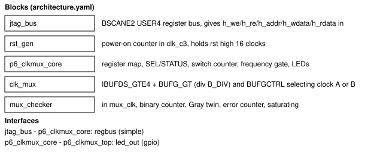

# p6_glitchfree_mux: P6 glitch-free clock multiplexer on the KR260

<!-- Generated from handover.yaml by flow/handover.py (brief 68). Edit handover.yaml, or the text between the prose markers, then run: python -m flow.handover write runs/20261125-203614-91c8/p6_glitchfree_mux -->

The design selects between the 25 MHz board clock and the SFP+ MGTREFCLK0 reference (through IBUFDS_GTE4 and BUFG_GT) with a BUFGCTRL, and exposes control, status, a Gray-coded counter checker and a frequency gate through a JTAG register bus. The run stopped at the RTL stage, whose design-standards gate failed on the BUFGCTRL clock mux. Verification reached V2 of V3, no Vivado build passed its gates, and nothing was run on the board. The specification and architecture were accepted automatically, with no human review.

Not in scope:

- Not a general clock manager. It has two inputs, one BUFGCTRL, and no PLL or MMCM.
- Does not use any GT transceiver channel; the GT reference buffer feeds only the mux.
- Not built, timed or run on hardware in this run; no resource, timing or power figure exists.

Kind: agent-run; produced by the agent (agent run `20261125-203614-91c8`, [record](../summary.json)). State: rtl. For an agent: [AGENT.md](AGENT.md).

Run: model claude-sonnet-5-5 (deepagents harness), 8 loops, 169 turns, 7,009,619 tokens, 2906.6 s wall time, 4.99015 USD model cost (provider-reported), stopped because: stage 2 visited more than 6 times; last failing gate: design standards; owned by the rtl role; the same failure on 4 consecutive visits (from the run record).

<!-- prose:what -->
<!-- /prose:what -->

## Technical parameters

| Item | Value |
|---|---|
| Part | `xck26-sfvc784-2LV-c` |
| Board | kr260 |
| Top | `p6_clkmux_top` |
| Tool | Vivado 2026.1 |

Clocks:

- `clk_25`: 25 MHz (from `runs/20261125-203614-91c8/p6_glitchfree_mux/design.xdc`)

Resets:

- `rst`, active high: Internal power-on reset in p6_clkmux_top.sv: a synchronous counter in clk_c3, held for RST_HOLD_CYCLES clocks, with no reset pin. It is brought into mux_clk through xpm_cdc_async_rst.

Interfaces:

- `clk_c3` (input, 25 MHz clock): design.xdc names this port clk_25 on pin C3 (LVCMOS18) with a 40 ns clock, while spec.yaml and the RTL top use clk_c3.
- `gtref_p / gtref_n` (input, differential reference clock, 156.25 MHz): Spec role is SFP+ MGTREFCLK0; design.xdc has no pin or clock constraint for these ports.
- `led` (output, 2 bits): The RTL drives led[0] = ACTIVE_SEL and led[1] = SWITCHING. design.xdc places them on F8 and E8 (LVCMOS18).
- `sfp_tx_disable` (output, 1 bit): Constant 1. design.xdc puts it on Y10 (LVCMOS33).

Registers (from spec.yaml; where the RTL differs, the gaps say so):

| Offset | Name | Access | Reset | Bits |
|---|---|---|---|---|
| 0 | `ID` | RO | 546701313 | 31:0 design ID |
| 4 | `BUILD` | RO | 0 | 31:0 USR_ACCESS word |
| 8 | `SCRATCH` | RW | 0 | 31:0 data |
| 16 | `SEL` | RW | 0 | 0 clock select (0=A, 1=B) |
| 20 | `STATUS` | RO | 0 | 0 SWITCHING, 1 ACTIVE_SEL |
| 24 | `B_DIV` | RO | 1 | 3:0 divide 1 to 8 |
| 28 | `GATE_LEN` | RW | 25000000 | 31:0 gate length in clk_c3 cycles |
| 32 | `FREQ_CTRL` | RW | 0 | 0 START self-clearing |
| 36 | `FREQ_STATUS` | RO | 0 | 0 BUSY, 1 DONE |
| 40 | `FREQ_COUNT` | RO | 0 | 31:0 edges in last gate |
| 44 | `MUX_ERRS` | RO | 0 | 31:0 error count |
| 48 | `MUX_COUNT` | RO | 0 | 31:0 counter at last SNAPSHOT |
| 52 | `SWITCH_COUNT` | RO | 0 | 31:0 switches done |
| 56 | `SNAPSHOT` | WO | 0 | any write latches MUX_COUNT |

| Parameter | Value | Legal range | Note |
|---|---|---|---|
| `ID_VALUE` | 546,701,313 | any 32-bit value | Value read from the ID register (0x20960001). |
| `B_DIV` | 1 | 1 to 8 | Divide applied to the GT reference by BUFG_GT and reported in B_DIV. At 1, clock B is 156.25 MHz. |
| `GATE_LEN_DEFAULT` | 25,000,000 | 1 to 4294967295 | Reset value of GATE_LEN, 1 s at 25 MHz per the spec. The benches simulate 200 (test_p6_glitchfree_mux_rtl.py:32), so the spec value was not simulated. Spec timing: 25,000,000 clk_c3 cycles = 1 s |
| `RST_HOLD_CYCLES` | 16 | 1 to 32 (the reset counter is 5 bits) | Number of clk_c3 cycles the power-on reset is held. |

| Quantity | Value | Source |
|---|---|---|
| Resources | not measured | [Known gaps](#known-gaps-and-limits) |
| Timing | not measured | [Known gaps](#known-gaps-and-limits) |
| Power | not measured | [Known gaps](#known-gaps-and-limits) |
| Latency | not measured | [Known gaps](#known-gaps-and-limits) |
| Throughput | not measured | [Known gaps](#known-gaps-and-limits) |

<!-- prose:parameters -->
<!-- /prose:parameters -->

## How to build, run and reproduce

| Step | Command | Heavy slot | Time |
|---|---|---|---|
| what changed since this handover (stale records, changed files, tool and knowledge-bank pins) | `python -m flow.handover fresh runs/20261125-203614-91c8/p6_glitchfree_mux` | no | - |
| pick the work up again from the earliest stage the change or the staleness needs; needs a model (see docs/agent.md); Vivado for any stage from synthesis on | `python -m agent resume runs/20261125-203614-91c8/p6_glitchfree_mux "<change request>"` | yes | - |
| run the Verifier's simulation tests; needs Icarus Verilog and cocotb, or the simulation container | `python -m pytest -q runs/20261125-203614-91c8/p6_glitchfree_mux/tests/test_p6_glitchfree_mux_rtl.py` | no | - |
| re-run the Verilator coverage simulation and the verification gates (line, toggle, functional and cover results); needs Verilator 5.036 or later and cocotb (the simulation container has them) | `SIM=verilator FDA_COVERAGE=1 FDA_SIM_RESULTS_DIR=runs/20261125-203614-91c8/p6_glitchfree_mux/build/verif/sim python -m pytest -q -x runs/20261125-203614-91c8/p6_glitchfree_mux/tests/test_p6_glitchfree_mux_rtl.py && python3 flow/verif_gates.py runs/20261125-203614-91c8/p6_glitchfree_mux --runs runs/20261125-203614-91c8/p6_glitchfree_mux/build/verif/sim` | no | - |
| rebuild the bitstream with the flow; needs Vivado 2026.1 and a heavy slot; peak memory 3286 MiB (anonymous, the systemd scope) | `flow/run_vivado.sh runs/20261125-203614-91c8/p6_glitchfree_mux base` | yes | about 1.7 min |

Tool: Vivado 2026.1. Build ID of the inputs at handover: `a072a826` (`python flow/manifest.py show runs/20261125-203614-91c8/p6_glitchfree_mux`: what a rebuild of today's sources and flow would carry; it changes when any build input or the flow changes, so it can differ from the build ID in an older evidence record). Knowledge-bank pin: `6185830`.

| File | What |
|---|---|
| [`runs/20261125-203614-91c8/p6_glitchfree_mux/spec.md`](spec.md) | the request the run started from |
| [`runs/20261125-203614-91c8/p6_glitchfree_mux/spec.yaml`](spec.yaml) | the specification the Clarifier wrote, approved automatically with no human review |
| [`runs/20261125-203614-91c8/p6_glitchfree_mux/ARCHITECTURE.md`](ARCHITECTURE.md) | the architecture note, accepted automatically before any RTL (no human review) |
| [`runs/20261125-203614-91c8/p6_glitchfree_mux/architecture.yaml`](architecture.yaml) | the machine-checked architecture: blocks, clocks, predicted resources |
| [`runs/20261125-203614-91c8/p6_glitchfree_mux/rtl/lint_waivers.vlt`](rtl/lint_waivers.vlt) | RTL written by the Designer |
| [`runs/20261125-203614-91c8/p6_glitchfree_mux/rtl/p6_clkmux_core.sv`](rtl/p6_clkmux_core.sv) | RTL written by the Designer |
| [`runs/20261125-203614-91c8/p6_glitchfree_mux/rtl/p6_clkmux_top.sv`](rtl/p6_clkmux_top.sv) | RTL written by the Designer |
| [`runs/20261125-203614-91c8/p6_glitchfree_mux/rtl/xilinx_sim_stubs.sv`](rtl/xilinx_sim_stubs.sv) | RTL written by the Designer |
| [`runs/20261125-203614-91c8/p6_glitchfree_mux/design.xdc`](design.xdc) | pin, I/O standard and timing constraints |
| [`runs/20261125-203614-91c8/p6_glitchfree_mux/build.yaml`](build.yaml) | the build description read by the flow |
| [`runs/20261125-203614-91c8/p6_glitchfree_mux/model.py`](model.py) | the Modeller's reference model of the visible behaviour |
| [`runs/20261125-203614-91c8/p6_glitchfree_mux/tests/p6_glitchfree_mux_bench.py`](tests/p6_glitchfree_mux_bench.py) | the Verifier's cocotb benches and pytest entries |
| [`runs/20261125-203614-91c8/p6_glitchfree_mux/tests/test_p6_glitchfree_mux_rtl.py`](tests/test_p6_glitchfree_mux_rtl.py) | the Verifier's cocotb benches and pytest entries |
| [`runs/20261125-203614-91c8/p6_glitchfree_mux/verif/testplan.yaml`](verif/testplan.yaml) | the test plan and mutant list read by the verification gates |
| [`runs/20261125-203614-91c8/p6_glitchfree_mux/verif/checkers/v_macros.svh`](verif/checkers/v_macros.svh) | bound assertion and cover checkers |
| [`runs/20261125-203614-91c8/p6_glitchfree_mux/build/review/02_rtl-design-creation.html`](build/review/02_rtl-design-creation.html) | the review page of stage rtl-design-creation: its exit gates and their failures at the last visit |

<!-- prose:build -->
<!-- /prose:build -->

## Verified

| ID | Activity | Result | What | Evidence | Conditions |
|---|---|---|---|---|---|
| E1 | review | partial | the specification and the architecture were approved automatically, with no human review (review off; the interview oracle claude-sonnet-5-5 only answered the interview questions); the interview asked 8 questions, 0 answered and 8 defaulted | [`runs/20261125-203614-91c8/summary.json`](../summary.json) | - |
| E2 | simulation | partial | verification (flow/verif_gates.py) against the Modeller's reference model reached V2 of V3; the run asked for V2; V2 means simulation: seeded runs, a constrained-random test, bound assertions and formal tasks; V3 (coverage (line, toggle, functional bins, cover properties), three seeds and the mutation score) did not pass: functional bins pct 0.0 (0/0) (needs 100); cover properties pct 0.0 (needs 100); line pct not measured (needs 90); toggle pct not measured (needs 75); mutation score pct not measured (needs 80); cdc injection clean missing (needs pass); no board result (V-HW) is recorded | [`runs/20261125-203614-91c8/p6_glitchfree_mux/build/verif/verif_gates.json`](build/verif/verif_gates.json) | - |
| E3 | build | fail | Vivado base build; flow stages that ran: rtl, post_synth | [`runs/20261125-203614-91c8/p6_glitchfree_mux/build/base/gates.json`](build/base/gates.json) | - |

Gates at handover: `clarify` pass, `board-and-device-planning` pass, `rtl-design-creation` fail, `constraints` not-run, `synthesis` not-run, `implementation` not-run, `timing-closure` not-run, `power-closure` not-run, `drc-closure` not-run, `configuration-and-debug` not-run.

<!-- prose:verified -->
<!-- /prose:verified -->

## Measured

Every value is read from the record by `python -m flow.handover fill`, not typed.

| ID | What | Value | Runs | Source | Conditions |
|---|---|---|---|---|---|
| M1 | simulation seeds run | 3 | 1 | [`runs/20261125-203614-91c8/p6_glitchfree_mux/build/verif/verif_gates.json`](build/verif/verif_gates.json) `stages.V3.checks.seeds_run.value` | Verilator coverage simulation of the RTL against the Modeller's model, every seed the bench ran |
| M2 | line coverage | not measured % | 1 | [`runs/20261125-203614-91c8/p6_glitchfree_mux/build/verif/verif_gates.json`](build/verif/verif_gates.json) `stages.V3.checks.line_pct.value` | Verilator coverage simulation of the RTL against the Modeller's model, every seed the bench ran |
| M3 | toggle coverage | not measured % | 1 | [`runs/20261125-203614-91c8/p6_glitchfree_mux/build/verif/verif_gates.json`](build/verif/verif_gates.json) `stages.V3.checks.toggle_pct.value` | Verilator coverage simulation of the RTL against the Modeller's model, every seed the bench ran |
| M4 | functional coverage bins hit | 0.0 (0/0) | 1 | [`runs/20261125-203614-91c8/p6_glitchfree_mux/build/verif/verif_gates.json`](build/verif/verif_gates.json) `stages.V3.checks.functional_bins_pct.value` | Verilator coverage simulation of the RTL against the Modeller's model, every seed the bench ran |
| M5 | cover properties hit | 0.0 % | 1 | [`runs/20261125-203614-91c8/p6_glitchfree_mux/build/verif/verif_gates.json`](build/verif/verif_gates.json) `stages.V3.checks.cover_properties_pct.value` | Verilator coverage simulation of the RTL against the Modeller's model, every seed the bench ran |
| M6 | model cost of the run, provider-reported | 4.99015 USD | 1 | [`runs/20261125-203614-91c8/summary.json`](../summary.json) `cost_usd` | every role and the interview oracle, as the run summary records it |

<!-- prose:measured -->
<!-- /prose:measured -->

## Known gaps and limits

- **REQ-01**: REQ-01 has no passing evidence for every proof method: hardware (uart_tests) is pending: no bring-up result
- **REQ-02**: REQ-02 has no passing evidence for every proof method: hardware (uart_tests) is pending: no bring-up result
- **REQ-03**: REQ-03 has no passing evidence for every proof method: hardware (uart_tests) is pending: no bring-up result
- **REQ-06**: REQ-06 has no passing evidence for every proof method: hardware (uart_tests) is pending: no bring-up result
- **REQ-07**: REQ-07 has no passing evidence for every proof method: analysis (post_route:setup) is not run (the stage that makes this evidence did not run): gate post_route:setup = None; hardware (ila_captures) is pending: no bring-up result
- **REQ-08**: REQ-08 has no passing evidence for every proof method: hardware (uart_tests) is pending: no bring-up result
- **REQ-10**: REQ-10 has no passing evidence for every proof method: hardware (uart_tests) is pending: no bring-up result
- **REQ-12**: REQ-12 has no passing evidence for every proof method: hardware (uart_tests) is pending: no bring-up result
- **REQ-14**: REQ-14 has no passing evidence for every proof method: hardware (uart_tests) is pending: no bring-up result
- **REQ-19**: REQ-19 has no passing evidence for every proof method: analysis (post_route:setup) is not run (the stage that makes this evidence did not run): gate post_route:setup = None
- **E1**: review evidence is partial: the specification and the architecture were approved automatically, with no human review (review off; the interview oracle claude-sonnet-5-5 only answered the interview questions); the interview asked 8 questions, 0 answered and 8 defaulted
- **E2**: simulation evidence is partial: verification reached V2 of V3 (the run asked for V2); the checks that did not pass or did not run are listed in the evidence row
- **E3**: build evidence is fail: Vivado base build; flow stages that ran: rtl, post_synth
- **rtl-design-creation**: stage rtl-design-creation did not pass its gates in this run; at its last visit: standards STD-CLK-01: rtl/p6_clkmux_core.sv:37: instance u_bufgctrl (BUFGCTRL) in p6_clkmux_core: a clock mux not declared in architecture.yaml clock_muxes (declare it with its inputs, condition and reason, or use a clock enable) FAIL
- **constraints**: stage constraints was not run: the run stopped before this stage (stage 2 visited more than 6 times; last failing gate: design standards; owned by the rtl role; the same failure on 4 consecutive visits)
- **synthesis**: stage synthesis was not run: the run stopped before this stage (stage 2 visited more than 6 times; last failing gate: design standards; owned by the rtl role; the same failure on 4 consecutive visits)
- **implementation**: stage implementation was not run: the run stopped before this stage (stage 2 visited more than 6 times; last failing gate: design standards; owned by the rtl role; the same failure on 4 consecutive visits)
- **timing-closure**: stage timing-closure was not run: the run stopped before this stage (stage 2 visited more than 6 times; last failing gate: design standards; owned by the rtl role; the same failure on 4 consecutive visits)
- **power-closure**: stage power-closure was not run: the run stopped before this stage (stage 2 visited more than 6 times; last failing gate: design standards; owned by the rtl role; the same failure on 4 consecutive visits)
- **drc-closure**: stage drc-closure was not run: the run stopped before this stage (stage 2 visited more than 6 times; last failing gate: design standards; owned by the rtl role; the same failure on 4 consecutive visits)
- **configuration-and-debug**: stage configuration-and-debug was not run: the run stopped before this stage (stage 2 visited more than 6 times; last failing gate: design standards; owned by the rtl role; the same failure on 4 consecutive visits)
- **formal**: formal checks were planned for REQ-05 and did not run; each was replaced by a simulation check (verif/testplan.yaml replan). Reason recorded: SymbiYosys is not installed here, so the read-latency claim is checked by model-compared register reads in simulation.
- **simulated_parameters**: the benches simulate at values other than the spec's (scaled for simulation speed or otherwise): GATE_LEN_DEFAULT is simulated at 200 (runs/20261125-203614-91c8/p6_glitchfree_mux/tests/test_p6_glitchfree_mux_rtl.py:32) while spec.yaml gives 25000000. Behaviour that depends on the spec's value, such as a divider's timing against the clock, was not simulated at that value; it is stated here, not shown, unless another record covers it
- **resources**: resources not measured: no current Vivado build of this design has been recorded
- **timing**: timing not measured: no current Vivado build of this design has been recorded
- **power**: power not measured: no current Vivado build of this design has been recorded
- **latency**: latency not measured: the run measured no latency; the spec's latency promise is checked only by the benches
- **throughput**: throughput not measured: the run measured no throughput
- **clock_port_name**: The spec and the top-level RTL call the 25 MHz port clk_c3, but design.xdc constrains a port named clk_25 (pin C3, 40 ns). The names disagree, so the constraint would not match the RTL port as written.
- **gtref_constraints**: design.xdc has no pin or clock constraint for gtref_p and gtref_n, although the spec gives a 156.25 MHz clock there. It also declares no asynchronous clock groups, which the spec assumes.
- **bufgctrl_declaration**: The BUFGCTRL at p6_clkmux_core.sv:37 is not declared in architecture.yaml clock_muxes, and this is the failing standards gate (STD-CLK-01).
- **cover_vs_functional**: Functional bins and cover properties both read 0.0 percent with 0 of 0 bins, so no bin or cover property was counted. Treat this as a measurement fault until the cover results are compared with the functional coverage.
- **read_latency**: h_rdata is registered in the core on h_re, so it is valid one clk_c3 cycle after h_re (p6_clkmux_core.sv). The spec allows 2. The jtag_bus delay is not counted here, and the value is held until the next h_re.
- **unmapped_access**: Reads of unmapped addresses return 0 (default of the read case). Writes to them are ignored. Offsets 0x00C, 0x03C and above are unmapped.
- **fixed_zero_reads**: A read of FREQ_CTRL (0x020) returns 0, so START is never seen as 1. Writes to RO registers are ignored. A write to SNAPSHOT (0x038) copies the most recent hand-over word into MUX_COUNT, with any data. That word comes from a continuous handover, so it can be older than the write.
- **freq_start_rules**: START is ignored while BUSY. GATE_LEN 0 is treated as 1 at START, and GATE_LEN writes apply at the next START. START clears DONE and FREQ_COUNT. DONE is set after the gate plus 12 settle clocks, so BUSY outlasts the gate.
- **sel_write_priority**: A SEL write during SWITCHING simply overwrites sel_q, so the latest value wins. SWITCHING is sel_q != active, which also reads 1 after the BUFGCTRL has switched until the detector updates ACTIVE_SEL.
- **active_sel_detection**: ACTIVE_SEL is inferred by counting toggles of a slow tap bit of the mux counter over 64-clock windows, and needs two consecutive agreeing windows. It assumes clock B is faster than clock A. At B_DIV values where clock B is not faster than 25 MHz, the detector would be wrong. It is not a direct read of BUFGCTRL state, so the switch latency is a multiple of 64 clk_c3 cycles.
- **build_in_sim**: BUILD reads 0 in simulation because USR_ACCESSE2 exists only under SYNTHESIS. REQ-02 can be proved only on hardware.
- **error_count**: MUX_ERRS saturates at 0xFFFFFFFF and clears only at reset. The checker skips its first mux_clk after reset (valid flag). The counter and Gray twin are not reset.
- **led_mapping**: The LED mapping was a defaulted interview answer, not a requirement. led = {SWITCHING, ACTIVE_SEL}.

<!-- prose:gaps -->
<!-- /prose:gaps -->

## Next steps

1. Fix the failing rtl-design-creation gate first: declare the BUFGCTRL u_bufgctrl in architecture.yaml clock_muxes with its inputs, condition and reason, then resume with python -m agent resume.
2. Reconcile design.xdc with the RTL: rename the clk_25 constraint to clk_c3 (or the reverse), add the gtref pins, the 156.25 MHz clock and the asynchronous clock groups.
3. Compare the cover results with the functional coverage before any new stimulus, because both read 0 of 0, then rerun the Verilator coverage simulation and the verification gates to reach V3.
4. Simulate with GATE_LEN_DEFAULT at the spec value, or add a check that covers it.
5. Re-run the later stages (constraints through configuration-and-debug) and the Vivado base build, then record resources, timing and power.
6. Run the hardware bring-up for the pending requirements, including the 1,000 random switches.

Open questions:

- Should the 25 MHz port be named clk_c3 or clk_25 in the final design?
- Is a one-cycle read latency acceptable for REQ-05, given jtag_bus adds its own delay?

<!-- prose:next -->
<!-- /prose:next -->

## History

| Date | Brief | PR | What |
|---|---|---|---|
| 2026-11-25 | agent run | - | produced by the agent graph; stages that passed: clarify, board-and-device-planning |

<!-- prose:history -->
<!-- /prose:history -->
