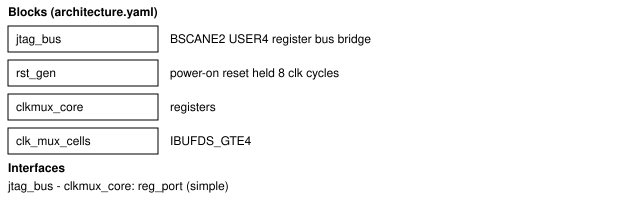

# p6_glitchfree_mux: Glitch-free clock multiplexer with self-checking muxed domain on the KR260

<!-- Generated from handover.yaml by flow/handover.py (brief 68). Edit handover.yaml, or the text between the prose markers, then run: python -m flow.handover write runs/20261126-011553-f268/p6_glitchfree_mux -->

The design switches a BUFGCTRL clock mux between the 25 MHz board clock (clock A) and the SFP+ 156.25 MHz GT reference clock divided by B_DIV (clock B). A counter with a Gray-coded twin runs on the muxed clock and counts its own errors. A JTAG register bus controls the select, a frequency gate, error and switch counters and a counter snapshot. The run stopped at rtl-design-creation, which failed its design-standards gate; no constraints, synthesis or implementation stage ran. Verification reached V2 of V3 and no board result exists.

Not in scope:

- Not a transceiver design; no GT channel is used and sfp_tx_disable is held at 1.
- Not proven on hardware, and no resource, timing or power figure exists for it.
- Not a clock-failure tolerant mux; both clocks must keep running during a switch.

Kind: agent-run; produced by the agent (agent run `20261126-011553-f268`, [record](../summary.json)). State: rtl. For an agent: [AGENT.md](AGENT.md).

Run: model claude-sonnet-5-5 (deepagents harness), 8 loops, 194 turns, 7,847,196 tokens, 2176.8 s wall time, 4.36906 USD model cost (provider-reported), stopped because: stage 2 visited more than 6 times; last failing gate: design standards; owned by the rtl role; the same failure on 3 consecutive visits (from the run record).

<!-- prose:what -->
<!-- /prose:what -->

## Technical parameters

| Item | Value |
|---|---|
| Part | `xck26-sfvc784-2LV-c` |
| Board | kr260 |
| Top | `p6_clkmux_top` |
| Tool | Vivado 2026.1 |

Clocks:

- `clk`: 25 MHz (from `runs/20261126-011553-f268/p6_glitchfree_mux/design.xdc`)
- `gtref_p`: 156.25 MHz (from `runs/20261126-011553-f268/p6_glitchfree_mux/design.xdc`)

Resets:

- `rst`, active high: Internal power-on reset generated in rtl/p6_clkmux_top.sv from a counter with initial values (no reset pin), synchronous to clk. It reaches the muxed domain through xpm_cdc_async_rst (rtl/p6_clkmux_core.sv).

Interfaces:

- `clk` (input, 25 MHz board clock on pin C3 (LVCMOS18)): Clock A, the register bus clock and the gate timer clock; design.xdc creates a 40 ns clock on it.
- `gtref_p` (input, differential GT reference clock, positive leg): Clock B source through IBUFDS_GTE4 and BUFG_GT; design.xdc creates a 6.4 ns clock on it but assigns no PACKAGE_PIN to it.
- `gtref_n` (input, differential GT reference clock, negative leg): No pin constraint in design.xdc; ARCHITECTURE.md says the pins are still to be resolved.
- `sfp_tx_disable` (output, 1 bit on pin Y10 (LVCMOS33)): Driven to 1 at all times.
- `led` (output, 2 bits, F8 for led[0] and E8 for led[1] (LVCMOS18)): led[0] is the synchronised ACTIVE_SEL; led[1] is set when the synchronised MUX_ERRS is nonzero.

Registers (from spec.yaml; where the RTL differs, the gaps say so):

| Offset | Name | Access | Reset | Bits |
|---|---|---|---|---|
| 0 | `ID` | RO | 546701313 | 31:0 design ID |
| 4 | `BUILD` | RO | 0 | 31:0 USR_ACCESS word |
| 8 | `SCRATCH` | RW | 0 | 31:0 data |
| 16 | `SEL` | RW | 0 | 0 select (0 clock A, 1 clock B) |
| 20 | `STATUS` | RO | 0 | 0 SWITCHING, 1 ACTIVE_SEL |
| 24 | `B_DIV` | RO | 1 | 3:0 divide 1 to 8 |
| 28 | `GATE_LEN` | RW | 25000000 | 31:0 gate length in C3 cycles |
| 32 | `FREQ_CTRL` | RW | 0 | 0 START self-clearing |
| 36 | `FREQ_STATUS` | RO | 0 | 0 BUSY, 1 DONE |
| 40 | `FREQ_COUNT` | RO | 0 | 31:0 edges in last gate |
| 44 | `MUX_ERRS` | RO | 0 | 31:0 error count |
| 48 | `MUX_COUNT` | RO | 0 | 31:0 counter low 32 bits at last SNAPSHOT |
| 52 | `SWITCH_COUNT` | RO | 0 | 31:0 switches carried out |
| 56 | `SNAPSHOT` | WO | 0 | any write latches MUX_COUNT |

| Parameter | Value | Legal range | Note |
|---|---|---|---|
| `DESIGN_ID` | 546,701,313 | any 32-bit value | Read back at ID (0x000); 546701313 is 0x20960001. |
| `B_DIV` | 1 | 1 to 8 | Fixed at build time; top feeds B_DIV-1 to the BUFG_GT DIV pin and B_DIV reads it back. Clock B is 156.25 MHz divided by B_DIV. |
| `GATE_LEN_DEFAULT` | 25,000,000 | 1 to 4294967295 (0 acts as 1) | Reset value of GATE_LEN in clk cycles; 25,000,000 is 1 s at 25 MHz. The benches ran at 300, so the spec's value was not simulated. Spec timing: GATE_LEN clk cycles; default 25,000,000 = 1 s at 25 MHz |
| `GATE_LEN_BITS` | 32 | fixed at 32 | Width of GATE_LEN and FREQ_COUNT. It is in the spec but not a parameter of the RTL, which hard-codes 32 bits. Spec timing: GATE_LEN clk cycles; default 25,000,000 = 1 s at 25 MHz |
| `RST_HOLD_CYCLES` | 8 | fixed at 8 | Not a parameter in the RTL. The reset counter in rtl/p6_clkmux_top.sv is hard-coded to count to 8. |
| `ADDR_WIDTH` | 12 | fixed at 12 | Width of h_addr from jtag_bus; hard-coded in the RTL. |

| Quantity | Value | Source |
|---|---|---|
| Resources | not measured | [Known gaps](#known-gaps-and-limits) |
| Timing | not measured | [Known gaps](#known-gaps-and-limits) |
| Power | not measured | [Known gaps](#known-gaps-and-limits) |
| Latency | not measured | [Known gaps](#known-gaps-and-limits) |
| Throughput | not measured | [Known gaps](#known-gaps-and-limits) |

<!-- prose:parameters -->
<!-- /prose:parameters -->

## How to build, run and reproduce

| Step | Command | Heavy slot | Time |
|---|---|---|---|
| what changed since this handover (stale records, changed files, tool and knowledge-bank pins) | `python -m flow.handover fresh runs/20261126-011553-f268/p6_glitchfree_mux` | no | - |
| pick the work up again from the earliest stage the change or the staleness needs; needs a model (see docs/agent.md); Vivado for any stage from synthesis on | `python -m agent resume runs/20261126-011553-f268/p6_glitchfree_mux "<change request>"` | yes | - |
| run the Verifier's simulation tests; needs Icarus Verilog and cocotb, or the simulation container | `python -m pytest -q runs/20261126-011553-f268/p6_glitchfree_mux/tests/test_p6_glitchfree_mux_rtl.py` | no | - |
| re-run the Verilator coverage simulation and the verification gates (line, toggle, functional and cover results); needs Verilator 5.036 or later and cocotb (the simulation container has them) | `SIM=verilator FDA_COVERAGE=1 FDA_SIM_RESULTS_DIR=runs/20261126-011553-f268/p6_glitchfree_mux/build/verif/sim python -m pytest -q -x runs/20261126-011553-f268/p6_glitchfree_mux/tests/test_p6_glitchfree_mux_rtl.py && python3 flow/verif_gates.py runs/20261126-011553-f268/p6_glitchfree_mux --runs runs/20261126-011553-f268/p6_glitchfree_mux/build/verif/sim` | no | - |
| rebuild the bitstream with the flow; needs Vivado 2026.1 and a heavy slot; peak memory 3370 MiB (anonymous, the systemd scope) | `flow/run_vivado.sh runs/20261126-011553-f268/p6_glitchfree_mux base` | yes | about 2.2 min |

Tool: Vivado 2026.1. Build ID of the inputs at handover: `4c855de1` (`python flow/manifest.py show runs/20261126-011553-f268/p6_glitchfree_mux`: what a rebuild of today's sources and flow would carry; it changes when any build input or the flow changes, so it can differ from the build ID in an older evidence record). Knowledge-bank pin: `6185830`.

| File | What |
|---|---|
| [`runs/20261126-011553-f268/p6_glitchfree_mux/spec.md`](spec.md) | the request the run started from |
| [`runs/20261126-011553-f268/p6_glitchfree_mux/spec.yaml`](spec.yaml) | the specification the Clarifier wrote, approved automatically with no human review |
| [`runs/20261126-011553-f268/p6_glitchfree_mux/ARCHITECTURE.md`](ARCHITECTURE.md) | the architecture note, accepted automatically before any RTL (no human review) |
| [`runs/20261126-011553-f268/p6_glitchfree_mux/architecture.yaml`](architecture.yaml) | the machine-checked architecture: blocks, clocks, predicted resources |
| [`runs/20261126-011553-f268/p6_glitchfree_mux/rtl/p6_clkmux_core.sv`](rtl/p6_clkmux_core.sv) | RTL written by the Designer |
| [`runs/20261126-011553-f268/p6_glitchfree_mux/rtl/p6_clkmux_top.sv`](rtl/p6_clkmux_top.sv) | RTL written by the Designer |
| [`runs/20261126-011553-f268/p6_glitchfree_mux/rtl/p6_clkmux_wrap.sv`](rtl/p6_clkmux_wrap.sv) | RTL written by the Designer |
| [`runs/20261126-011553-f268/p6_glitchfree_mux/rtl/p6_lint_cfg.sv`](rtl/p6_lint_cfg.sv) | RTL written by the Designer |
| [`runs/20261126-011553-f268/p6_glitchfree_mux/rtl/p6_mux_domain.sv`](rtl/p6_mux_domain.sv) | RTL written by the Designer |
| [`runs/20261126-011553-f268/p6_glitchfree_mux/rtl/xilinx_sim_stubs.sv`](rtl/xilinx_sim_stubs.sv) | RTL written by the Designer |
| [`runs/20261126-011553-f268/p6_glitchfree_mux/design.xdc`](design.xdc) | pin, I/O standard and timing constraints |
| [`runs/20261126-011553-f268/p6_glitchfree_mux/build.yaml`](build.yaml) | the build description read by the flow |
| [`runs/20261126-011553-f268/p6_glitchfree_mux/model.py`](model.py) | the Modeller's reference model of the visible behaviour |
| [`runs/20261126-011553-f268/p6_glitchfree_mux/tests/p6_bench.py`](tests/p6_bench.py) | the Verifier's cocotb benches and pytest entries |
| [`runs/20261126-011553-f268/p6_glitchfree_mux/tests/test_p6_glitchfree_mux_rtl.py`](tests/test_p6_glitchfree_mux_rtl.py) | the Verifier's cocotb benches and pytest entries |
| [`runs/20261126-011553-f268/p6_glitchfree_mux/verif/testplan.yaml`](verif/testplan.yaml) | the test plan and mutant list read by the verification gates |
| [`runs/20261126-011553-f268/p6_glitchfree_mux/verif/checkers/v_macros.svh`](verif/checkers/v_macros.svh) | bound assertion and cover checkers |
| [`runs/20261126-011553-f268/p6_glitchfree_mux/build/review/02_rtl-design-creation.html`](build/review/02_rtl-design-creation.html) | the review page of stage rtl-design-creation: its exit gates and their failures at the last visit |

<!-- prose:build -->
<!-- /prose:build -->

## Verified

| ID | Activity | Result | What | Evidence | Conditions |
|---|---|---|---|---|---|
| E1 | review | partial | the specification and the architecture were approved automatically, with no human review (review off; the interview oracle claude-sonnet-5-5 only answered the interview questions); the interview asked 8 questions, 0 answered and 8 defaulted | [`runs/20261126-011553-f268/summary.json`](../summary.json) | - |
| E2 | simulation | partial | verification (flow/verif_gates.py) against the Modeller's reference model reached V2 of V3; the run asked for V2; V2 means simulation: seeded runs, a constrained-random test, bound assertions and formal tasks; V3 (coverage (line, toggle, functional bins, cover properties), three seeds and the mutation score) did not pass: functional bins pct 0.0 (0/0) (needs 100); cover properties pct 0.0 (needs 100); line pct not measured (needs 90); toggle pct not measured (needs 75); mutation score pct not measured (needs 80); cdc structure clean U5 u_core/u_core/u_err/dest_graysync_ff_reg[0][0]: xpm_gray bus without its Max Delay Datapath Only exception (exception: 'Asynch Clock Groups'): the macro's constraints did not reach the netlist, U5 u_core/u_core/u_err/dest_graysync_ff_reg[0][10]: xpm_gray bus without its Max Delay Datapath Only exception (exception: 'Asynch Clock Groups'): the macro's constraints did not reach the netlist, U5 u_core/u_core/u_err/dest_graysync_ff_reg[0][11]: xpm_gray bus without its Max Delay Datapath Only exception (exception: 'Asynch Clock Groups'): the macro's constraints did not reach the netlist, U5 u_core/u_core/u_err/dest_graysync_ff_reg[0][12]: xpm_gray bus without its Max Delay Datapath Only exception (exception: 'Asynch Clock Groups'): the macro's constraints did not reach the netlist, U5 u_core/u_core/u_err/dest_graysync_ff_reg[0][13]: xpm_gray bus without its Max Delay Datapath Only exception (exception: 'Asynch Clock Groups'): the macro's constraints did not reach the netlist, U5 u_core/u_core/u_err/dest_graysync_ff_reg[0][14]: xpm_gray bus without its Max Delay Datapath Only exception (exception: 'Asynch Clock Groups'): the macro's constraints did not reach the netlist ... (needs no unsafe crossing); cdc injection clean missing (needs pass); no board result (V-HW) is recorded | [`runs/20261126-011553-f268/p6_glitchfree_mux/build/verif/verif_gates.json`](build/verif/verif_gates.json) | - |
| E3 | build | fail | Vivado base build; flow stages that ran: rtl, post_synth | [`runs/20261126-011553-f268/p6_glitchfree_mux/build/base/gates.json`](build/base/gates.json) | - |

Gates at handover: `clarify` pass, `board-and-device-planning` pass, `rtl-design-creation` fail, `constraints` not-run, `synthesis` not-run, `implementation` not-run, `timing-closure` not-run, `power-closure` not-run, `drc-closure` not-run, `configuration-and-debug` not-run.

<!-- prose:verified -->
<!-- /prose:verified -->

## Measured

Every value is read from the record by `python -m flow.handover fill`, not typed.

| ID | What | Value | Runs | Source | Conditions |
|---|---|---|---|---|---|
| M1 | simulation seeds run | 3 | 1 | [`runs/20261126-011553-f268/p6_glitchfree_mux/build/verif/verif_gates.json`](build/verif/verif_gates.json) `stages.V3.checks.seeds_run.value` | Verilator coverage simulation of the RTL against the Modeller's model, every seed the bench ran |
| M2 | line coverage | not measured % | 1 | [`runs/20261126-011553-f268/p6_glitchfree_mux/build/verif/verif_gates.json`](build/verif/verif_gates.json) `stages.V3.checks.line_pct.value` | Verilator coverage simulation of the RTL against the Modeller's model, every seed the bench ran |
| M3 | toggle coverage | not measured % | 1 | [`runs/20261126-011553-f268/p6_glitchfree_mux/build/verif/verif_gates.json`](build/verif/verif_gates.json) `stages.V3.checks.toggle_pct.value` | Verilator coverage simulation of the RTL against the Modeller's model, every seed the bench ran |
| M4 | functional coverage bins hit | 0.0 (0/0) | 1 | [`runs/20261126-011553-f268/p6_glitchfree_mux/build/verif/verif_gates.json`](build/verif/verif_gates.json) `stages.V3.checks.functional_bins_pct.value` | Verilator coverage simulation of the RTL against the Modeller's model, every seed the bench ran |
| M5 | cover properties hit | 0.0 % | 1 | [`runs/20261126-011553-f268/p6_glitchfree_mux/build/verif/verif_gates.json`](build/verif/verif_gates.json) `stages.V3.checks.cover_properties_pct.value` | Verilator coverage simulation of the RTL against the Modeller's model, every seed the bench ran |
| M6 | model cost of the run, provider-reported | 4.36906 USD | 1 | [`runs/20261126-011553-f268/summary.json`](../summary.json) `cost_usd` | every role and the interview oracle, as the run summary records it |

<!-- prose:measured -->
<!-- /prose:measured -->

## Known gaps and limits

- **REQ-01**: REQ-01 has no passing evidence for every proof method: hardware (uart_tests) is pending: no bring-up result
- **REQ-02**: REQ-02 has no passing evidence for every proof method: hardware (uart_tests) is pending: no bring-up result
- **REQ-03**: REQ-03 has no passing evidence for every proof method: hardware (uart_tests) is pending: no bring-up result
- **REQ-07**: REQ-07 has no passing evidence for every proof method: hardware (uart_tests) is pending: no bring-up result
- **REQ-29**: REQ-29 has no passing evidence for every proof method: hardware (uart_tests) is pending: no bring-up result
- **REQ-08**: REQ-08 has no passing evidence for every proof method: hardware (uart_tests) is pending: no bring-up result
- **REQ-10**: REQ-10 has no passing evidence for every proof method: hardware (uart_tests) is pending: no bring-up result
- **REQ-13**: REQ-13 has no passing evidence for every proof method: hardware (uart_tests) is pending: no bring-up result
- **REQ-31**: REQ-31 has no passing evidence for every proof method: hardware (uart_tests) is pending: no bring-up result
- **REQ-14**: REQ-14 has no passing evidence for every proof method: hardware (uart_tests) is pending: no bring-up result
- **REQ-15**: REQ-15 has no passing evidence for every proof method: hardware (uart_tests) is pending: no bring-up result
- **REQ-18**: REQ-18 has no passing evidence for every proof method: hardware (uart_tests) is pending: no bring-up result
- **REQ-19**: REQ-19 has no passing evidence for every proof method: hardware (uart_tests) is pending: no bring-up result
- **REQ-21**: REQ-21 has no passing evidence for every proof method: hardware (uart_tests) is pending: no bring-up result
- **REQ-24**: REQ-24 has no passing evidence for every proof method: analysis (post_route:setup) is not run (the stage that makes this evidence did not run): gate post_route:setup = None
- **E1**: review evidence is partial: the specification and the architecture were approved automatically, with no human review (review off; the interview oracle claude-sonnet-5-5 only answered the interview questions); the interview asked 8 questions, 0 answered and 8 defaulted
- **E2**: simulation evidence is partial: verification reached V2 of V3 (the run asked for V2); the checks that did not pass or did not run are listed in the evidence row
- **E3**: build evidence is fail: Vivado base build; flow stages that ran: rtl, post_synth
- **rtl-design-creation**: stage rtl-design-creation did not pass its gates in this run; at its last visit: standards STD-ARCH-00: :0: the checker could not read the design: KeyError: 'id' FAIL
- **constraints**: stage constraints was not run: the run stopped before this stage (stage 2 visited more than 6 times; last failing gate: design standards; owned by the rtl role; the same failure on 3 consecutive visits)
- **synthesis**: stage synthesis was not run: the run stopped before this stage (stage 2 visited more than 6 times; last failing gate: design standards; owned by the rtl role; the same failure on 3 consecutive visits)
- **implementation**: stage implementation was not run: the run stopped before this stage (stage 2 visited more than 6 times; last failing gate: design standards; owned by the rtl role; the same failure on 3 consecutive visits)
- **timing-closure**: stage timing-closure was not run: the run stopped before this stage (stage 2 visited more than 6 times; last failing gate: design standards; owned by the rtl role; the same failure on 3 consecutive visits)
- **power-closure**: stage power-closure was not run: the run stopped before this stage (stage 2 visited more than 6 times; last failing gate: design standards; owned by the rtl role; the same failure on 3 consecutive visits)
- **drc-closure**: stage drc-closure was not run: the run stopped before this stage (stage 2 visited more than 6 times; last failing gate: design standards; owned by the rtl role; the same failure on 3 consecutive visits)
- **configuration-and-debug**: stage configuration-and-debug was not run: the run stopped before this stage (stage 2 visited more than 6 times; last failing gate: design standards; owned by the rtl role; the same failure on 3 consecutive visits)
- **formal**: formal checks were planned for REQ-05, REQ-28, REQ-16, REQ-17, REQ-22 and did not run; each was replaced by a simulation check (verif/testplan.yaml replan). Reason recorded: SymbiYosys is not installed here, so the read latency is checked in simulation against the model.
- **simulated_parameters**: the benches simulate at values other than the spec's (scaled for simulation speed or otherwise): GATE_LEN_DEFAULT is simulated at 300 (runs/20261126-011553-f268/p6_glitchfree_mux/tests/test_p6_glitchfree_mux_rtl.py:21) while spec.yaml gives 25000000. Behaviour that depends on the spec's value, such as a divider's timing against the clock, was not simulated at that value; it is stated here, not shown, unless another record covers it
- **resources**: resources not measured: no current Vivado build of this design has been recorded
- **timing**: timing not measured: no current Vivado build of this design has been recorded
- **power**: power not measured: no current Vivado build of this design has been recorded
- **latency**: latency not measured: the run measured no latency; the spec's latency promise is checked only by the benches
- **throughput**: throughput not measured: the run measured no throughput
- **GATE_LEN_BITS_RST_HOLD**: GATE_LEN_BITS, RST_HOLD_CYCLES and ADDR_WIDTH are listed as parameters in spec.yaml but are literals in the RTL, so they cannot be changed from the top level.
- **reset_hold_length**: The reset counter in rtl/p6_clkmux_top.sv counts rst_cnt from 0 to 8 before releasing rst, so reset is held for about 9 clk cycles, not the 8 the spec states. The RTL is what was built.
- **register_decode**: Unmapped addresses read 0 and ignore writes. Writes to RO registers are ignored. FREQ_CTRL reads 0 always. Reading SNAPSHOT (0x038) returns 0 (default arm).
- **start_behaviour**: A START write is ignored while BUSY. GATE_LEN is sampled at START, and a value of 0 is treated as 1. The gate timer does not count down in the cycle of a START write.
- **sel_during_switching**: A SEL write is stored in sel immediately, but the mux only follows after the current change completes (latest value wins). SWITCH_COUNT is incremented when a switch completes, after a minimum wait of 16 clk cycles (SW_MIN).
- **read_latency**: In rtl/p6_clkmux_core.sv h_rdata is registered on h_re, so it is valid 1 clk after h_re and held until the next h_re. This is within the spec's 2 clk promise. The latency was checked only in simulation. A write takes effect 1 clk after h_we.
- **build_register**: BUILD reads USR_ACCESSE2 only under SYNTHESIS; in simulation it reads 0.
- **bufgctrl_sim_model**: In simulation BUFGCTRL and BUFG_GT are ideal stubs (rtl/xilinx_sim_stubs.sv), so glitch-free switching and the clock B divide are not exercised by the benches.
- **cdc_finding**: The verification gate reports unsafe crossings on the xpm_cdc_gray bus u_err (MUX_ERRS), saying the macro's Max Delay Datapath Only exception is missing and that only an Asynch Clock Groups exception is present. design.xdc uses set_clock_groups, so it needs checking after a build. The cdc injection check is missing.
- **gt_pins**: design.xdc has no PACKAGE_PIN for gtref_p or gtref_n, although the spec names SFP+ MGTREFCLK0. The pin assignment is unresolved.
- **spec_disagrees_ids**: The spec requirement gaps for hardware proof (uart_tests) refer to a bring-up that was never run, and REQ-24 needs post_route timing that never ran.
- **approval**: The specification and architecture were approved automatically with no human review; the interview oracle only answered the interview questions.
- **coverage_disagreement**: Functional bins read 0 of 0 and cover properties 0.0 percent, and line, toggle and mutation figures were not measured, so coverage is unproven rather than shown.

<!-- prose:gaps -->
<!-- /prose:gaps -->

## Next steps

1. Fix the design-standards failure at rtl-design-creation (STD-ARCH-00, the checker raises KeyError 'id' while reading the design; look at architecture.yaml for a missing id field), then resume with python -m agent resume.
2. Compare the cover results with the functional coverage before adding any new stimulus, since both read 0 of 0.
3. Resolve the gtref_p and gtref_n pin assignments in design.xdc and review the clock-group constraints against the u_err Gray crossing finding.
4. Run constraints through implementation, then check timing, and plan a hardware bring-up for the hardware-proof requirements.

Open questions:

- Which package pins carry SFP+ MGTREFCLK0 on the KR260, so gtref_p and gtref_n can be constrained?
- Should the spec's reset hold of 8 clk cycles be restated to match the longer hold the RTL implements, or the RTL changed?

<!-- prose:next -->
<!-- /prose:next -->

## History

| Date | Brief | PR | What |
|---|---|---|---|
| 2026-11-26 | agent run | - | produced by the agent graph; stages that passed: clarify, board-and-device-planning |

<!-- prose:history -->
<!-- /prose:history -->
