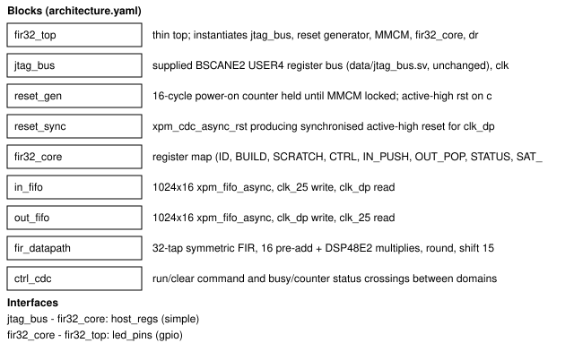

# p4_fir_dsp: 32-tap symmetric FIR low-pass filter with JTAG register bus (KR260)

<!-- Generated from handover.yaml by flow/handover.py (brief 68). Edit handover.yaml, or the text between the prose markers, then run: python -m flow.handover write runs/20261126-152242-3f5c/p4_fir_dsp -->

The design is a 32-tap symmetric FIR filter on the KR260. Samples are pushed through a JTAG register bus into an input memory, a RUN command streams them through a pre-add plus 16-multiplier datapath on a 250 MHz clock made by an MMCM from the 25 MHz board clock, and the saturated 16-bit results are read back from an output memory. The run stopped at rtl-design-creation, which did not pass its gates (a setup path on the reset synchroniser in the post-synthesis timing report). Verification reached V2 of V3, and no routed build, power or hardware result exists. The specification and architecture were approved automatically, with no human review.

Not in scope:

- Not a general FIR; the 32 coefficients are fixed at build time and symmetric.
- No transceiver is used and sfp_tx_disable is held at 1.
- No AXI or other bus is offered; the only host path is the JTAG register bus (data/jtag_bus.sv).
- Not verified on hardware, and no timing closure at 250 MHz is shown.

Kind: agent-run; produced by the agent (agent run `20261126-152242-3f5c`, [record](../summary.json)). State: rtl. For an agent: [AGENT.md](AGENT.md).

Run: model claude-sonnet-5-5 (deepagents harness), 8 loops, 121 turns, 5,290,559 tokens, 2537.7 s wall time, 5.11191 USD model cost (provider-reported), permission mode auto (8 distinct gated decisions listed in handover.yaml), stopped because: stage 2 visited more than 6 times; last failing gate: report gates; owned by the rtl role (from the run record).

<!-- prose:what -->
<!-- /prose:what -->

## Technical parameters

| Item | Value |
|---|---|
| Part | `xck26-sfvc784-2LV-c` |
| Board | kr260 |
| Top | `fir32_top` |
| Tool | Vivado 2026.1 |

Clocks:

- `clk_25`: 25 MHz (from `runs/20261126-152242-3f5c/p4_fir_dsp/design.xdc`)

Resets:

- `rst`, active high: Internal only, there is no reset port. rtl/reset_gen.sv holds it for RESET_CYCLES clk_25 cycles after the MMCM locks. rtl/reset_sync.sv (xpm_cdc_async_rst) derives the clk_dp reset, which asserts asynchronously and releases synchronously. Registers have initial values (reprogram model).

Interfaces:

- `clk_25` (input clock, 25 MHz, pin C3 LVCMOS18): Board clock; the MMCM makes clk_dp (250 MHz) from it in rtl/fir32_top.sv.
- `led` (output, 2 bits, F8 and E8 LVCMOS18): led[0] is BUSY and led[1] is sticky saturation since CLEAR (rtl/fir32_core.sv).
- `sfp_tx_disable` (output, 1 bit, Y10 LVCMOS33): Constant 1.

Registers (from spec.yaml; where the RTL differs, the gaps say so):

| Offset | Name | Access | Reset | Bits |
|---|---|---|---|---|
| 0 | `ID` | RO | 546570241 | 31:0 design ID |
| 4 | `BUILD` | RO | 0 | 31:0 USR_ACCESS word |
| 8 | `SCRATCH` | RW | 0 | 31:0 read back value |
| 16 | `CTRL` | RW | 0 | 0 CLEAR self-clearing, 1 RUN self-clearing |
| 20 | `IN_PUSH` | WO | 0 | 15:0 sample |
| 24 | `OUT_POP` | RO | 0 | 31 valid, 15:0 oldest output, read pops |
| 28 | `STATUS` | RO | 0 | 0 BUSY, 15:4 input FIFO count, 31:20 output FIFO count |
| 32 | `SAT_COUNT` | RO | 0 | 31:0 saturated outputs since CLEAR |
| 36 | `SAMPLES_DONE` | RO | 0 | 31:0 samples processed since CLEAR |

| Parameter | Value | Legal range | Note |
|---|---|---|---|
| `NUM_TAPS` | 32 | fixed at 32 | Not a module parameter in the RTL; the datapath is hard-wired to 32 taps. |
| `UNIQUE_COEFFS` | 16 | fixed at 16 | Equals NUM_TAPS/2; the coefficients are literals in rtl/fir_datapath.sv. |
| `DATA_WIDTH` | 16 | fixed at 16 | Signed samples; the register map and FIFOs assume 16 bits. |
| `COEFF_WIDTH` | 16 | fixed at 16 | Signed coefficients. |
| `FIFO_DEPTH` | 1024 | fixed at 1024 | Both sample memories use 10-bit addresses, and the 11-bit counts assume 1024. |
| `ROUND_CONST` | 16,384 | fixed at 16384 (0x4000) | Added before the shift in rtl/fir_datapath.sv. |
| `SHIFT` | 15 | fixed at 15 | Arithmetic shift right. |
| `RESET_CYCLES` | 16 | 1 to 31 (5-bit counter) | Set on reset_gen in rtl/fir32_top.sv. Reset stays active until the MMCM is locked and then for this many clk_25 cycles. |
| `DESIGN_ID` | 546,570,241 | any 32-bit value | Equals 0x20940001; read from the ID register. |

| Quantity | Value | Source |
|---|---|---|
| Resources | not measured | [Known gaps](#known-gaps-and-limits) |
| Timing | not measured | [Known gaps](#known-gaps-and-limits) |
| Power | not measured | [Known gaps](#known-gaps-and-limits) |
| Latency | not measured | [Known gaps](#known-gaps-and-limits) |
| Throughput | not measured | [Known gaps](#known-gaps-and-limits) |

<!-- prose:parameters -->
<!-- /prose:parameters -->

## How to build, run and reproduce

| Step | Command | Heavy slot | Time |
|---|---|---|---|
| what changed since this handover (stale records, changed files, tool and knowledge-bank pins) | `python -m flow.handover fresh runs/20261126-152242-3f5c/p4_fir_dsp` | no | - |
| pick the work up again from the earliest stage the change or the staleness needs; needs a model (see docs/agent.md); Vivado for any stage from synthesis on | `python -m agent resume runs/20261126-152242-3f5c/p4_fir_dsp "<change request>"` | yes | - |
| run the Verifier's simulation tests; needs Icarus Verilog and cocotb, or the simulation container | `python -m pytest -q runs/20261126-152242-3f5c/p4_fir_dsp/tests/test_p4_fir_dsp_rtl.py` | no | - |
| re-run the Verilator coverage simulation and the verification gates (line, toggle, functional and cover results); needs Verilator 5.036 or later and cocotb (the simulation container has them) | `SIM=verilator FDA_COVERAGE=1 FDA_SIM_RESULTS_DIR=runs/20261126-152242-3f5c/p4_fir_dsp/build/verif/sim python -m pytest -q -x runs/20261126-152242-3f5c/p4_fir_dsp/tests/test_p4_fir_dsp_rtl.py && python3 flow/verif_gates.py runs/20261126-152242-3f5c/p4_fir_dsp --runs runs/20261126-152242-3f5c/p4_fir_dsp/build/verif/sim` | no | - |
| rebuild the bitstream with the flow; needs Vivado 2026.1 and a heavy slot; peak memory 3516 MiB (anonymous, the systemd scope) | `flow/run_vivado.sh runs/20261126-152242-3f5c/p4_fir_dsp base` | yes | about 3 min |

Tool: Vivado 2026.1. Build ID of the inputs at handover: `c99205ef` (`python flow/manifest.py show runs/20261126-152242-3f5c/p4_fir_dsp`: what a rebuild of today's sources and flow would carry; it changes when any build input or the flow changes, so it can differ from the build ID in an older evidence record). Knowledge-bank pin: `eaf6794`.

| File | What |
|---|---|
| [`runs/20261126-152242-3f5c/p4_fir_dsp/spec.md`](spec.md) | the request the run started from |
| [`runs/20261126-152242-3f5c/p4_fir_dsp/spec.yaml`](spec.yaml) | the specification the Clarifier wrote, approved automatically with no human review |
| [`runs/20261126-152242-3f5c/p4_fir_dsp/ARCHITECTURE.md`](ARCHITECTURE.md) | the architecture note, accepted automatically before any RTL (no human review) |
| [`runs/20261126-152242-3f5c/p4_fir_dsp/architecture.yaml`](architecture.yaml) | the machine-checked architecture: blocks, clocks, predicted resources |
| [`runs/20261126-152242-3f5c/p4_fir_dsp/rtl/fir32_core.sv`](rtl/fir32_core.sv) | RTL written by the Designer |
| [`runs/20261126-152242-3f5c/p4_fir_dsp/rtl/fir32_top.sv`](rtl/fir32_top.sv) | RTL written by the Designer |
| [`runs/20261126-152242-3f5c/p4_fir_dsp/rtl/fir_datapath.sv`](rtl/fir_datapath.sv) | RTL written by the Designer |
| [`runs/20261126-152242-3f5c/p4_fir_dsp/rtl/lint_waivers.sv`](rtl/lint_waivers.sv) | RTL written by the Designer |
| [`runs/20261126-152242-3f5c/p4_fir_dsp/rtl/reset_gen.sv`](rtl/reset_gen.sv) | RTL written by the Designer |
| [`runs/20261126-152242-3f5c/p4_fir_dsp/rtl/reset_sync.sv`](rtl/reset_sync.sv) | RTL written by the Designer |
| [`runs/20261126-152242-3f5c/p4_fir_dsp/rtl/xilinx_sim_stubs.sv`](rtl/xilinx_sim_stubs.sv) | RTL written by the Designer |
| [`runs/20261126-152242-3f5c/p4_fir_dsp/design.xdc`](design.xdc) | pin, I/O standard and timing constraints |
| [`runs/20261126-152242-3f5c/p4_fir_dsp/build.yaml`](build.yaml) | the build description read by the flow |
| [`runs/20261126-152242-3f5c/p4_fir_dsp/model.py`](model.py) | the Modeller's reference model of the visible behaviour |
| [`runs/20261126-152242-3f5c/p4_fir_dsp/tests/fir_bench.py`](tests/fir_bench.py) | the Verifier's cocotb benches and pytest entries |
| [`runs/20261126-152242-3f5c/p4_fir_dsp/tests/test_p4_fir_dsp_rtl.py`](tests/test_p4_fir_dsp_rtl.py) | the Verifier's cocotb benches and pytest entries |
| [`runs/20261126-152242-3f5c/p4_fir_dsp/verif/testplan.yaml`](verif/testplan.yaml) | the test plan and mutant list read by the verification gates |
| [`runs/20261126-152242-3f5c/p4_fir_dsp/verif/checkers/v_macros.svh`](verif/checkers/v_macros.svh) | bound assertion and cover checkers |
| [`runs/20261126-152242-3f5c/p4_fir_dsp/build/review/02_rtl-design-creation.html`](build/review/02_rtl-design-creation.html) | the review page of stage rtl-design-creation: its exit gates and their failures at the last visit |

<!-- prose:build -->
<!-- /prose:build -->

## Verified

Requirement by requirement, with where each came from and its evidence: [REQUIREMENTS_REPORT.md](REQUIREMENTS_REPORT.md).

| ID | Activity | Result | What | Evidence | Conditions |
|---|---|---|---|---|---|
| E1 | review | partial | the specification and the architecture were approved automatically, with no human review (review off; the interview oracle claude-sonnet-5-5 only answered the interview questions); the interview asked 8 questions, 0 answered and 8 defaulted | [`runs/20261126-152242-3f5c/summary.json`](../summary.json) | - |
| E2 | simulation | partial | verification (flow/verif_gates.py) against the Modeller's reference model reached V2 of V3; the run asked for V2; V2 means simulation: seeded runs, a constrained-random test, bound assertions and formal tasks; V3 (coverage (line, toggle, functional bins, cover properties), three seeds and the mutation score) did not pass: functional bins pct 0.0 (0/0) (needs 100); cover properties pct 0.0 (needs 100); line pct not measured (needs 90); toggle pct not measured (needs 75); mutation score pct not measured (needs 80); cdc structure clean missing (needs no unsafe crossing); cdc injection clean missing (needs pass); no board result (V-HW) is recorded | [`runs/20261126-152242-3f5c/p4_fir_dsp/build/verif/verif_gates.json`](build/verif/verif_gates.json) | - |
| E3 | build | fail | Vivado base build; flow stages that ran: rtl, post_synth | [`runs/20261126-152242-3f5c/p4_fir_dsp/build/base/gates.json`](build/base/gates.json) | - |

Gates at handover: `clarify` pass, `board-and-device-planning` pass, `rtl-design-creation` fail, `constraints` not-run, `synthesis` not-run, `implementation` not-run, `timing-closure` not-run, `power-closure` not-run, `drc-closure` not-run, `configuration-and-debug` not-run.

<!-- prose:verified -->
<!-- /prose:verified -->

## Measured

Every value is read from the record by `python -m flow.handover fill`, not typed.

| ID | What | Value | Runs | Source | Conditions |
|---|---|---|---|---|---|
| M1 | simulation seeds run | 3 | 1 | [`runs/20261126-152242-3f5c/p4_fir_dsp/build/verif/verif_gates.json`](build/verif/verif_gates.json) `stages.V3.checks.seeds_run.value` | Verilator coverage simulation of the RTL against the Modeller's model, every seed the bench ran |
| M2 | line coverage | not measured % | 1 | [`runs/20261126-152242-3f5c/p4_fir_dsp/build/verif/verif_gates.json`](build/verif/verif_gates.json) `stages.V3.checks.line_pct.value` | Verilator coverage simulation of the RTL against the Modeller's model, every seed the bench ran |
| M3 | toggle coverage | not measured % | 1 | [`runs/20261126-152242-3f5c/p4_fir_dsp/build/verif/verif_gates.json`](build/verif/verif_gates.json) `stages.V3.checks.toggle_pct.value` | Verilator coverage simulation of the RTL against the Modeller's model, every seed the bench ran |
| M4 | functional coverage bins hit | 0.0 (0/0) | 1 | [`runs/20261126-152242-3f5c/p4_fir_dsp/build/verif/verif_gates.json`](build/verif/verif_gates.json) `stages.V3.checks.functional_bins_pct.value` | Verilator coverage simulation of the RTL against the Modeller's model, every seed the bench ran |
| M5 | cover properties hit | 0.0 % | 1 | [`runs/20261126-152242-3f5c/p4_fir_dsp/build/verif/verif_gates.json`](build/verif/verif_gates.json) `stages.V3.checks.cover_properties_pct.value` | Verilator coverage simulation of the RTL against the Modeller's model, every seed the bench ran |
| M6 | model cost of the run, provider-reported | 5.11191 USD | 1 | [`runs/20261126-152242-3f5c/summary.json`](../summary.json) `cost_usd` | every role and the interview oracle, as the run summary records it |

<!-- prose:measured -->
<!-- /prose:measured -->

## Known gaps and limits

- **REQ-01**: REQ-01 has no passing evidence for every proof method: hardware (uart_tests) is pending: no bring-up result
- **REQ-02**: REQ-02 has no passing evidence for every proof method: hardware (uart_tests) is pending: no bring-up result
- **REQ-03**: REQ-03 has no passing evidence for every proof method: hardware (uart_tests) is pending: no bring-up result
- **REQ-06**: REQ-06 has no passing evidence for every proof method: hardware (uart_tests) is pending: no bring-up result
- **REQ-07**: REQ-07 has no passing evidence for every proof method: hardware (uart_tests) is pending: no bring-up result
- **REQ-08**: REQ-08 has no passing evidence for every proof method: hardware (uart_tests) is pending: no bring-up result
- **REQ-09**: REQ-09 has no passing evidence for every proof method: hardware (uart_tests) is pending: no bring-up result
- **REQ-11**: REQ-11 has no passing evidence for every proof method: analysis (post_synth:post_synth_resources_in_range) is pending: no flow gates result
- **REQ-12**: REQ-12 has no passing evidence for every proof method: analysis (post_synth:post_synth_resources_in_range) is pending: no flow gates result
- **REQ-38**: REQ-38 has no passing evidence for every proof method: analysis (post_synth:post_synth_resources_in_range) is pending: no flow gates result
- **REQ-14**: REQ-14 has no passing evidence for every proof method: analysis (post_route:setup) is pending: no flow gates result
- **REQ-15**: REQ-15 has no passing evidence for every proof method: analysis (post_route:setup) is pending: no flow gates result
- **REQ-16**: REQ-16 has no passing evidence for every proof method: analysis (post_route:setup) is pending: no flow gates result
- **REQ-19**: REQ-19 has no passing evidence for every proof method: hardware (uart_tests) is pending: no bring-up result
- **REQ-30**: REQ-30 has no passing evidence for every proof method: analysis (post_synth:post_synth_resources_in_range) is pending: no flow gates result; hardware (uart_tests) is pending: no bring-up result
- **REQ-31**: REQ-31 has no passing evidence for every proof method: analysis (post_synth:post_synth_resources_in_range) is pending: no flow gates result
- **REQ-32**: REQ-32 has no passing evidence for every proof method: analysis (post_synth:post_synth_resources_in_range) is pending: no flow gates result
- **E1**: review evidence is partial: the specification and the architecture were approved automatically, with no human review (review off; the interview oracle claude-sonnet-5-5 only answered the interview questions); the interview asked 8 questions, 0 answered and 8 defaulted
- **E2**: simulation evidence is partial: verification reached V2 of V3 (the run asked for V2); the checks that did not pass or did not run are listed in the evidence row
- **E3**: build evidence is fail: Vivado base build; flow stages that ran: rtl, post_synth
- **rtl-design-creation**: stage rtl-design-creation did not pass its gates in this run; at its last visit: report gate RPT-LL-02 timing_summary_synth.rpt:u_rst/rst_reg/C->u_core/u_rsync/u_rst/arststages_ff_reg[0]/PRE: setup path u_rst/rst_reg/C to u_core/u_rsync/u_rst/arststages_ff_reg[0]/PRE (sys_clk_pin, requirement 0.0 ns) has slack -0.477 ns with 0.157 ns of net delay; with the net delay removed it is still -0.320 ns, so no placement can close it (UG949 p.200): 0 logic levels, logic delay 0.084 ns. ...
- **constraints**: stage constraints was not run: the run stopped before this stage (stage 2 visited more than 6 times; last failing gate: report gates; owned by the rtl role)
- **synthesis**: stage synthesis was not run: the run stopped before this stage (stage 2 visited more than 6 times; last failing gate: report gates; owned by the rtl role)
- **implementation**: stage implementation was not run: the run stopped before this stage (stage 2 visited more than 6 times; last failing gate: report gates; owned by the rtl role)
- **timing-closure**: stage timing-closure was not run: the run stopped before this stage (stage 2 visited more than 6 times; last failing gate: report gates; owned by the rtl role)
- **power-closure**: stage power-closure was not run: the run stopped before this stage (stage 2 visited more than 6 times; last failing gate: report gates; owned by the rtl role)
- **drc-closure**: stage drc-closure was not run: the run stopped before this stage (stage 2 visited more than 6 times; last failing gate: report gates; owned by the rtl role)
- **configuration-and-debug**: stage configuration-and-debug was not run: the run stopped before this stage (stage 2 visited more than 6 times; last failing gate: report gates; owned by the rtl role)
- **formal**: formal checks were planned for REQ-23, REQ-40, REQ-33 and did not run; each was replaced by a simulation check (verif/testplan.yaml replan). Reason recorded: SymbiYosys is not installed here, so the input-count check is done by model-compared simulation at empty, partial and full.
- **resources**: resources not measured: no current Vivado build of this design has been recorded
- **timing**: timing not measured: no current Vivado build of this design has been recorded
- **power**: power not measured: no current Vivado build of this design has been recorded
- **latency**: latency not measured: the run measured no latency; the spec's latency promise is checked only by the benches
- **throughput**: throughput not measured: the run measured no throughput
- **coefficients**: The coefficients are literals in rtl/fir_datapath.sv, not read from data/coeffs.hex via $readmemh as spec.yaml and ARCHITECTURE.md say. This run did not check that they match the file.
- **filter_latency**: Counting the RTL, the datapath takes 11 clk_dp cycles from v_in to v_out (rtl/fir_datapath.sv). Reads of the input memory add one more cycle, and results reach the host through the handshake CDC. No total latency was measured.
- **clock_ratio**: ARCHITECTURE.md describes the MMCM as VCO 1000 MHz with x40 and divide 4, and the RTL sets CLKFBOUT_MULT_F 40.0 and CLKOUT0_DIVIDE_F 4.0. spec.yaml calls it 25 MHz x 10. The RTL gives 250 MHz.
- **cdc_style**: spec.yaml and ARCHITECTURE.md describe async FIFOs. The RTL uses dual-clock xpm_memory_sdpram blocks plus xpm_cdc_handshake for commands and done messages (rtl/fir32_core.sv), and the CDC structure and injection checks have no result.
- **reset_style**: spec.yaml describes a reset port with polarity and sync_to, but the top level has no reset input and the interview chose the reprogram model. In the RTL, rst is generated internally and used synchronously on clk_25, and clk_dp logic uses a synchronised copy.
- **reset_timing**: The post-synthesis timing report shows a negative setup slack from u_rst/rst_reg to the clk_dp reset synchroniser's first flop (-0.477 ns), which no placement can close. This is the open failure at rtl-design-creation.
- **run_semantics**: RUN is ignored while BUSY and when CLEAR is also written in the same write (CLEAR has priority). RUN is also ignored if n_calc is 0. The batch is min(input count, free output space), and leftover samples stay in the input FIFO.
- **clear_while_busy**: CLEAR aborts the run, empties both FIFOs, zeroes counters and the sticky LED, and sends a clear message to clk_dp, which drops samples in flight and zeroes history.
- **unmapped_access**: Reads of any unmapped address return 0 and writes to unmapped addresses do nothing. Write-only IN_PUSH reads 0, and CTRL reads 0 because there is no read case for it.
- **read_side_effects**: Reading OUT_POP at 0x018 pops the oldest entry only when the output count is non-zero; an empty read returns 0 with bit 31 clear. Only a read pops.
- **counters**: SAT_COUNT and SAMPLES_DONE are 32-bit and wrap. They are updated when a run finishes, not per sample, so they can lag the output FIFO count.
- **simulation_stubs**: rtl/xilinx_sim_stubs.sv provides simulation models of the MMCM, BUFG, USR_ACCESSE2 and XPM blocks, so BUILD reads 0 and the clock ratio is 1:1 in simulation. These do not represent the real primitives.

<!-- prose:gaps -->
<!-- /prose:gaps -->

## Assumptions you did not confirm

The agent settled these questions with its own default (nobody answered, or the answer was waived). A passing test shows the design matches the assumption, not that the assumption is what you want. Check the high-risk rows first.

| Risk | Question | The design used | How it was settled |
|---|---|---|---|
| high | What is the register map (offset, width, reset value and access of every register)? | The map in registers.map: ID 0x000, BUILD 0x004, SCRATCH 0x008, CTRL 0x010, IN_PUSH 0x014, OUT_POP 0x018, STATUS 0x01C, SAT_COUNT 0x020, SAMPLES_DONE 0x024, all 32 bits, resets 0 except ID. | defaulted: nobody answered |
| high | What does a read of SAT_COUNT or SAMPLES_DONE do on overflow? | 32-bit counters that wrap. | defaulted: nobody answered |
| high | What happens if IN_PUSH is written while BUSY? | The push is accepted if the FIFO is not full, and it is not part of the running batch. | defaulted: nobody answered |
| high | What happens if the output FIFO would overflow during RUN? | Not possible when the output FIFO is empty at RUN. RUN is limited to the free output space, and leftover input stays in the input FIFO. | defaulted: nobody answered |
| high | What happens if CLEAR is written while BUSY? | CLEAR aborts the run and empties everything. | defaulted: nobody answered |
| high | What is the exact filter latency in clocks? | Any fixed pipeline depth, since only results through the FIFO are observed. | defaulted: nobody answered |
| high | This design has no reset input. Is every reset a reconfiguration of the FPGA (the device is reprogrammed, so every register starts from its initial value), or does something restart the running design (then it needs a reset input)? | Every reset is a reconfiguration of the FPGA (reset model: reprogram): registers get initial values, control state included, and the design has no reset input. Record it in spec.yaml as reset: {model: reprogram}; a design that restarts while it runs is reset: {model: reset} with a reset port. | defaulted: nobody answered |
| medium | What do the two LEDs show? | led[0] = BUSY, led[1] = 1 once any output has saturated since CLEAR. | defaulted: nobody answered |

## Next steps

1. Fix the earliest failure first, at rtl-design-creation. The setup path from the reset register in reset_gen to the clk_dp reset synchroniser is a clk_25 to clk_dp crossing with a 40 ns requirement in the report. Look at how the rst crossing is constrained and structured, then rebuild.
2. Compare the cover results with the functional coverage before any new stimulus, since functional bins show 0 of 0 and cover properties show 0 percent. Then re-run the Verilator coverage command to get line, toggle, seed and mutation results.
3. Check the literal coefficients in rtl/fir_datapath.sv against data/coeffs.hex, and decide whether the spec should say literals.
4. Once the RTL gates pass, continue with constraints, synthesis, implementation and timing closure at 250 MHz, then bring up on the board.

Open questions:

- Should the reset crossing to clk_dp be restructured, or constrained, to remove the failing synthesis path?
- Is the 11-cycle datapath depth, plus the handshake delay, acceptable as the filter latency the spec leaves open?

<!-- prose:next -->
<!-- /prose:next -->

## History

| Date | Brief | PR | What |
|---|---|---|---|
| 2026-11-26 | agent run | - | produced by the agent graph; stages that passed: clarify, board-and-device-planning |

<!-- prose:history -->
<!-- /prose:history -->
