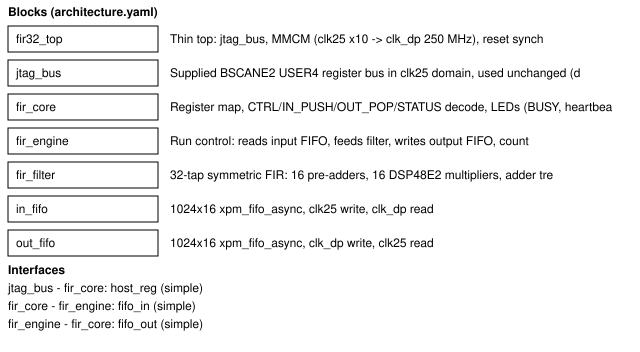

# p4_fir_dsp: 32-tap symmetric FIR low-pass filter with FIFOs and JTAG register bus

<!-- Generated from handover.yaml by flow/handover.py (brief 68). Edit handover.yaml, or the text between the prose markers, then run: python -m flow.handover write runs/20261126-191008-4141/p4_fir_dsp -->

The design is a 32-tap symmetric FIR filter (Q1.15 coefficients, 16 DSP multipliers) on the KR260. Samples are pushed through a JTAG register bus into a 1024-deep input FIFO. A RUN command filters them at 250 MHz (MMCM from the 25 MHz board clock) into a 1024-deep output FIFO. The run passed clarify, board planning and RTL creation, but stopped at the constraints stage because a synthesis timing path from the reset register to the clk_dp reset synchroniser failed. Synthesis, implementation and later stages did not run. Simulation verification reached V2 of V3, and no hardware result exists.

Not in scope:

- Not a runtime-programmable filter; the 16 unique coefficients are fixed constants in fir_filter.sv.
- Not a transceiver design; sfp_tx_disable is held at 1 and no GT channel is used.
- No streaming interface; all data moves through the JTAG register bus and the two FIFOs.
- Not built, timed or tested on hardware in this run.

Kind: agent-run; produced by the agent (agent run `20261126-191008-4141`, [record](../summary.json)). State: simulated. For an agent: [AGENT.md](AGENT.md).

Run: model claude-sonnet-5-5 (deepagents harness), 10 loops, 224 turns, 9,928,619 tokens, 6295.7 s wall time, 7.18109 USD model cost (provider-reported), permission mode auto (12 distinct gated decisions listed in handover.yaml), stopped because: stage 2 visited more than 6 times; last failing gate: report gate RPT-LL-02 timing_summary_synth.rpt:bus_rst_q_reg/C->u_core/u_fir_core/u_rst_dp, report gate RPT-LL-02 timing_summary_synth.rpt:bus_rst_q_reg/C->u_core/u_fir_core/u_rst_dp; the failure was in stage 3 constraints (visit 4), routed to stage 2 rtl-design-creation; stage 2 was refused before any gate ran (from the run record).

<!-- prose:what -->
<!-- /prose:what -->

## Technical parameters

| Item | Value |
|---|---|
| Part | `xck26-sfvc784-2LV-c` |
| Board | kr260 |
| Top | `fir32_top` |
| Tool | Vivado 2026.1 |

Clocks:

- `clk25`: 25 MHz (from `runs/20261126-191008-4141/p4_fir_dsp/design.xdc`)

Resets:

- `rst (bus_rst)`, active high: Generated in fir32_top.sv from a 4-clock power-on shift register and the MMCM LOCKED flag, registered on clk25. It resets the clk25 registers and, through xpm_cdc_async_rst, the clk_dp datapath. The design has no external reset pin.

Interfaces:

- `clk25` (input, 1 bit, 25 MHz board clock, pin C3 (LVCMOS18)): Register bus clock, FIFO host side and MMCM input; constrained at 40.00 ns in design.xdc.
- `led` (output, 2 bits, pins F8 (led[0]) and E8 (led[1]), LVCMOS18): led[0] is BUSY; led[1] is hb[23], a heartbeat counted on clk25.
- `sfp_tx_disable` (output, 1 bit, pin Y10, LVCMOS33): Constant 1 (laser off).

Registers (from spec.yaml; where the RTL differs, the gaps say so):

| Offset | Name | Access | Reset | Bits |
|---|---|---|---|---|
| 0 | `ID` | RO | 546570241 | 31:0 design ID |
| 4 | `BUILD` | RO | 0 | 31:0 USR_ACCESS word |
| 8 | `SCRATCH` | RW | 0 | 31:0 scratch |
| 16 | `CTRL` | RW | 0 | 0 CLEAR self-clearing; 1 RUN self-clearing |
| 20 | `IN_PUSH` | WO | 0 | 15:0 sample |
| 24 | `OUT_POP` | RO | 0 | 31 valid; 15:0 data; read pops |
| 28 | `STATUS` | RO | 0 | 0 BUSY; 15:4 input count; 31:20 output count |
| 32 | `SAT_COUNT` | RO | 0 | 31:0 saturated outputs since CLEAR |
| 36 | `SAMPLES_DONE` | RO | 0 | 31:0 samples processed since CLEAR |

| Parameter | Value | Legal range | Note |
|---|---|---|---|
| `TAPS` | 32 | fixed at 32 | The history, pre-add and tree in fir_filter.sv are written for 32 taps; the parameter is not wired into the RTL. |
| `UNIQUE_COEFFS` | 16 | fixed at 16 (TAPS/2) | One DSP multiplier per unique coefficient. |
| `DATA_WIDTH` | 16 | fixed at 16 | Signed sample and output width. |
| `COEFF_WIDTH` | 16 | fixed at 16 | Signed Q1.15 coefficients. |
| `FIFO_DEPTH` | 1024 | fixed at 1024 | The RTL instantiates FIFOs of write depth 2048 and limits the input count to 1024 in logic; the output limit comes from the room check in fir_engine.sv. |
| `ROUND_CONST` | 16,384 | fixed at 16384 (0x4000) | Added before the arithmetic shift. |
| `SHIFT` | 15 | fixed at 15 | Arithmetic right shift before saturation. |
| `MMCM_MULT` | 10 | fixed at 10 | The RTL uses CLKFBOUT_MULT_F 40.0 and CLKOUT0_DIVIDE_F 4.0 for 250 MHz (VCO 1000 MHz); the spec's multiply of 10 gives the same clk_dp. |
| `MMCM_DIV` | 1 | fixed at 1 | Maps to DIVCLK_DIVIDE 1. |
| `DESIGN_ID` | 546,570,241 | fixed (0x20940001) | Returned by the ID register. |

| Quantity | Value | Source |
|---|---|---|
| Resources | not measured | [Known gaps](#known-gaps-and-limits) |
| Timing | not measured | [Known gaps](#known-gaps-and-limits) |
| Power | not measured | [Known gaps](#known-gaps-and-limits) |
| Latency | not measured | [Known gaps](#known-gaps-and-limits) |
| Throughput | not measured | [Known gaps](#known-gaps-and-limits) |

<!-- prose:parameters -->
<!-- /prose:parameters -->

## How to build, run and reproduce

| Step | Command | Heavy slot | Time |
|---|---|---|---|
| what changed since this handover (stale records, changed files, tool and knowledge-bank pins) | `python -m flow.handover fresh runs/20261126-191008-4141/p4_fir_dsp` | no | - |
| pick the work up again from the earliest stage the change or the staleness needs; needs a model (see docs/agent.md); Vivado for any stage from synthesis on | `python -m agent resume runs/20261126-191008-4141/p4_fir_dsp "<change request>"` | yes | - |
| run the Verifier's simulation tests; needs Icarus Verilog and cocotb, or the simulation container | `python -m pytest -q runs/20261126-191008-4141/p4_fir_dsp/tests/test_p4_fir_dsp_rtl.py` | no | - |
| re-run the Verilator coverage simulation and the verification gates (line, toggle, functional and cover results); needs Verilator 5.036 or later and cocotb (the simulation container has them) | `SIM=verilator FDA_COVERAGE=1 FDA_SIM_RESULTS_DIR=runs/20261126-191008-4141/p4_fir_dsp/build/verif/sim python -m pytest -q -x runs/20261126-191008-4141/p4_fir_dsp/tests/test_p4_fir_dsp_rtl.py && python3 flow/verif_gates.py runs/20261126-191008-4141/p4_fir_dsp --runs runs/20261126-191008-4141/p4_fir_dsp/build/verif/sim` | no | - |
| rebuild the bitstream with the flow; needs Vivado 2026.1 and a heavy slot; peak memory 3492 MiB (anonymous, the systemd scope) | `flow/run_vivado.sh runs/20261126-191008-4141/p4_fir_dsp base` | yes | about 3.7 min |

Tool: Vivado 2026.1. Build ID of the inputs at handover: `9b98fb8c` (`python flow/manifest.py show runs/20261126-191008-4141/p4_fir_dsp`: what a rebuild of today's sources and flow would carry; it changes when any build input or the flow changes, so it can differ from the build ID in an older evidence record). Knowledge-bank pin: `eaf6794`.

| File | What |
|---|---|
| [`runs/20261126-191008-4141/p4_fir_dsp/spec.md`](spec.md) | the request the run started from |
| [`runs/20261126-191008-4141/p4_fir_dsp/spec.yaml`](spec.yaml) | the specification the Clarifier wrote, approved automatically with no human review |
| [`runs/20261126-191008-4141/p4_fir_dsp/ARCHITECTURE.md`](ARCHITECTURE.md) | the architecture note, accepted automatically before any RTL (no human review) |
| [`runs/20261126-191008-4141/p4_fir_dsp/architecture.yaml`](architecture.yaml) | the machine-checked architecture: blocks, clocks, predicted resources |
| [`runs/20261126-191008-4141/p4_fir_dsp/rtl/fir32_core.sv`](rtl/fir32_core.sv) | RTL written by the Designer |
| [`runs/20261126-191008-4141/p4_fir_dsp/rtl/fir32_top.sv`](rtl/fir32_top.sv) | RTL written by the Designer |
| [`runs/20261126-191008-4141/p4_fir_dsp/rtl/fir_core.sv`](rtl/fir_core.sv) | RTL written by the Designer |
| [`runs/20261126-191008-4141/p4_fir_dsp/rtl/fir_engine.sv`](rtl/fir_engine.sv) | RTL written by the Designer |
| [`runs/20261126-191008-4141/p4_fir_dsp/rtl/fir_filter.sv`](rtl/fir_filter.sv) | RTL written by the Designer |
| [`runs/20261126-191008-4141/p4_fir_dsp/rtl/lint_waivers.sv`](rtl/lint_waivers.sv) | RTL written by the Designer |
| [`runs/20261126-191008-4141/p4_fir_dsp/rtl/xilinx_sim_stubs.sv`](rtl/xilinx_sim_stubs.sv) | RTL written by the Designer |
| [`runs/20261126-191008-4141/p4_fir_dsp/design.xdc`](design.xdc) | pin, I/O standard and timing constraints |
| [`runs/20261126-191008-4141/p4_fir_dsp/build.yaml`](build.yaml) | the build description read by the flow |
| [`runs/20261126-191008-4141/p4_fir_dsp/model.py`](model.py) | the Modeller's reference model of the visible behaviour |
| [`runs/20261126-191008-4141/p4_fir_dsp/tests/fir_bench.py`](tests/fir_bench.py) | the Verifier's cocotb benches and pytest entries |
| [`runs/20261126-191008-4141/p4_fir_dsp/tests/test_p4_fir_dsp_rtl.py`](tests/test_p4_fir_dsp_rtl.py) | the Verifier's cocotb benches and pytest entries |
| [`runs/20261126-191008-4141/p4_fir_dsp/verif/testplan.yaml`](verif/testplan.yaml) | the test plan and mutant list read by the verification gates |
| [`runs/20261126-191008-4141/p4_fir_dsp/verif/checkers/v_macros.svh`](verif/checkers/v_macros.svh) | bound assertion and cover checkers |
| [`runs/20261126-191008-4141/p4_fir_dsp/build/review/03_constraints.html`](build/review/03_constraints.html) | the review page of stage constraints: its exit gates and their failures at the last visit |

<!-- prose:build -->
<!-- /prose:build -->

## Verified

Requirement by requirement, with where each came from and its evidence: [REQUIREMENTS_REPORT.md](REQUIREMENTS_REPORT.md).

| ID | Activity | Result | What | Evidence | Conditions |
|---|---|---|---|---|---|
| E1 | review | partial | the specification and the architecture were approved automatically, with no human review (review off; the interview oracle claude-sonnet-5-5 only answered the interview questions); the interview asked 10 questions, 0 answered and 10 defaulted | [`runs/20261126-191008-4141/summary.json`](../summary.json) | - |
| E2 | simulation | partial | verification (flow/verif_gates.py) against the Modeller's reference model reached V2 of V3; the run asked for V2; V2 means simulation: seeded runs, a constrained-random test, bound assertions and formal tasks; V3 (coverage (line, toggle, functional bins, cover properties), three seeds and the mutation score) did not pass: functional bins pct 0.0 (0/0) (needs 100); cover properties pct 0.0 (needs 100); line pct not measured (needs 90); toggle pct not measured (needs 75); mutation score pct not measured (needs 80); cdc injection clean missing (needs pass); no board result (V-HW) is recorded | [`runs/20261126-191008-4141/p4_fir_dsp/build/verif/verif_gates.json`](build/verif/verif_gates.json) | - |
| E3 | build | fail | Vivado base build; flow stages that ran: rtl, post_synth | [`runs/20261126-191008-4141/p4_fir_dsp/build/base/gates.json`](build/base/gates.json) | - |

Gates at handover: `clarify` pass, `board-and-device-planning` pass, `rtl-design-creation` pass, `constraints` fail, `synthesis` not-run, `implementation` not-run, `timing-closure` not-run, `power-closure` not-run, `drc-closure` not-run, `configuration-and-debug` not-run.

<!-- prose:verified -->
<!-- /prose:verified -->

## Measured

Every value is read from the record by `python -m flow.handover fill`, not typed.

| ID | What | Value | Runs | Source | Conditions |
|---|---|---|---|---|---|
| M1 | simulation seeds run | 3 | 1 | [`runs/20261126-191008-4141/p4_fir_dsp/build/verif/verif_gates.json`](build/verif/verif_gates.json) `stages.V3.checks.seeds_run.value` | Verilator coverage simulation of the RTL against the Modeller's model, every seed the bench ran |
| M2 | line coverage | not measured % | 1 | [`runs/20261126-191008-4141/p4_fir_dsp/build/verif/verif_gates.json`](build/verif/verif_gates.json) `stages.V3.checks.line_pct.value` | Verilator coverage simulation of the RTL against the Modeller's model, every seed the bench ran |
| M3 | toggle coverage | not measured % | 1 | [`runs/20261126-191008-4141/p4_fir_dsp/build/verif/verif_gates.json`](build/verif/verif_gates.json) `stages.V3.checks.toggle_pct.value` | Verilator coverage simulation of the RTL against the Modeller's model, every seed the bench ran |
| M4 | functional coverage bins hit | 0.0 (0/0) | 1 | [`runs/20261126-191008-4141/p4_fir_dsp/build/verif/verif_gates.json`](build/verif/verif_gates.json) `stages.V3.checks.functional_bins_pct.value` | Verilator coverage simulation of the RTL against the Modeller's model, every seed the bench ran |
| M5 | cover properties hit | 0.0 % | 1 | [`runs/20261126-191008-4141/p4_fir_dsp/build/verif/verif_gates.json`](build/verif/verif_gates.json) `stages.V3.checks.cover_properties_pct.value` | Verilator coverage simulation of the RTL against the Modeller's model, every seed the bench ran |
| M6 | model cost of the run, provider-reported | 7.18109 USD | 1 | [`runs/20261126-191008-4141/summary.json`](../summary.json) `cost_usd` | every role and the interview oracle, as the run summary records it |

<!-- prose:measured -->
<!-- /prose:measured -->

## Known gaps and limits

- **REQ-01**: REQ-01 has no passing evidence for every proof method: hardware (uart_tests) is pending: no bring-up result
- **REQ-02**: REQ-02 has no passing evidence for every proof method: hardware (uart_tests) is pending: no bring-up result
- **REQ-03**: REQ-03 has no passing evidence for every proof method: hardware (uart_tests) is pending: no bring-up result
- **REQ-35**: REQ-35 has no passing evidence for every proof method: hardware (uart_tests) is pending: no bring-up result
- **REQ-06**: REQ-06 has no passing evidence for every proof method: hardware (uart_tests) is pending: no bring-up result
- **REQ-10**: REQ-10 has no passing evidence for every proof method: analysis (post_synth:post_synth_resources_in_range) is fail: gate post_synth:post_synth_resources_in_range = False
- **REQ-12**: REQ-12 has no passing evidence for every proof method: analysis (post_route:setup) is not run (the stage that makes this evidence did not run): gate post_route:setup = None
- **REQ-16**: REQ-16 has no passing evidence for every proof method: hardware (uart_tests) is pending: no bring-up result
- **REQ-17**: REQ-17 has no passing evidence for every proof method: hardware (uart_tests) is pending: no bring-up result
- **REQ-18**: REQ-18 has no passing evidence for every proof method: hardware (uart_tests) is pending: no bring-up result
- **REQ-28**: REQ-28 has no passing evidence for every proof method: analysis (post_synth:post_synth_resources_in_range) is fail: gate post_synth:post_synth_resources_in_range = False; hardware (uart_tests) is pending: no bring-up result
- **REQ-29**: REQ-29 has no passing evidence for every proof method: analysis (post_synth:post_synth_resources_in_range) is fail: gate post_synth:post_synth_resources_in_range = False
- **REQ-30**: REQ-30 has no passing evidence for every proof method: analysis (post_synth:post_synth_resources_in_range) is fail: gate post_synth:post_synth_resources_in_range = False
- **REQ-31**: REQ-31 has no passing evidence for every proof method: analysis (post_synth:post_synth_resources_in_range) is fail: gate post_synth:post_synth_resources_in_range = False
- **REQ-40**: REQ-40 has no passing evidence for every proof method: analysis (post_route:setup) is not run (the stage that makes this evidence did not run): gate post_route:setup = None
- **E1**: review evidence is partial: the specification and the architecture were approved automatically, with no human review (review off; the interview oracle claude-sonnet-5-5 only answered the interview questions); the interview asked 10 questions, 0 answered and 10 defaulted
- **E2**: simulation evidence is partial: verification reached V2 of V3 (the run asked for V2); the checks that did not pass or did not run are listed in the evidence row
- **E3**: build evidence is fail: Vivado base build; flow stages that ran: rtl, post_synth
- **constraints**: stage constraints did not pass its gates in this run; at its last visit: report gate RPT-LL-02 timing_summary_synth.rpt:bus_rst_q_reg/C->u_core/u_fir_core/u_rst_dp/arststages_ff_reg[0]/PRE: setup path bus_rst_q_reg/C to u_core/u_fir_core/u_rst_dp/arststages_ff_reg[0]/PRE (sys_clk_pin, requirement 0.0 ns) has slack -0.377 ns with 0.154 ns of net delay; with the net delay removed it is still -0.223 ns, so no placement can close it (UG949 p.200): 0 logic levels, logic del ...
- **synthesis**: stage synthesis was not run: the run stopped before this stage (stage 2 visited more than 6 times; last failing gate: report gate RPT-LL-02 timing_summary_synth.rpt:bus_rst_q_reg/C->u_core/u_fir_core/u_rst_dp, report gate RPT-LL-02 timing_summary_synth.rpt:bus_rst_q_reg/C->u_core/u_fir_core/u_rst_dp; the failure was in stage 3 constraints (visit 4), routed to stage 2 rtl-design-creation; stage 2 was refused before any gate ran)
- **implementation**: stage implementation was not run: the run stopped before this stage (stage 2 visited more than 6 times; last failing gate: report gate RPT-LL-02 timing_summary_synth.rpt:bus_rst_q_reg/C->u_core/u_fir_core/u_rst_dp, report gate RPT-LL-02 timing_summary_synth.rpt:bus_rst_q_reg/C->u_core/u_fir_core/u_rst_dp; the failure was in stage 3 constraints (visit 4), routed to stage 2 rtl-design-creation; stage 2 was refused before any gate ran)
- **timing-closure**: stage timing-closure was not run: the run stopped before this stage (stage 2 visited more than 6 times; last failing gate: report gate RPT-LL-02 timing_summary_synth.rpt:bus_rst_q_reg/C->u_core/u_fir_core/u_rst_dp, report gate RPT-LL-02 timing_summary_synth.rpt:bus_rst_q_reg/C->u_core/u_fir_core/u_rst_dp; the failure was in stage 3 constraints (visit 4), routed to stage 2 rtl-design-creation; stage 2 was refused before any gate ran)
- **power-closure**: stage power-closure was not run: the run stopped before this stage (stage 2 visited more than 6 times; last failing gate: report gate RPT-LL-02 timing_summary_synth.rpt:bus_rst_q_reg/C->u_core/u_fir_core/u_rst_dp, report gate RPT-LL-02 timing_summary_synth.rpt:bus_rst_q_reg/C->u_core/u_fir_core/u_rst_dp; the failure was in stage 3 constraints (visit 4), routed to stage 2 rtl-design-creation; stage 2 was refused before any gate ran)
- **drc-closure**: stage drc-closure was not run: the run stopped before this stage (stage 2 visited more than 6 times; last failing gate: report gate RPT-LL-02 timing_summary_synth.rpt:bus_rst_q_reg/C->u_core/u_fir_core/u_rst_dp, report gate RPT-LL-02 timing_summary_synth.rpt:bus_rst_q_reg/C->u_core/u_fir_core/u_rst_dp; the failure was in stage 3 constraints (visit 4), routed to stage 2 rtl-design-creation; stage 2 was refused before any gate ran)
- **configuration-and-debug**: stage configuration-and-debug was not run: the run stopped before this stage (stage 2 visited more than 6 times; last failing gate: report gate RPT-LL-02 timing_summary_synth.rpt:bus_rst_q_reg/C->u_core/u_fir_core/u_rst_dp, report gate RPT-LL-02 timing_summary_synth.rpt:bus_rst_q_reg/C->u_core/u_fir_core/u_rst_dp; the failure was in stage 3 constraints (visit 4), routed to stage 2 rtl-design-creation; stage 2 was refused before any gate ran)
- **formal**: formal checks were planned for REQ-04, REQ-36, REQ-15, REQ-20 and did not run; each was replaced by a simulation check (verif/testplan.yaml replan). Reason recorded: SymbiYosys is not installed here, so the read-latency property is checked by the cocotb bench on every register read.
- **resources**: resources not measured: no current Vivado build of this design has been recorded
- **timing**: timing not measured: no current Vivado build of this design has been recorded
- **power**: power not measured: no current Vivado build of this design has been recorded
- **latency**: latency not measured: the run measured no latency; the spec's latency promise is checked only by the benches
- **throughput**: throughput not measured: the run measured no throughput
- **reset_style**: spec.yaml describes rst as a synchronous jtag_bus output. In fir32_top.sv bus_rst is built in the top from a power-on shift register and the MMCM lock, and is passed to jtag_bus and the core. In fir_core.sv it enters clk_dp through xpm_cdc_async_rst (asynchronous assertion). ARCHITECTURE.md also names a reprogram reset model that the spec's reset field does not record.
- **unmapped_access**: In fir_core.sv, reads of unmapped addresses (including 0x00C and 0x010 CTRL, 0x014 IN_PUSH) return 0 and writes to them change nothing. CTRL and IN_PUSH read back 0.
- **ctrl_priority**: When CTRL is written with both bits set, CLEAR wins and RUN is dropped. RUN is also ignored while BUSY, with an empty input FIFO, or while the input FIFO is still being reset after CLEAR.
- **read_latency**: In fir_core.sv h_rdata is registered on the clk25 edge after h_re, so it is valid one clk25 cycle after h_re and holds until the next h_re; this is within the spec's 2 cycles. Only the benches checked it, since the formal checks were not run.
- **pop_side_effect**: Reading OUT_POP returns the head word and pops it one cycle later (pop_v); a read while the output FIFO is empty returns 0. Reading any other address returns with no pop.
- **counters_snapshot**: SAT_COUNT and SAMPLES_DONE are read from a snapshot refreshed continuously through a CDC handshake, so they can lag the datapath by several clock cycles. BUSY includes a 300-cycle clk_dp tail so the counters settle before BUSY drops.
- **filter_latency**: fir_filter.sv has a 9-stage pipeline from accepted sample to output, within the spec's proposed bound of under 12 clk_dp cycles. It accepts one sample per clk_dp cycle, but fir_engine.sv waits a 15-cycle hold at RUN start, so a run is not gapless from the start. This was not measured.
- **full_output**: If the output FIFO lacks room, a RUN processes only as many samples as fit and leaves the rest in the input FIFO (fir_engine.sv room check).
- **fifo_sim_model**: The simulated FIFO, MMCM and CDC models in xilinx_sim_stubs.sv are simplified stand-ins; the clock in simulation is not 10 times clk25.
- **build_word**: BUILD reads 0 in simulation because the USR_ACCESSE2 stub returns 0; the real value exists only in hardware.
- **constraints_failure**: The failing path is bus_rst_q_reg (clk25) to the PRE pin of the first xpm_cdc_async_rst stage in fir_core.sv; the synchroniser is asynchronous-set and the path is timed against the 40 ns clock with negative slack even without net delay, per the stage record above.
- **coverage_disagreement**: Functional bins and cover properties both read 0 of 0 with the V3 coverage run not completed; no coverage figure is available.
- **clk_dp_constraint**: design.xdc creates only the 40.00 ns clock on clk25; clk_dp (250 MHz, the spec's target) comes from the MMCM in fir32_top.sv and has no constraint of its own, so the 250 MHz target is not stated in the XDC.
- **coefficients_source**: The spec says coefficients are read from data/coeffs.hex; fir_filter.sv holds them as constants, so the file is not read at build time.

<!-- prose:gaps -->
<!-- /prose:gaps -->

## Assumptions you did not confirm

The agent settled these questions with its own default (nobody answered, or the answer was waived). A passing test shows the design matches the assumption, not that the assumption is what you want. Check the high-risk rows first.

| Risk | Question | The design used | How it was settled |
|---|---|---|---|
| high | What is the register map (offset, width, reset value and access of every register)? | The map in registers.map: ID 0x000 RO, BUILD 0x004 RO, SCRATCH 0x008 RW, CTRL 0x010 RW, IN_PUSH 0x014 WO, OUT_POP 0x018 RO, STATUS 0x01C RO, SAT_COUNT 0x020 RO, SAMPLES_DONE 0x024 RO, all 32 bits wide, reset 0 except ID. | defaulted: nobody answered |
| high | Which pin or bus signal gives the design reset, and is it only the jtag_bus rst? | Use jtag_bus rst only, synchronised into clk_dp. | defaulted: nobody answered |
| high | What happens when RUN is written while BUSY? | Ignored. | defaulted: nobody answered |
| high | Do SAT_COUNT and SAMPLES_DONE wrap at 32 bits? | Wrap at 2^32. | defaulted: nobody answered |
| high | This design has no reset input. Is every reset a reconfiguration of the FPGA (the device is reprogrammed, so every register starts from its initial value), or does something restart the running design (then it needs a reset input)? | Every reset is a reconfiguration of the FPGA (reset model: reprogram): registers get initial values, control state included, and the design has no reset input. Record it in spec.yaml as reset: {model: reprogram}; a design that restarts while it runs is reset: {model: reset} with a reset port. | defaulted: nobody answered |
| medium | What if the output FIFO lacks room for all queued inputs at RUN? | Process only as many samples as free output space; the rest stay in the input FIFO. | defaulted: nobody answered |
| medium | Does CLEAR written while BUSY abort the run? | Yes, abort and clear everything. | defaulted: nobody answered |
| medium | Are CTRL bits read back as 0 and does writing both bits at once do CLEAR first then RUN? | CTRL reads 0; CLEAR wins and RUN is dropped when both are set. | defaulted: nobody answered |
| medium | Does writing IN_PUSH or reading OUT_POP while BUSY have defined behaviour? | Push accepted into the FIFO while busy (processed in a later RUN or the same run if still draining); pops are allowed. | defaulted: nobody answered |
| medium | What do the LEDs show? | led[0]=BUSY, led[1]=heartbeat from clk25. | defaulted: nobody answered |

## Next steps

1. Fix the earliest failure first (constraints): the path from bus_rst_q_reg to the xpm_cdc_async_rst PRE pin has negative slack even with no net delay. Change how the reset reaches clk_dp (for example register it first or use a synchronous reset on clk_dp), then re-check timing_summary_synth.rpt.
2. Compare the cover results with the functional coverage before any new stimulus, since both read 0 of 0.
3. Re-run the Verilator coverage simulation and verification gates to reach V3 (line, toggle, functional, cover, three seeds, mutation).
4. Rebuild with flow/run_vivado.sh once synthesis timing is clean, then take resources, timing and power from the new records.
5. Run the hardware bring-up for the requirements that list hardware proof.

Open questions:

- Which reset structure for clk_dp should replace the failing asynchronous path, and does the spec's synchronous reset field stay as written?

<!-- prose:next -->
<!-- /prose:next -->

## History

| Date | Brief | PR | What |
|---|---|---|---|
| 2026-11-26 | agent run | - | produced by the agent graph; stages that passed: clarify, board-and-device-planning, rtl-design-creation |

<!-- prose:history -->
<!-- /prose:history -->
