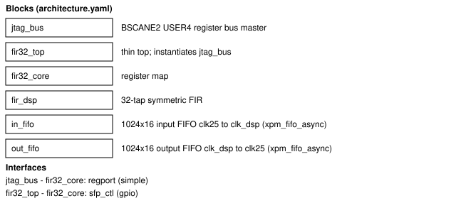

# p4_fir_dsp: 32-tap symmetric FIR filter with FIFOs on a JTAG register bus (KR260)

<!-- Generated from handover.yaml by flow/handover.py (brief 68). Edit handover.yaml, or the text between the prose markers, then run: python -m flow.handover write runs/20261126-105159-268e/p4_fir_dsp -->

The design is a 32-tap symmetric Q1.15 FIR low-pass filter. Samples are pushed into an input FIFO over a JTAG register bus on clk25, a RUN command filters them on a 250 MHz MMCM clock using 16 multipliers, and the results are read back from an output FIFO. The run got as far as the constraints stage, whose gates failed; synthesis and later stages did not run. Verification reached V2 of V3, and no resource, timing or power number was measured.

Not in scope:

- Not a runtime-programmable filter; the coefficients are fixed, symmetric and written into fir_dsp.sv.
- Not a streaming core; samples go in only through the IN_PUSH register and come out through OUT_POP.
- No transceiver is used (sfp_tx_disable is a constant output) and no hardware result exists for this design.

Kind: agent-run; produced by the agent (agent run `20261126-105159-268e`, [record](../summary.json)). State: simulated. For an agent: [AGENT.md](AGENT.md).

Run: model claude-sonnet-5-5 (deepagents harness), 10 loops, 169 turns, 6,832,515 tokens, 5605.5 s wall time, 6.91115 USD model cost (provider-reported), permission mode auto (12 distinct gated decisions listed in handover.yaml), stopped because: stage 2 visited more than 6 times; last failing gate: post_synth:post_synth_exceptions_clean (EXC-IGNORED position 3 Position=3 From=[get_clocks, report gate RPT-LL-02 timing_summary_synth.rpt:rst25_reg/C->u_core/u_rst_dsp/arststages_ff; the failure was in stage 3 constraints (visit 1), routed to stage 2 rtl-design-creation; stage 2 was refused before any gate ran (from the run record).

<!-- prose:what -->
<!-- /prose:what -->

## Technical parameters

| Item | Value |
|---|---|
| Part | `xck26-sfvc784-2LV-c` |
| Board | kr260 |
| Top | `fir32_top` |
| Tool | Vivado 2026.1 |

Clocks:

- `clk25`: 25 MHz (from `runs/20261126-105159-268e/p4_fir_dsp/design.xdc`)

Resets:

- `rst (internal, no pin)`, active high: fir32_top.sv builds rst25 from a 16-clock power-on counter and the MMCM lock, registered in clk25, and feeds it to jtag_bus and fir32_core (synchronous in clk25). It enters clk_dsp through xpm_cdc_async_rst, which asserts asynchronously. The spec says the design has no reset input and uses reprogram; the RTL has this internal reset.

Interfaces:

- `clk25` (input, 25 MHz board clock, pin C3 LVCMOS18): Constrained with a 40.00 ns period named sys_clk_pin in design.xdc.
- `led` (output [1:0], F8 (led[0]) and E8 (led[1]), LVCMOS18): fir32_top.sv drives led[0] with BUSY and led[1] with the synchronised MMCM lock. The XDC has a false path to both.
- `sfp_tx_disable` (output, pin Y10, LVCMOS33): Constant 1 (fir32_core.sv). The XDC has a false path to it.
- `h_we, h_re, h_addr, h_wdata, h_rdata` (internal register port to jtag_bus (no pins), 1, 1, 12, 32 and 32 bits): Runs on clk25. These signals are internal nets between jtag_bus and fir32_core, not top-level ports in fir32_top.sv.

Registers (from spec.yaml; where the RTL differs, the gaps say so):

| Offset | Name | Access | Reset | Bits |
|---|---|---|---|---|
| 0 | `ID` | RO | 546570241 | 31:0 design ID |
| 4 | `BUILD` | RO | 0 | 31:0 USR_ACCESS word |
| 8 | `SCRATCH` | RW | 0 | 31:0 scratch |
| 16 | `CTRL` | RW | 0 | 0 CLEAR self-clearing, 1 RUN self-clearing, 31:2 reserved 0 |
| 20 | `IN_PUSH` | WO | 0 | 15:0 sample pushed |
| 24 | `OUT_POP` | RO | 0 | 31 valid, 15:0 oldest output, read pops; 0 when empty |
| 28 | `STATUS` | RO | 0 | 0 BUSY, 15:4 input FIFO count, 31:20 output FIFO count, others 0 |
| 32 | `SAT_COUNT` | RO | 0 | 31:0 saturated outputs since CLEAR |
| 36 | `SAMPLES_DONE` | RO | 0 | 31:0 samples processed since CLEAR |

| Parameter | Value | Legal range | Note |
|---|---|---|---|
| `N_TAPS` | 32 | fixed at 32 | Not a Verilog parameter; the tap count is fixed in fir_dsp.sv, with taps paired by symmetry. |
| `N_MULT` | 16 | fixed at 16 (N_TAPS/2) | Not a Verilog parameter; fir_dsp.sv has 16 multipliers. The spec expects them in DSP slices, which no build has confirmed. |
| `DATA_WIDTH` | 16 | fixed at 16 | Signed input and output sample width, hard-coded in the RTL. |
| `COEF_WIDTH` | 16 | fixed at 16 | Signed Q1.15 coefficients; the 16 values are written into the coef function in fir_dsp.sv. |
| `ACC_WIDTH` | 38 | fixed at 38 | Exact sum plus the rounding constant, no intermediate rounding. |
| `FIFO_DEPTH` | 1024 | fixed at 1024 | Both FIFOs are distributed-memory xpm_fifo_async with depth 1024, not BRAM as the spec expected. |
| `SHIFT` | 15 | fixed at 15 | Arithmetic right shift before saturation. |
| `ROUND_CONST` | 16,384 | fixed at 16384 (2^(SHIFT-1)) | Added to the sum before the shift. |
| `DESIGN_ID` | 546,570,241 | fixed at 0x20940001 | Read from the ID register; a localparam in fir32_core.sv. |
| `SFP_TX_DISABLE_VALUE` | 1 | fixed at 1 | sfp_tx_disable is tied to 1 and there is no parameter. |

| Quantity | Value | Source |
|---|---|---|
| Resources | not measured | [Known gaps](#known-gaps-and-limits) |
| Timing | not measured | [Known gaps](#known-gaps-and-limits) |
| Power | not measured | [Known gaps](#known-gaps-and-limits) |
| Latency | not measured | [Known gaps](#known-gaps-and-limits) |
| Throughput | not measured | [Known gaps](#known-gaps-and-limits) |

<!-- prose:parameters -->
<!-- /prose:parameters -->

## How to build, run and reproduce

| Step | Command | Heavy slot | Time |
|---|---|---|---|
| what changed since this handover (stale records, changed files, tool and knowledge-bank pins) | `python -m flow.handover fresh runs/20261126-105159-268e/p4_fir_dsp` | no | - |
| pick the work up again from the earliest stage the change or the staleness needs; needs a model (see docs/agent.md); Vivado for any stage from synthesis on | `python -m agent resume runs/20261126-105159-268e/p4_fir_dsp "<change request>"` | yes | - |
| run the Verifier's simulation tests; needs Icarus Verilog and cocotb, or the simulation container | `python -m pytest -q runs/20261126-105159-268e/p4_fir_dsp/tests/test_p4_fir_dsp_rtl.py` | no | - |
| re-run the Verilator coverage simulation and the verification gates (line, toggle, functional and cover results); needs Verilator 5.036 or later and cocotb (the simulation container has them) | `SIM=verilator FDA_COVERAGE=1 FDA_SIM_RESULTS_DIR=runs/20261126-105159-268e/p4_fir_dsp/build/verif/sim python -m pytest -q -x runs/20261126-105159-268e/p4_fir_dsp/tests/test_p4_fir_dsp_rtl.py && python3 flow/verif_gates.py runs/20261126-105159-268e/p4_fir_dsp --runs runs/20261126-105159-268e/p4_fir_dsp/build/verif/sim` | no | - |
| rebuild the bitstream with the flow; needs Vivado 2026.1 and a heavy slot; peak memory 3532 MiB (anonymous, the systemd scope) | `flow/run_vivado.sh runs/20261126-105159-268e/p4_fir_dsp base` | yes | about 3.3 min |

Tool: Vivado 2026.1. Build ID of the inputs at handover: `0ce4163c` (`python flow/manifest.py show runs/20261126-105159-268e/p4_fir_dsp`: what a rebuild of today's sources and flow would carry; it changes when any build input or the flow changes, so it can differ from the build ID in an older evidence record). Knowledge-bank pin: `eaf6794`.

| File | What |
|---|---|
| [`runs/20261126-105159-268e/p4_fir_dsp/spec.md`](spec.md) | the request the run started from |
| [`runs/20261126-105159-268e/p4_fir_dsp/spec.yaml`](spec.yaml) | the specification the Clarifier wrote, approved automatically with no human review |
| [`runs/20261126-105159-268e/p4_fir_dsp/ARCHITECTURE.md`](ARCHITECTURE.md) | the architecture note, accepted automatically before any RTL (no human review) |
| [`runs/20261126-105159-268e/p4_fir_dsp/architecture.yaml`](architecture.yaml) | the machine-checked architecture: blocks, clocks, predicted resources |
| [`runs/20261126-105159-268e/p4_fir_dsp/rtl/a_lint_waivers.sv`](rtl/a_lint_waivers.sv) | RTL written by the Designer |
| [`runs/20261126-105159-268e/p4_fir_dsp/rtl/fir32_core.sv`](rtl/fir32_core.sv) | RTL written by the Designer |
| [`runs/20261126-105159-268e/p4_fir_dsp/rtl/fir32_top.sv`](rtl/fir32_top.sv) | RTL written by the Designer |
| [`runs/20261126-105159-268e/p4_fir_dsp/rtl/fir_dsp.sv`](rtl/fir_dsp.sv) | RTL written by the Designer |
| [`runs/20261126-105159-268e/p4_fir_dsp/rtl/xilinx_sim_stubs.sv`](rtl/xilinx_sim_stubs.sv) | RTL written by the Designer |
| [`runs/20261126-105159-268e/p4_fir_dsp/design.xdc`](design.xdc) | pin, I/O standard and timing constraints |
| [`runs/20261126-105159-268e/p4_fir_dsp/build.yaml`](build.yaml) | the build description read by the flow |
| [`runs/20261126-105159-268e/p4_fir_dsp/model.py`](model.py) | the Modeller's reference model of the visible behaviour |
| [`runs/20261126-105159-268e/p4_fir_dsp/tests/fir_bench.py`](tests/fir_bench.py) | the Verifier's cocotb benches and pytest entries |
| [`runs/20261126-105159-268e/p4_fir_dsp/tests/test_p4_fir_dsp_rtl.py`](tests/test_p4_fir_dsp_rtl.py) | the Verifier's cocotb benches and pytest entries |
| [`runs/20261126-105159-268e/p4_fir_dsp/verif/testplan.yaml`](verif/testplan.yaml) | the test plan and mutant list read by the verification gates |
| [`runs/20261126-105159-268e/p4_fir_dsp/verif/checkers/v_macros.svh`](verif/checkers/v_macros.svh) | bound assertion and cover checkers |
| [`runs/20261126-105159-268e/p4_fir_dsp/build/review/03_constraints.html`](build/review/03_constraints.html) | the review page of stage constraints: its exit gates and their failures at the last visit |

<!-- prose:build -->
<!-- /prose:build -->

## Verified

Requirement by requirement, with where each came from and its evidence: [REQUIREMENTS_REPORT.md](REQUIREMENTS_REPORT.md).

| ID | Activity | Result | What | Evidence | Conditions |
|---|---|---|---|---|---|
| E1 | review | partial | the specification and the architecture were approved automatically, with no human review (review off; the interview oracle claude-sonnet-5-5 only answered the interview questions); the interview asked 9 questions, 0 answered and 9 defaulted | [`runs/20261126-105159-268e/summary.json`](../summary.json) | - |
| E2 | simulation | partial | verification (flow/verif_gates.py) against the Modeller's reference model reached V2 of V3; the run asked for V2; V2 means simulation: seeded runs, a constrained-random test, bound assertions and formal tasks; V3 (coverage (line, toggle, functional bins, cover properties), three seeds and the mutation score) did not pass: functional bins pct 0.0 (0/0) (needs 100); cover properties pct 0.0 (needs 100); line pct not measured (needs 90); toggle pct not measured (needs 75); mutation score pct not measured (needs 80); cdc structure clean missing (needs no unsafe crossing); cdc injection clean missing (needs pass); no board result (V-HW) is recorded | [`runs/20261126-105159-268e/p4_fir_dsp/build/verif/verif_gates.json`](build/verif/verif_gates.json) | - |
| E3 | build | fail | Vivado base build; flow stages that ran: rtl, post_synth | [`runs/20261126-105159-268e/p4_fir_dsp/build/base/gates.json`](build/base/gates.json) | - |

Gates at handover: `clarify` pass, `board-and-device-planning` pass, `rtl-design-creation` pass, `constraints` fail, `synthesis` not-run, `implementation` not-run, `timing-closure` not-run, `power-closure` not-run, `drc-closure` not-run, `configuration-and-debug` not-run.

<!-- prose:verified -->
<!-- /prose:verified -->

## Measured

Every value is read from the record by `python -m flow.handover fill`, not typed.

| ID | What | Value | Runs | Source | Conditions |
|---|---|---|---|---|---|
| M1 | simulation seeds run | 3 | 1 | [`runs/20261126-105159-268e/p4_fir_dsp/build/verif/verif_gates.json`](build/verif/verif_gates.json) `stages.V3.checks.seeds_run.value` | Verilator coverage simulation of the RTL against the Modeller's model, every seed the bench ran |
| M2 | line coverage | not measured % | 1 | [`runs/20261126-105159-268e/p4_fir_dsp/build/verif/verif_gates.json`](build/verif/verif_gates.json) `stages.V3.checks.line_pct.value` | Verilator coverage simulation of the RTL against the Modeller's model, every seed the bench ran |
| M3 | toggle coverage | not measured % | 1 | [`runs/20261126-105159-268e/p4_fir_dsp/build/verif/verif_gates.json`](build/verif/verif_gates.json) `stages.V3.checks.toggle_pct.value` | Verilator coverage simulation of the RTL against the Modeller's model, every seed the bench ran |
| M4 | functional coverage bins hit | 0.0 (0/0) | 1 | [`runs/20261126-105159-268e/p4_fir_dsp/build/verif/verif_gates.json`](build/verif/verif_gates.json) `stages.V3.checks.functional_bins_pct.value` | Verilator coverage simulation of the RTL against the Modeller's model, every seed the bench ran |
| M5 | cover properties hit | 0.0 % | 1 | [`runs/20261126-105159-268e/p4_fir_dsp/build/verif/verif_gates.json`](build/verif/verif_gates.json) `stages.V3.checks.cover_properties_pct.value` | Verilator coverage simulation of the RTL against the Modeller's model, every seed the bench ran |
| M6 | model cost of the run, provider-reported | 6.91115 USD | 1 | [`runs/20261126-105159-268e/summary.json`](../summary.json) `cost_usd` | every role and the interview oracle, as the run summary records it |

<!-- prose:measured -->
<!-- /prose:measured -->

## Known gaps and limits

- **REQ-01**: REQ-01 has no passing evidence for every proof method: hardware (uart_tests) is pending: no bring-up result
- **REQ-02**: REQ-02 has no passing evidence for every proof method: hardware (uart_tests) is pending: no bring-up result
- **REQ-03**: REQ-03 has no passing evidence for every proof method: hardware (uart_tests) is pending: no bring-up result
- **REQ-04**: REQ-04 has no passing evidence for every proof method: hardware (uart_tests) is pending: no bring-up result
- **REQ-05**: REQ-05 has no passing evidence for every proof method: hardware (uart_tests) is pending: no bring-up result
- **REQ-06**: REQ-06 has no passing evidence for every proof method: hardware (uart_tests) is pending: no bring-up result
- **REQ-12**: REQ-12 has no passing evidence for every proof method: analysis (post_route:setup) is not run (the stage that makes this evidence did not run): gate post_route:setup = None
- **REQ-13**: REQ-13 has no passing evidence for every proof method: analysis (post_route:setup) is not run (the stage that makes this evidence did not run): gate post_route:setup = None
- **REQ-14**: REQ-14 has no passing evidence for every proof method: analysis (post_synth:post_synth_resources_in_range) is not run (the stage that makes this evidence did not run): gate post_synth:post_synth_resources_in_range = None
- **REQ-43**: REQ-43 has no passing evidence for every proof method: analysis (post_synth:post_synth_resources_in_range) is not run (the stage that makes this evidence did not run): gate post_synth:post_synth_resources_in_range = None
- **REQ-17**: REQ-17 has no passing evidence for every proof method: hardware (uart_tests) is pending: no bring-up result
- **REQ-20**: REQ-20 has no passing evidence for every proof method: hardware (uart_tests) is pending: no bring-up result
- **REQ-45**: REQ-45 has no passing evidence for every proof method: hardware (uart_tests) is pending: no bring-up result
- **REQ-44**: REQ-44 has no passing evidence for every proof method: hardware (uart_tests) is pending: no bring-up result
- **REQ-22**: REQ-22 has no passing evidence for every proof method: hardware (uart_tests) is pending: no bring-up result
- **REQ-33**: REQ-33 has no passing evidence for every proof method: hardware (uart_tests) is pending: no bring-up result
- **REQ-34**: REQ-34 has no passing evidence for every proof method: hardware (uart_tests) is pending: no bring-up result
- **REQ-28**: REQ-28 has no passing evidence for every proof method: analysis (post_synth:post_synth_resources_in_range) is not run (the stage that makes this evidence did not run): gate post_synth:post_synth_resources_in_range = None
- **REQ-29**: REQ-29 has no passing evidence for every proof method: analysis (post_synth:post_synth_resources_in_range) is not run (the stage that makes this evidence did not run): gate post_synth:post_synth_resources_in_range = None
- **REQ-30**: REQ-30 has no passing evidence for every proof method: analysis (post_synth:post_synth_resources_in_range) is not run (the stage that makes this evidence did not run): gate post_synth:post_synth_resources_in_range = None
- **REQ-31**: REQ-31 has no passing evidence for every proof method: analysis (post_route:setup) is not run (the stage that makes this evidence did not run): gate post_route:setup = None
- **REQ-37**: REQ-37 has no passing evidence for every proof method: analysis (post_route:setup) is not run (the stage that makes this evidence did not run): gate post_route:setup = None
- **REQ-38**: REQ-38 has no passing evidence for every proof method: analysis (post_route:setup) is not run (the stage that makes this evidence did not run): gate post_route:setup = None
- **E1**: review evidence is partial: the specification and the architecture were approved automatically, with no human review (review off; the interview oracle claude-sonnet-5-5 only answered the interview questions); the interview asked 9 questions, 0 answered and 9 defaulted
- **E2**: simulation evidence is partial: verification reached V2 of V3 (the run asked for V2); the checks that did not pass or did not run are listed in the evidence row
- **E3**: build evidence is fail: Vivado base build; flow stages that ran: rtl, post_synth
- **constraints**: stage constraints did not pass its gates in this run; at its last visit: post_synth:post_synth_exceptions_clean (EXC-IGNORED position 3 Position=3 From=[get_clocks usr_cclk] Through=* To=* Setup=false Hold=false Status=Totally overridden path by FP 7) FAIL report gate RPT-LL-02 timing_summary_synth.rpt:rst25_reg/C->u_core/u_rst_dsp/arststages_ff_reg[0]/PRE: setup path rst25_reg/C to u_core/u_rst_dsp/arststages_ff_reg[0]/PRE (sys_clk_pin, requirement 0.0 ns) has slack - ...
- **synthesis**: stage synthesis was not run: the run stopped before this stage (stage 2 visited more than 6 times; last failing gate: post_synth:post_synth_exceptions_clean (EXC-IGNORED position 3 Position=3 From=[get_clocks, report gate RPT-LL-02 timing_summary_synth.rpt:rst25_reg/C->u_core/u_rst_dsp/arststages_ff; the failure was in stage 3 constraints (visit 1), routed to stage 2 rtl-design-creation; stage 2 was refused before any gate ran)
- **implementation**: stage implementation was not run: the run stopped before this stage (stage 2 visited more than 6 times; last failing gate: post_synth:post_synth_exceptions_clean (EXC-IGNORED position 3 Position=3 From=[get_clocks, report gate RPT-LL-02 timing_summary_synth.rpt:rst25_reg/C->u_core/u_rst_dsp/arststages_ff; the failure was in stage 3 constraints (visit 1), routed to stage 2 rtl-design-creation; stage 2 was refused before any gate ran)
- **timing-closure**: stage timing-closure was not run: the run stopped before this stage (stage 2 visited more than 6 times; last failing gate: post_synth:post_synth_exceptions_clean (EXC-IGNORED position 3 Position=3 From=[get_clocks, report gate RPT-LL-02 timing_summary_synth.rpt:rst25_reg/C->u_core/u_rst_dsp/arststages_ff; the failure was in stage 3 constraints (visit 1), routed to stage 2 rtl-design-creation; stage 2 was refused before any gate ran)
- **power-closure**: stage power-closure was not run: the run stopped before this stage (stage 2 visited more than 6 times; last failing gate: post_synth:post_synth_exceptions_clean (EXC-IGNORED position 3 Position=3 From=[get_clocks, report gate RPT-LL-02 timing_summary_synth.rpt:rst25_reg/C->u_core/u_rst_dsp/arststages_ff; the failure was in stage 3 constraints (visit 1), routed to stage 2 rtl-design-creation; stage 2 was refused before any gate ran)
- **drc-closure**: stage drc-closure was not run: the run stopped before this stage (stage 2 visited more than 6 times; last failing gate: post_synth:post_synth_exceptions_clean (EXC-IGNORED position 3 Position=3 From=[get_clocks, report gate RPT-LL-02 timing_summary_synth.rpt:rst25_reg/C->u_core/u_rst_dsp/arststages_ff; the failure was in stage 3 constraints (visit 1), routed to stage 2 rtl-design-creation; stage 2 was refused before any gate ran)
- **configuration-and-debug**: stage configuration-and-debug was not run: the run stopped before this stage (stage 2 visited more than 6 times; last failing gate: post_synth:post_synth_exceptions_clean (EXC-IGNORED position 3 Position=3 From=[get_clocks, report gate RPT-LL-02 timing_summary_synth.rpt:rst25_reg/C->u_core/u_rst_dsp/arststages_ff; the failure was in stage 3 constraints (visit 1), routed to stage 2 rtl-design-creation; stage 2 was refused before any gate ran)
- **formal**: formal checks were planned for REQ-09, REQ-10, REQ-15, REQ-42, REQ-25, REQ-26, REQ-35, REQ-27, REQ-36, REQ-28 and did not run; each was replaced by a simulation check (verif/testplan.yaml replan). Reason recorded: SymbiYosys is not installed so bit-exact comparison against the model covers the exact sum.
- **resources**: resources not measured: no current Vivado build of this design has been recorded
- **timing**: timing not measured: no current Vivado build of this design has been recorded
- **power**: power not measured: no current Vivado build of this design has been recorded
- **latency**: latency not measured: the run measured no latency; the spec's latency promise is checked only by the benches
- **throughput**: throughput not measured: the run measured no throughput
- **coverage_vs_cover**: The V3 record shows functional bins 0/0 and cover properties at 0.0 while line and toggle coverage were not measured, so these results say nothing about hit bins. Compare the cover results with the functional coverage before any new stimulus.
- **reset_model**: The spec says the design has no reset input and every reset is a reprogram. The RTL has an internal active-high rst (fir32_top.sv, a power-on counter plus MMCM lock) and clears state on it. Spec.yaml also names a reset "rst" with a port-like description, which is not a pin.
- **reset_failing_path**: The failing constraints gate reports a setup path from rst25_reg to the PRE pin of the xpm_cdc_async_rst flops in u_rst_dsp (timing_summary_synth.rpt), and an overridden exception on usr_cclk. design.xdc has no clock for the USR_ACCESSE2 CFGCLK domain. Neither is fixed.
- **build_register**: BUILD reads 0 in simulation because the USR_ACCESSE2 stub in xilinx_sim_stubs.sv returns 0. In fir32_core.sv it passes through a 2-stage xpm_cdc_array_single with a source clock tied to 0.
- **reset_values**: On rst, fir32_core.sv clears scratch, the counters, h_rdata and the push buffer to 0. ID reads 0x20940001 whatever the reset state.
- **unmapped_access**: In fir32_core.sv a read of an unmapped address returns 0 and a write to one changes nothing. Writes to ID, BUILD, STATUS, OUT_POP, SAT_COUNT and SAMPLES_DONE have no effect. Reads of IN_PUSH and CTRL return 0 (default branch).
- **ctrl_priority**: A CTRL write with bit 0 set runs CLEAR only; bit 1 (RUN) is ignored in that write. RUN is also ignored while BUSY is 1 or when the input FIFO is empty. CLEAR is not instant: it resets the input FIFO for 4 clocks and holds OUT_POP and the STATUS output count at 0 for 8 clk25 clocks, and the output FIFO is reset for 16 clk_dsp clocks. OUT_POP reads 0 and does not pop during this window.
- **out_pop_read**: OUT_POP pops only on an h_re when the FIFO is not empty and not in reset. h_rdata is registered, so it shows the value on the clock after h_re (one clk25 cycle), within the spec's limit of 2. It holds until the next h_re.
- **in_push_buffer**: The IN_PUSH writes are accepted when STATUS-visible input count (FIFO plus a 4-entry holding buffer) is below 1024, otherwise ignored. The holding buffer covers an FIFO reset or busy window. STATUS input count is the sum of the FIFO count and the buffer.
- **busy_sample_push**: Pushes while BUSY are accepted and wait for the next RUN, since RUN takes only the count present at the start. The assumption was defaulted; no one confirmed it.
- **counters_wrap**: SAT_COUNT and SAMPLES_DONE are 32-bit and wrap. They reach clk25 by a 64-bit handshake sent only when a run ends, so they are stale during a run.
- **filter_latency**: Counted from fir_dsp.sv: history register, pre-add, multiply, 4-way sum, 2-way sum, final sum and shift/saturate give out_valid 6 clk_dsp cycles after in_valid, plus 1 clock for the history register, so about 7 stages. The spec promised about 10 to 12. The run measured none of this.
- **fifo_memory**: Both FIFOs are FIFO_MEMORY_TYPE distributed in fir32_core.sv; the spec expected BRAM (2 BRAM36). Resource predictions in ARCHITECTURE.md do not match this.
- **mmcm_math**: The ARCHITECTURE.md clock plan text is garbled; fir32_top.sv sets CLKFBOUT_MULT_F 40 and CLKOUT0_DIVIDE_F 4 (VCO 1000 MHz, output 250 MHz). design.xdc defines only the clk25 clock; the MMCM output is auto-derived.
- **led_order**: ARCHITECTURE.md says led[1] is MMCM locked and led[0] is BUSY; fir32_top.sv drives led = {locked25, busy}, which matches. fir32_core.sv drives its own led as {1, busy25}, which the top ignores except for bit 0.
- **sim_stubs**: In simulation the MMCM stub outputs a constant 0 clock (CLKOUT0 = 0) in xilinx_sim_stubs.sv, so the benches must drive clk_dsp another way. How the benches do this was not checked here.
- **unseen_inputs**: spec.yaml says data/jtag_bus.sv and data/coeffs.hex were not visible when the spec was written. The coefficients in fir_dsp.sv are inlined; whether they match data/coeffs.hex was not checked.

<!-- prose:gaps -->
<!-- /prose:gaps -->

## Assumptions you did not confirm

The agent settled these questions with its own default (nobody answered, or the answer was waived). A passing test shows the design matches the assumption, not that the assumption is what you want. Check the high-risk rows first.

| Risk | Question | The design used | How it was settled |
|---|---|---|---|
| high | What is the register map (offset, width, reset value and access of every register)? | The map given in spec.md: ID 0x000, BUILD 0x004, SCRATCH 0x008, CTRL 0x010, IN_PUSH 0x014, OUT_POP 0x018, STATUS 0x01C, SAT_COUNT 0x020, SAMPLES_DONE 0x024, all 32 bits, resets 0 except ID. | defaulted: nobody answered |
| high | What happens if RUN is written while BUSY is 1? | The write is ignored. | defaulted: nobody answered |
| high | What happens when IN_PUSH is written while BUSY is 1? | The sample is accepted if the FIFO is not full, and is processed by the next RUN. | defaulted: nobody answered |
| high | Do SAT_COUNT and SAMPLES_DONE wrap or saturate at 2^32? | They wrap. | defaulted: nobody answered |
| high | Is the 250 MHz clock a target or may a faster one such as 300 MHz be used? | 250 MHz exactly from the MMCM. | defaulted: nobody answered |
| high | Does the BUILD register read 0 in simulation? | Yes, the USR_ACCESSE2 primitive is replaced by a 0 constant (or a testbench word). | defaulted: nobody answered |
| high | This design has no reset input. Is every reset a reconfiguration of the FPGA (the device is reprogrammed, so every register starts from its initial value), or does something restart the running design (then it needs a reset input)? | Every reset is a reconfiguration of the FPGA (reset model: reprogram): registers get initial values, control state included, and the design has no reset input. Record it in spec.yaml as reset: {model: reprogram}; a design that restarts while it runs is reset: {model: reset} with a reset port. | defaulted: nobody answered |
| medium | What happens when the output FIFO is full during a run? | The run is limited so it never overflows: processing stalls until the output FIFO has room (no result is lost). | defaulted: nobody answered |
| medium | What do led[1:0] show? | led[0] = BUSY, led[1] = MMCM locked. | defaulted: nobody answered |

## Next steps

1. Fix the earliest failing stage, constraints: clear the post_synth_exceptions_clean and RPT-LL-02 failures on the rst25 to u_rst_dsp path and the usr_cclk exception (see reset_failing_path), then re-run the base build.
2. Compare the cover results with the functional coverage (0/0 bins, 0.0 cover) before any new stimulus; then re-run the Verilator coverage command and the verification gates to reach V3.
3. When the flow reaches the build again, re-measure resources, timing, power and latency with python -m agent resume.
4. Bring the spec in line with the RTL on reset model, FIFO memory type and latency, or change the RTL to match it.
5. Run hardware bring-up for the requirements that name it.

Open questions:

- Does data/coeffs.hex match the coefficients written in fir_dsp.sv?
- Should the design keep an internal reset, or follow the spec and use reprogram only?
- Should RUN while BUSY and IN_PUSH while BUSY keep the defaulted behaviour (ignore RUN, accept pushes)?

<!-- prose:next -->
<!-- /prose:next -->

## History

| Date | Brief | PR | What |
|---|---|---|---|
| 2026-11-26 | agent run | - | produced by the agent graph; stages that passed: clarify, board-and-device-planning, rtl-design-creation |

<!-- prose:history -->
<!-- /prose:history -->
