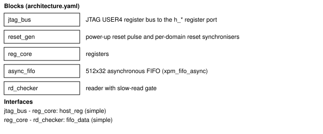
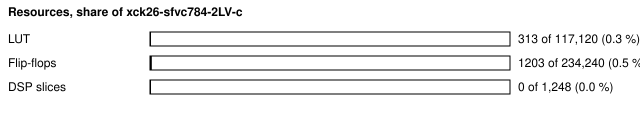
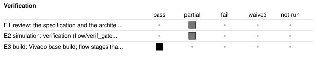

# p5_async_fifo: Asynchronous FIFO soak with PRBS-31 (25 MHz writer, 156.25 MHz reader)

<!-- Generated from handover.yaml by flow/handover.py (brief 68). Edit handover.yaml, or the text between the prose markers, then run: python -m flow.handover write runs/20261126-164034-895f/p5_async_fifo -->

The design writes a PRBS-31 word stream into a 512 x 32 asynchronous FIFO in the 25 MHz clk_wr domain. A reader in the 156.25 MHz clk_rd domain checks each word against its own PRBS-31 copy and counts errors. A JTAG register port exposes control, snapshot counters and an ID. The run reached a routed bitstream on the KR260 with the timing, power and DRC stages passing. Verification reached V2 of V3, and the bring-up on the board has not been run.

Not in scope:

- It is not a transceiver design. No GT channel is used, and the SFP+ reference clock is only a 156.25 MHz fabric clock source.
- It does not drive the SFP+ laser, because sfp_tx_disable is held at 1.
- It has no reset input; every reset is a reconfiguration of the FPGA, and the top runs a power-up reset generator.
- It is not a throughput or latency benchmark; neither was measured.

Kind: agent-run; produced by the agent (agent run `20261126-164034-895f`, [record](../summary.json)). State: built. For an agent: [AGENT.md](AGENT.md).

Run: model claude-sonnet-5-5 (deepagents harness), 4 loops, 171 turns, 6,790,952 tokens, 4372.6 s wall time, 5.58428 USD model cost (provider-reported), permission mode auto (36 distinct gated decisions listed in handover.yaml), stopped because: paused: awaiting the owner's approval to program the board (stage 9) (from the run record).

<!-- prose:what -->
<!-- /prose:what -->

## Technical parameters

| Item | Value |
|---|---|
| Part | `xck26-sfvc784-2LV-c` |
| Board | kr260 |
| Top | `p5_async_fifo_soak` |
| Tool | Vivado 2026.1 |

Clocks:

- `clk_c3`: 25 MHz (from `runs/20261126-164034-895f/p5_async_fifo/design.xdc`)

Resets:

- `rst (internal)`, active high: Not a port. The top holds it for 16 clk_wr clocks from initial values (p5_async_fifo_soak.sv), then xpm_cdc_async_rst (4 stages) gives each domain its own reset. The spec says it comes from jtag_bus, but the RTL generates it in the top; jtag_bus gets a registered copy, rst_j.

Interfaces:

- `clk_c3` (input clock, 25 MHz, pin C3 LVCMOS18): Drives clk_wr through a BUFG; the writer, jtag_bus and registers run on it.
- `gt_refclk_p / gt_refclk_n` (differential input clock, 156.25 MHz, SFP+ MGTREFCLK0): IBUFDS_GTE4 then BUFG_GT gives clk_rd. design.xdc does not redefine the clock; the flow creates it. The spec and ARCHITECTURE.md say IBUFDS_GTE2/BUFG, and the RTL uses GTE4 and BUFG_GT.
- `led` (output, 2 bits, pins F8 (led[0]) and E8 (led[1]) LVCMOS18): led[0] = RUN. led[1] = reader error flag (DATA_ERRS or UNDERFLOWS nonzero, through a CDC) OR OVERFLOWS nonzero (soak_core.sv).
- `sfp_tx_disable` (output, 1 bit, pin Y10 LVCMOS33): Constant 1 (laser off).
- `JTAG register port (internal)` (jtag_bus h_we, h_re, h_addr[11:0], h_wdata, h_rdata on clk_wr): Register map is in the registers list. Not a top-level port.

Registers (from spec.yaml; where the RTL differs, the gaps say so):

| Offset | Name | Access | Reset | Bits |
|---|---|---|---|---|
| 0 | `ID` | RO | 546635777 | 31:0 design ID |
| 4 | `BUILD` | RO | 0 | 31:0 USR_ACCESS word from USR_ACCESSE2 |
| 8 | `SCRATCH` | RW | 0 | 31:0 read-back |
| 16 | `CTRL` | RW | 0 | 0 RUN, 1 SLOW_READ, 2 CLEAR (self-clearing, only while RUN 0), 3 INJECT (self-clearing) |
| 20 | `WORDS_W` | RO | 0 | 31:0 words written (snapshot) |
| 24 | `WORDS_R` | RO | 0 | 31:0 words read and checked (snapshot) |
| 28 | `DATA_ERRS` | RO | 0 | 31:0 mismatching words (snapshot) |
| 32 | `OVERFLOWS` | RO | 0 | 31:0 (snapshot) |
| 36 | `UNDERFLOWS` | RO | 0 | 31:0 (snapshot) |
| 40 | `STALL_W` | RO | 0 | 31:0 writer clocks held off by full (snapshot) |
| 44 | `OCC_MAX` | RO | 0 | 9:0 highest fill in words (snapshot) |
| 48 | `SNAPSHOT` | WO | 0 | any write latches 0x014 to 0x02C; reads 0 |

| Parameter | Value | Legal range | Note |
|---|---|---|---|
| `FIFO_DEPTH_WORDS` | 512 | 512 only | Fixed by the RTL (9-bit addresses, 10-bit pointers); not a module parameter. The spec gives a write rate of 25 Mword/s. |
| `DATA_WIDTH_BITS` | 32 | 32 only | Fixed in the RTL (PRBS word and FIFO width); not a module parameter. |
| `PRBS_SEED` | 2,147,483,647 | nonzero 31-bit value | Seed 0x7FFFFFFF for both PRBS copies; a zero seed would lock the generator. |
| `SLOW_READ_PERIOD_CYCLES` | 8 | 2 or more | With SLOW_READ set the reader takes at most one word per this many clk_rd clocks, 19.53 Mword/s per the spec. The benches ran at this value. |
| `DESIGN_ID` | 546,635,777 | any 32-bit value | Read at offset 0 (0x20950001). |
| `COUNTER_WIDTH_BITS` | 32 | 32 as built and verified | Counter width; the spec requires 32 and counters wrap. Other widths were not checked. |

| Quantity | Value | Source |
|---|---|---|
| Resources | slice LUTs used: 313; flip-flops used: 1203; block RAM tiles used: 0.5; DSP slices used: 0 | M8, M9, M10, M11 |
| Timing | worst setup slack after routing: 2.447 ns; worst hold slack after routing: 0.014 ns | M6, M7 |
| Power | total on-chip power, vectorless estimate: 0.367 W | M12 |
| Latency | not measured | [Known gaps](#known-gaps-and-limits) |
| Throughput | not measured | [Known gaps](#known-gaps-and-limits) |

<!-- prose:parameters -->
<!-- /prose:parameters -->

## How to build, run and reproduce

| Step | Command | Heavy slot | Time |
|---|---|---|---|
| what changed since this handover (stale records, changed files, tool and knowledge-bank pins) | `python -m flow.handover fresh runs/20261126-164034-895f/p5_async_fifo` | no | - |
| pick the work up again from the earliest stage the change or the staleness needs; needs a model (see docs/agent.md); Vivado for any stage from synthesis on | `python -m agent resume runs/20261126-164034-895f/p5_async_fifo "<change request>"` | yes | - |
| run the Verifier's simulation tests; needs Icarus Verilog and cocotb, or the simulation container | `python -m pytest -q runs/20261126-164034-895f/p5_async_fifo/tests/test_p5_async_fifo_rtl.py` | no | - |
| re-run the Verilator coverage simulation and the verification gates (line, toggle, functional and cover results); needs Verilator 5.036 or later and cocotb (the simulation container has them) | `SIM=verilator FDA_COVERAGE=1 FDA_SIM_RESULTS_DIR=runs/20261126-164034-895f/p5_async_fifo/build/verif/sim python -m pytest -q -x runs/20261126-164034-895f/p5_async_fifo/tests/test_p5_async_fifo_rtl.py && python3 flow/verif_gates.py runs/20261126-164034-895f/p5_async_fifo --runs runs/20261126-164034-895f/p5_async_fifo/build/verif/sim` | no | - |
| rebuild the bitstream with the flow; needs Vivado 2026.1 and a heavy slot; peak memory 3485 MiB (anonymous, the systemd scope) | `flow/run_vivado.sh runs/20261126-164034-895f/p5_async_fifo base` | yes | about 5.2 min |

Tool: Vivado 2026.1. Build ID of the inputs at handover: `15952a5f` (`python flow/manifest.py show runs/20261126-164034-895f/p5_async_fifo`: what a rebuild of today's sources and flow would carry; it changes when any build input or the flow changes, so it can differ from the build ID in an older evidence record). Knowledge-bank pin: `eaf6794`.

| File | What |
|---|---|
| [`runs/20261126-164034-895f/p5_async_fifo/spec.md`](spec.md) | the request the run started from |
| [`runs/20261126-164034-895f/p5_async_fifo/spec.yaml`](spec.yaml) | the specification the Clarifier wrote, approved automatically with no human review |
| [`runs/20261126-164034-895f/p5_async_fifo/ARCHITECTURE.md`](ARCHITECTURE.md) | the architecture note, accepted automatically before any RTL (no human review) |
| [`runs/20261126-164034-895f/p5_async_fifo/architecture.yaml`](architecture.yaml) | the machine-checked architecture: blocks, clocks, predicted resources |
| [`runs/20261126-164034-895f/p5_async_fifo/rtl/p5_async_fifo_mem.sv`](rtl/p5_async_fifo_mem.sv) | RTL written by the Designer |
| [`runs/20261126-164034-895f/p5_async_fifo/rtl/p5_async_fifo_prbs.sv`](rtl/p5_async_fifo_prbs.sv) | RTL written by the Designer |
| [`runs/20261126-164034-895f/p5_async_fifo/rtl/p5_async_fifo_rd.sv`](rtl/p5_async_fifo_rd.sv) | RTL written by the Designer |
| [`runs/20261126-164034-895f/p5_async_fifo/rtl/p5_async_fifo_reset.sv`](rtl/p5_async_fifo_reset.sv) | RTL written by the Designer |
| [`runs/20261126-164034-895f/p5_async_fifo/rtl/p5_async_fifo_soak.sv`](rtl/p5_async_fifo_soak.sv) | RTL written by the Designer |
| [`runs/20261126-164034-895f/p5_async_fifo/rtl/p5_async_fifo_soak_core.sv`](rtl/p5_async_fifo_soak_core.sv) | RTL written by the Designer |
| [`runs/20261126-164034-895f/p5_async_fifo/rtl/p5_async_fifo_xing.sv`](rtl/p5_async_fifo_xing.sv) | RTL written by the Designer |
| [`runs/20261126-164034-895f/p5_async_fifo/rtl/xilinx_sim_stubs.sv`](rtl/xilinx_sim_stubs.sv) | RTL written by the Designer |
| [`runs/20261126-164034-895f/p5_async_fifo/design.xdc`](design.xdc) | pin, I/O standard and timing constraints |
| [`runs/20261126-164034-895f/p5_async_fifo/build.yaml`](build.yaml) | the build description read by the flow |
| [`runs/20261126-164034-895f/p5_async_fifo/model.py`](model.py) | the Modeller's reference model of the visible behaviour |
| [`runs/20261126-164034-895f/p5_async_fifo/tests/p5_async_fifo_bench.py`](tests/p5_async_fifo_bench.py) | the Verifier's cocotb benches and pytest entries |
| [`runs/20261126-164034-895f/p5_async_fifo/tests/test_p5_async_fifo_hw.py`](tests/test_p5_async_fifo_hw.py) | the Verifier's cocotb benches and pytest entries |
| [`runs/20261126-164034-895f/p5_async_fifo/tests/test_p5_async_fifo_rtl.py`](tests/test_p5_async_fifo_rtl.py) | the Verifier's cocotb benches and pytest entries |
| [`runs/20261126-164034-895f/p5_async_fifo/verif/testplan.yaml`](verif/testplan.yaml) | the test plan and mutant list read by the verification gates |
| [`runs/20261126-164034-895f/p5_async_fifo/verif/checkers/v_macros.svh`](verif/checkers/v_macros.svh) | bound assertion and cover checkers |
| [`runs/20261126-164034-895f/p5_async_fifo/hw_checks.py`](hw_checks.py) | the ILA capture checks for bring-up |
| [`runs/20261126-164034-895f/p5_async_fifo/BRINGUP.md`](BRINGUP.md) | the bring-up procedure for a tester |

<!-- prose:build -->
<!-- /prose:build -->

## Verified

Requirement by requirement, with where each came from and its evidence: [REQUIREMENTS_REPORT.md](REQUIREMENTS_REPORT.md).

| ID | Activity | Result | What | Evidence | Conditions |
|---|---|---|---|---|---|
| E1 | review | partial | the specification and the architecture were approved automatically, with no human review (review off; the interview oracle claude-sonnet-5-5 only answered the interview questions); the interview asked 8 questions, 0 answered and 8 defaulted | [`runs/20261126-164034-895f/summary.json`](../summary.json) | - |
| E2 | simulation | partial | verification (flow/verif_gates.py) against the Modeller's reference model reached V2 of V3; the run asked for V2; V2 means simulation: seeded runs, a constrained-random test, bound assertions and formal tasks; V3 (coverage (line, toggle, functional bins, cover properties), three seeds and the mutation score) did not pass: functional bins pct 0.0 (0/0) (needs 100); cover properties pct 0.0 (needs 100); line pct not measured (needs 90); toggle pct not measured (needs 75); mutation score pct not measured (needs 70); cdc structure clean missing (needs no unsafe crossing); cdc injection clean missing (needs pass); no board result (V-HW) is recorded | [`runs/20261126-164034-895f/p5_async_fifo/build/verif/verif_gates.json`](build/verif/verif_gates.json) | - |
| E3 | build | pass | Vivado base build; flow stages that ran: rtl, post_synth, post_place, post_route, bitstream | [`runs/20261126-164034-895f/p5_async_fifo/build/base/gates.json`](build/base/gates.json) | - |

Gates at handover: `clarify` pass, `board-and-device-planning` pass, `rtl-design-creation` pass, `constraints` pass, `synthesis` pass, `implementation` pass, `timing-closure` pass, `power-closure` pass, `drc-closure` pass, `configuration-and-debug` not-run.

<!-- prose:verified -->
<!-- /prose:verified -->

## Measured

Every value is read from the record by `python -m flow.handover fill`, not typed.

| ID | What | Value | Runs | Source | Conditions |
|---|---|---|---|---|---|
| M1 | simulation seeds run | 3 | 1 | [`runs/20261126-164034-895f/p5_async_fifo/build/verif/verif_gates.json`](build/verif/verif_gates.json) `stages.V3.checks.seeds_run.value` | Verilator coverage simulation of the RTL against the Modeller's model, every seed the bench ran |
| M2 | line coverage | not measured % | 1 | [`runs/20261126-164034-895f/p5_async_fifo/build/verif/verif_gates.json`](build/verif/verif_gates.json) `stages.V3.checks.line_pct.value` | Verilator coverage simulation of the RTL against the Modeller's model, every seed the bench ran |
| M3 | toggle coverage | not measured % | 1 | [`runs/20261126-164034-895f/p5_async_fifo/build/verif/verif_gates.json`](build/verif/verif_gates.json) `stages.V3.checks.toggle_pct.value` | Verilator coverage simulation of the RTL against the Modeller's model, every seed the bench ran |
| M4 | functional coverage bins hit | 0.0 (0/0) | 1 | [`runs/20261126-164034-895f/p5_async_fifo/build/verif/verif_gates.json`](build/verif/verif_gates.json) `stages.V3.checks.functional_bins_pct.value` | Verilator coverage simulation of the RTL against the Modeller's model, every seed the bench ran |
| M5 | cover properties hit | 0.0 % | 1 | [`runs/20261126-164034-895f/p5_async_fifo/build/verif/verif_gates.json`](build/verif/verif_gates.json) `stages.V3.checks.cover_properties_pct.value` | Verilator coverage simulation of the RTL against the Modeller's model, every seed the bench ran |
| M6 | worst setup slack after routing | 2.447 ns | 1 | [`runs/20261126-164034-895f/p5_async_fifo/build/base/gates.json`](build/base/gates.json) `timing.wns_ns` | post-route, the constrained clock of design.xdc |
| M7 | worst hold slack after routing | 0.014 ns | 1 | [`runs/20261126-164034-895f/p5_async_fifo/build/base/gates.json`](build/base/gates.json) `timing.whs_ns` | post-route |
| M8 | slice LUTs used | 313 | 1 | [`runs/20261126-164034-895f/p5_async_fifo/build/base/gates.json`](build/base/gates.json) `utilization.lut` | post-route utilization |
| M9 | flip-flops used | 1203 | 1 | [`runs/20261126-164034-895f/p5_async_fifo/build/base/gates.json`](build/base/gates.json) `utilization.ff` | post-route utilization |
| M10 | block RAM tiles used | 0.5 | 1 | [`runs/20261126-164034-895f/p5_async_fifo/build/base/gates.json`](build/base/gates.json) `utilization.bram_tile` | post-route utilization |
| M11 | DSP slices used | 0 | 1 | [`runs/20261126-164034-895f/p5_async_fifo/build/base/gates.json`](build/base/gates.json) `utilization.dsp` | post-route utilization |
| M12 | total on-chip power, vectorless estimate | 0.367 W | 1 | [`runs/20261126-164034-895f/p5_async_fifo/build/base/gates.json`](build/base/gates.json) `power.total_w` | report_power, vectorless (no switching activity file), default environment |
| M13 | model cost of the run, provider-reported | 5.58428 USD | 1 | [`runs/20261126-164034-895f/summary.json`](../summary.json) `cost_usd` | every role and the interview oracle, as the run summary records it |

<!-- prose:measured -->
<!-- /prose:measured -->

## Known gaps and limits

- **REQ-02**: REQ-02 has no passing evidence for every proof method: hardware (uart_tests) is pending: no bring-up result
- **REQ-03**: REQ-03 has no passing evidence for every proof method: hardware (uart_tests) is pending: no bring-up result
- **REQ-06**: REQ-06 has no passing evidence for every proof method: hardware (uart_tests) is pending: no bring-up result
- **REQ-09**: REQ-09 has no passing evidence for every proof method: analysis (post_synth:post_synth_resources_in_range) is pending: no flow gates result
- **REQ-10**: REQ-10 has no passing evidence for every proof method: hardware (uart_tests) is pending: no bring-up result
- **REQ-11**: REQ-11 has no passing evidence for every proof method: hardware (uart_tests) is pending: no bring-up result
- **REQ-12**: REQ-12 has no passing evidence for every proof method: hardware (uart_tests) is pending: no bring-up result
- **REQ-14**: REQ-14 has no passing evidence for every proof method: hardware (uart_tests) is pending: no bring-up result
- **REQ-15**: REQ-15 has no passing evidence for every proof method: hardware (uart_tests) is pending: no bring-up result
- **REQ-23**: REQ-23 has no passing evidence for every proof method: hardware (ila_captures) is pending: no bring-up result
- **REQ-24**: REQ-24 has no passing evidence for every proof method: hardware (uart_tests) is pending: no bring-up result
- **REQ-25**: REQ-25 has no passing evidence for every proof method: analysis (post_synth:post_synth_resources_in_range) is pending: no flow gates result
- **REQ-26**: REQ-26 has no passing evidence for every proof method: analysis (post_route:setup) is pending: no flow gates result
- **REQ-27**: REQ-27 has no passing evidence for every proof method: analysis (post_route:setup) is pending: no flow gates result
- **REQ-28**: REQ-28 has no passing evidence for every proof method: analysis (post_synth:post_synth_resources_in_range) is pending: no flow gates result
- **REQ-29**: REQ-29 has no passing evidence for every proof method: hardware (uart_tests) is pending: no bring-up result
- **REQ-33**: REQ-33 has no passing evidence for every proof method: hardware (uart_tests) is pending: no bring-up result
- **REQ-35**: REQ-35 has no passing evidence for every proof method: analysis (post_route:setup) is pending: no flow gates result
- **E1**: review evidence is partial: the specification and the architecture were approved automatically, with no human review (review off; the interview oracle claude-sonnet-5-5 only answered the interview questions); the interview asked 8 questions, 0 answered and 8 defaulted
- **E2**: simulation evidence is partial: verification reached V2 of V3 (the run asked for V2); the checks that did not pass or did not run are listed in the evidence row
- **configuration-and-debug**: stage configuration-and-debug was not run: the run stopped before this stage (paused: awaiting the owner's approval to program the board (stage 9))
- **formal**: formal checks were planned for REQ-10, REQ-11, REQ-20, REQ-21, REQ-32 and did not run; each was replaced by a simulation check (verif/testplan.yaml replan). Reason recorded: SymbiYosys is not installed, so the no-overflow property is checked by constrained-random and directed simulation against the model.
- **latency**: latency not measured: the run measured no latency; the spec's latency promise is checked only by the benches
- **throughput**: throughput not measured: the run measured no throughput
- **cover-vs-functional**: The V3 record shows functional bins 0 of 0 and cover properties 0.0 percent, with line, toggle and mutation not measured. The cover results and the functional coverage do not agree and must be compared before new stimulus.
- **reset-source**: spec.yaml says rst comes from jtag_bus; p5_async_fifo_soak.sv generates it from a 16-clock power-up counter and no reset input exists. The RTL is what was built.
- **reset-values**: All registers reset to 0 as in the map. Snapshot registers read 0 until the first SNAPSHOT write (assumption, defaulted). SCRATCH and CTRL return to 0 only on reconfiguration or the power-up reset.
- **unmapped-access**: Reads of unmapped or reserved addresses return 0 (default branch in soak_core.sv; 0x00C, 0x03C etc.). Writes to unmapped addresses change nothing. SNAPSHOT (0x030) reads 0, since it has no read case.
- **read-latency**: In p5_async_fifo_soak_core.sv h_rdata is registered on h_re, so it shows the addressed value one clk_wr clock after h_re and holds it until the next h_re. This is inside the spec's 2-clock promise. Register writes also take effect one clock after h_we.
- **ctrl-read-layout**: CTRL reads back bit 0 RUN, bit 1 SLOW_READ, bit 3 INJECT pending, bit 2 always 0. Every CTRL write replaces RUN and SLOW_READ with bits 0 and 1 of the data.
- **clear-behaviour**: CLEAR is tested against the old RUN value (the RTL checks !run before the same write updates it), so writing RUN=1 and CLEAR=1 together still clears. CLEAR holds the writer in reset for 10 clk_wr clocks (clr_cnt), and the writer does not write during that time. A CLEAR while RUN is 1 is ignored silently.
- **inject-behaviour**: INJECT flips bit 0 of the next word popped by the reader, and the request is dropped if the previous ack is still showing (inj_ack_s). It clears when the reader acknowledges, not at the write.
- **led-priority**: led[1] includes OVERFLOWS but, as built, UNDERFLOWS is never counted in the reader; the UNDERFLOWS register is fed from a handshake field that the reader leaves at zero, so it reads 0 always. The spec promises an underflow count.
- **overflow-count**: OVERFLOWS increments only when a write is made while full, but the write enable already includes not-full, so the counter cannot count in the built RTL.
- **snapshot-timing**: Writer-side counters latch at the SNAPSHOT write. The reader counters (WORDS_R, DATA_ERRS, UNDERFLOWS) arrive later by a handshake, so the snapshot is not one instant and a read right after the write may show old reader values. The spec promises one instant.
- **occupancy**: OCC_MAX is computed in clk_wr from the synchronised read pointer, so it can over-read the true fill by the pointer synchroniser delay. It is a 10-bit value; full is flagged at 512.
- **slow-read-period**: The benches ran at the spec value of SLOW_READ_PERIOD_CYCLES; no other value was simulated.
- **stop-behaviour**: When RUN falls the writer stops and the reader drains and checks the remaining words (assumption, defaulted). Counters keep their values until CLEAR.
- **pin-spec**: The spec says IBUFDS_GTE2 and BUFG; the RTL uses IBUFDS_GTE4, BUFG_GT and USR_ACCESSE2. design.xdc sets the max delay clk_wr to clk_rd at 6.4 ns only in that direction.

<!-- prose:gaps -->
<!-- /prose:gaps -->

## Assumptions you did not confirm

The agent settled these questions with its own default (nobody answered, or the answer was waived). A passing test shows the design matches the assumption, not that the assumption is what you want. Check the high-risk rows first.

| Risk | Question | The design used | How it was settled |
|---|---|---|---|
| high | Which clock drives jtag_bus and the register block? | clk_wr (25 MHz) | defaulted: nobody answered |
| high | What do snapshot registers read before the first SNAPSHOT write? | 0 | defaulted: nobody answered |
| high | Should the LEDs show anything? | led[0] = RUN, led[1] = any error seen (DATA_ERRS, OVERFLOWS or UNDERFLOWS nonzero). | defaulted: nobody answered |
| high | Please confirm the register map (offset, width, reset value and access of every register). | The map in registers.map: 0x000 ID, 0x004 BUILD, 0x008 SCRATCH, 0x010 CTRL, 0x014 to 0x02C counters, 0x030 SNAPSHOT, all 32 bits, as in the request. | defaulted: nobody answered |
| high | This design has no reset input. Is every reset a reconfiguration of the FPGA (the device is reprogrammed, so every register starts from its initial value), or does something restart the running design (then it needs a reset input)? | Every reset is a reconfiguration of the FPGA (reset model: reprogram): registers get initial values, control state included, and the design has no reset input. Record it in spec.yaml as reset: {model: reprogram}; a design that restarts while it runs is reset: {model: reset} with a reset port. | defaulted: nobody answered |
| medium | What happens to words still in the FIFO when RUN falls? | The reader keeps draining and checking until empty; the writer stops. | defaulted: nobody answered |
| medium | Which bit does INJECT flip? | Bit 0 of the next word read after INJECT is seen by the reader. | defaulted: nobody answered |
| medium | Does a CLEAR with RUN 1 set any error flag? | No, it is ignored silently and the bit still self-clears. | defaulted: nobody answered |

## Next steps

1. Compare the cover results with the functional coverage (functional bins 0 of 0, cover properties 0.0 percent), then rerun the V3 coverage command listed under commands before adding stimulus.
2. Check the UNDERFLOWS and OVERFLOWS gaps against the RTL and the model, and fix or amend the spec so the counters can be exercised.
3. Get the owner's approval to program the board, then run the bring-up from BRINGUP.md and record the hardware results for the pending requirements.
4. Review the specification and architecture by a human, since both were approved automatically.

Open questions:

- Should a CLEAR written in the same CTRL write that sets RUN to 1 be accepted, as the RTL does, or ignored?
- Should UNDERFLOWS and OVERFLOWS be able to count, and how are they to be tested in hardware?

<!-- prose:next -->
<!-- /prose:next -->

## History

| Date | Brief | PR | What |
|---|---|---|---|
| 2026-11-26 | agent run | - | produced by the agent graph; stages that passed: clarify, board-and-device-planning, rtl-design-creation, constraints, synthesis, implementation, timing-closure, power-closure, drc-closure |

<!-- prose:history -->
<!-- /prose:history -->
