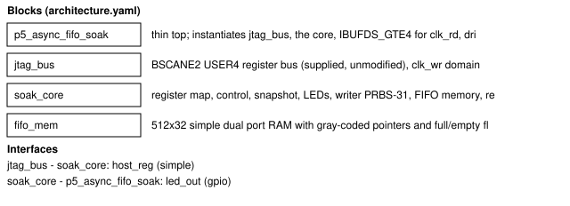
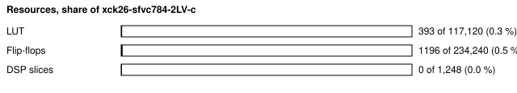
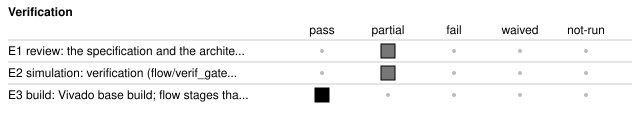

# p5_async_fifo: Asynchronous FIFO soak, 25 MHz writer to 156.25 MHz reader

<!-- Generated from handover.yaml by flow/handover.py (brief 68). Edit handover.yaml, or the text between the prose markers, then run: python -m flow.handover write runs/20261126-210155-ee69/p5_async_fifo -->

The design writes a PRBS-31 word stream into a 512-word, 32-bit FIFO on the 25 MHz board clock. A reader on the 156.25 MHz SFP+ reference clock pops the words, compares each with its own PRBS-31 copy and counts words, mismatches and fill. A host reads and controls it through a JTAG register bus (jtag_bus, BSCANE2 USER4). The run reached synthesis, implementation, timing, power and DRC closure and produced a bitstream (build evidence E3 passes). Verification reached V2 of V3: the V3 coverage, mutation and CDC checks did not pass or were not measured. Configuration and debug was not run, and nothing was tried on the board. The specification and architecture were approved automatically, with no human review.

Not in scope:

- Not a transceiver design. No GT channel is used, only the GT reference clock buffer, and sfp_tx_disable is held at 1.
- Not hardware-proven. There is no bring-up or board result, so the 10-minute soak and the 25 million words per second rate are not demonstrated.
- Not a design with a reset input. Every reset is a reconfiguration of the FPGA (reset model reprogram).
- Not a general FIFO IP. The data source is the internal PRBS-31 writer and the sink is the internal checker.

Kind: agent-run; produced by the agent (agent run `20261126-210155-ee69`, [record](../summary.json)). State: built. For an agent: [AGENT.md](AGENT.md).

Run: model claude-sonnet-5-5 (deepagents harness), 9 loops, 266 turns, 11,290,891 tokens, 4836.5 s wall time, 12.014 USD model cost (provider-reported), permission mode auto (36 distinct gated decisions listed in handover.yaml), stopped because: done (from the run record).

<!-- prose:what -->
<!-- /prose:what -->

## Technical parameters

| Item | Value |
|---|---|
| Part | `xck26-sfvc784-2LV-c` |
| Board | kr260 |
| Top | `p5_async_fifo_soak` |
| Tool | Vivado 2026.1 |

Clocks:

- `clk_25`: 25 MHz (from `runs/20261126-210155-ee69/p5_async_fifo/design.xdc`)

Resets:

- `rst_sr[3] (internal, drives jtag_bus rst)`, active high: A 4-bit shift register initialised to all ones in rtl/p5_async_fifo_soak.sv holds jtag_bus in reset for a few clk_25 cycles after configuration. There is no external reset input, and all other registers start from their initial values.

Interfaces:

- `clk_25` (input, 25 MHz clock, pin C3, LVCMOS18): This is the spec's clk_wr. It drives the register port, writer and control. design.xdc creates the clock with a 40.00 ns period.
- `mgtrefclk0_p, mgtrefclk0_n` (differential input, SFP+ MGTREFCLK0, 156.25 MHz): Goes through IBUFDS_GTE4 ODIV2 and BUFG_GT to become clk_rd (the spec's reader clock). design.xdc has no pin and no create_clock for these ports (see gaps).
- `led` (output, 2 bits, led[0] F8 and led[1] E8, LVCMOS18): led[0] is RUN. led[1] is a sticky error from the checker (data error or underflow) or a nonzero OVERFLOWS count, and CLEAR resets it.
- `sfp_tx_disable` (output, 1 bit, pin Y10, LVCMOS33): Constant 1.

Registers (from spec.yaml; where the RTL differs, the gaps say so):

| Offset | Name | Access | Reset | Bits |
|---|---|---|---|---|
| 0 | `ID` | RO | 546635777 | 31:0 design ID |
| 4 | `BUILD` | RO | 0 | 31:0 USR_ACCESS word |
| 8 | `SCRATCH` | RW | 0 | 31:0 scratch |
| 16 | `CTRL` | RW | 0 | 0 RUN; 1 SLOW_READ; 2 CLEAR self-clearing; 3 INJECT self-clearing |
| 20 | `WORDS_W` | RO | 0 | 31:0 words written (snapshot) |
| 24 | `WORDS_R` | RO | 0 | 31:0 words read and checked (snapshot) |
| 28 | `DATA_ERRS` | RO | 0 | 31:0 mismatched words (snapshot) |
| 32 | `OVERFLOWS` | RO | 0 | 31:0 (snapshot) |
| 36 | `UNDERFLOWS` | RO | 0 | 31:0 (snapshot) |
| 40 | `STALL_W` | RO | 0 | 31:0 writer clocks held off (snapshot) |
| 44 | `OCC_MAX` | RO | 0 | 31:0 highest fill in words (snapshot) |
| 48 | `SNAPSHOT` | WO | 0 | any write latches 0x014 to 0x02C |

| Parameter | Value | Legal range | Note |
|---|---|---|---|
| `FIFO_DEPTH` | 512 | Must equal 2^ADDR_WIDTH; the pointers are ADDR_WIDTH+1 bits wide. | Spec value, and the value built. The depth drives the full test and the single BRAM expected by the spec. |
| `DATA_WIDTH` | 32 | Only 32 works; the PRBS step produces a fixed 32-bit word. | Width of the FIFO memory word and of the compared data. |
| `ADDR_WIDTH` | 9 | log2(FIFO_DEPTH). | Memory address width. |
| `PRBS_SEED` | 2,147,483,647 | Any nonzero 31-bit value (only bits 30:0 are used). Zero would lock the LFSR. | Spec seed 0x7FFFFFFF, shared by writer and reader and reloaded on CLEAR. |
| `DESIGN_ID` | 546,635,777 | Any 32-bit value. | Read back at 0x000 (0x20950001). |
| `SLOW_READ_DIV_CYCLES` | 8 | 1 to 16, because it is loaded as value minus 1 into a 4-bit counter. | With SLOW_READ set the reader pops at most one word per 8 clk_rd (156.25 MHz), as in the spec's timing section. |
| `SYNC_STAGES` | 2 | 2 or more. | Flip-flop depth of every XPM CDC synchroniser. |

| Quantity | Value | Source |
|---|---|---|
| Resources | slice LUTs used: 393; flip-flops used: 1196; block RAM tiles used: 0.5; DSP slices used: 0 | M8, M9, M10, M11 |
| Timing | worst setup slack after routing: 2.59 ns; worst hold slack after routing: 0.012 ns | M6, M7 |
| Power | total on-chip power, vectorless estimate: 0.368 W | M12 |
| Latency | not measured | [Known gaps](#known-gaps-and-limits) |
| Throughput | not measured | [Known gaps](#known-gaps-and-limits) |

<!-- prose:parameters -->
<!-- /prose:parameters -->

## How to build, run and reproduce

| Step | Command | Heavy slot | Time |
|---|---|---|---|
| what changed since this handover (stale records, changed files, tool and knowledge-bank pins) | `python -m flow.handover fresh runs/20261126-210155-ee69/p5_async_fifo` | no | - |
| pick the work up again from the earliest stage the change or the staleness needs; needs a model (see docs/agent.md); Vivado for any stage from synthesis on | `python -m agent resume runs/20261126-210155-ee69/p5_async_fifo "<change request>"` | yes | - |
| run the Verifier's simulation tests; needs Icarus Verilog and cocotb, or the simulation container | `python -m pytest -q runs/20261126-210155-ee69/p5_async_fifo/tests/test_p5_async_fifo_rtl.py` | no | - |
| re-run the Verilator coverage simulation and the verification gates (line, toggle, functional and cover results); needs Verilator 5.036 or later and cocotb (the simulation container has them) | `SIM=verilator FDA_COVERAGE=1 FDA_SIM_RESULTS_DIR=runs/20261126-210155-ee69/p5_async_fifo/build/verif/sim python -m pytest -q -x runs/20261126-210155-ee69/p5_async_fifo/tests/test_p5_async_fifo_rtl.py && python3 flow/verif_gates.py runs/20261126-210155-ee69/p5_async_fifo --runs runs/20261126-210155-ee69/p5_async_fifo/build/verif/sim` | no | - |
| rebuild the bitstream with the flow; needs Vivado 2026.1 and a heavy slot; peak memory 3007 MiB (anonymous, the systemd scope) | `flow/run_vivado.sh runs/20261126-210155-ee69/p5_async_fifo base` | yes | about 3.4 min |

Tool: Vivado 2026.1. Build ID of the inputs at handover: `ac51e220` (`python flow/manifest.py show runs/20261126-210155-ee69/p5_async_fifo`: what a rebuild of today's sources and flow would carry; it changes when any build input or the flow changes, so it can differ from the build ID in an older evidence record). Knowledge-bank pin: `eaf6794`.

| File | What |
|---|---|
| [`runs/20261126-210155-ee69/p5_async_fifo/spec.md`](spec.md) | the request the run started from |
| [`runs/20261126-210155-ee69/p5_async_fifo/spec.yaml`](spec.yaml) | the specification the Clarifier wrote, approved automatically with no human review |
| [`runs/20261126-210155-ee69/p5_async_fifo/ARCHITECTURE.md`](ARCHITECTURE.md) | the architecture note, accepted automatically before any RTL (no human review) |
| [`runs/20261126-210155-ee69/p5_async_fifo/architecture.yaml`](architecture.yaml) | the machine-checked architecture: blocks, clocks, predicted resources |
| [`runs/20261126-210155-ee69/p5_async_fifo/rtl/p5_async_fifo_soak.sv`](rtl/p5_async_fifo_soak.sv) | RTL written by the Designer |
| [`runs/20261126-210155-ee69/p5_async_fifo/rtl/p5_async_fifo_soak_core.sv`](rtl/p5_async_fifo_soak_core.sv) | RTL written by the Designer |
| [`runs/20261126-210155-ee69/p5_async_fifo/rtl/prbs31_step.sv`](rtl/prbs31_step.sv) | RTL written by the Designer |
| [`runs/20261126-210155-ee69/p5_async_fifo/rtl/xilinx_sim_stubs.sv`](rtl/xilinx_sim_stubs.sv) | RTL written by the Designer |
| [`runs/20261126-210155-ee69/p5_async_fifo/design.xdc`](design.xdc) | pin, I/O standard and timing constraints |
| [`runs/20261126-210155-ee69/p5_async_fifo/build.yaml`](build.yaml) | the build description read by the flow |
| [`runs/20261126-210155-ee69/p5_async_fifo/model.py`](model.py) | the Modeller's reference model of the visible behaviour |
| [`runs/20261126-210155-ee69/p5_async_fifo/tests/p5_async_fifo_bench.py`](tests/p5_async_fifo_bench.py) | the Verifier's cocotb benches and pytest entries |
| [`runs/20261126-210155-ee69/p5_async_fifo/tests/test_p5_async_fifo_rtl.py`](tests/test_p5_async_fifo_rtl.py) | the Verifier's cocotb benches and pytest entries |
| [`runs/20261126-210155-ee69/p5_async_fifo/verif/mutants.yaml`](verif/mutants.yaml) | the test plan and mutant list read by the verification gates |
| [`runs/20261126-210155-ee69/p5_async_fifo/verif/testplan.yaml`](verif/testplan.yaml) | the test plan and mutant list read by the verification gates |
| [`runs/20261126-210155-ee69/p5_async_fifo/verif/checkers/v_macros.svh`](verif/checkers/v_macros.svh) | bound assertion and cover checkers |

<!-- prose:build -->
<!-- /prose:build -->

## Verified

Requirement by requirement, with where each came from and its evidence: [REQUIREMENTS_REPORT.md](REQUIREMENTS_REPORT.md).

| ID | Activity | Result | What | Evidence | Conditions |
|---|---|---|---|---|---|
| E1 | review | partial | the specification and the architecture were approved automatically, with no human review (review off; the interview oracle claude-sonnet-5-5 only answered the interview questions); the interview asked 9 questions, 0 answered and 9 defaulted | [`runs/20261126-210155-ee69/summary.json`](../summary.json) | - |
| E2 | simulation | partial | verification (flow/verif_gates.py) against the Modeller's reference model reached V2 of V3; the run asked for V2; V2 means simulation: seeded runs, a constrained-random test, bound assertions and formal tasks; V3 (coverage (line, toggle, functional bins, cover properties), three seeds and the mutation score) did not pass: functional bins pct 0.0 (0/0) (needs 100); cover properties pct 0.0 (needs 100); line pct not measured (needs 90); toggle pct not measured (needs 75); mutation score pct not measured (needs 70); cdc structure clean missing (needs no unsafe crossing); cdc injection clean missing (needs pass); no board result (V-HW) is recorded | [`runs/20261126-210155-ee69/p5_async_fifo/build/verif/verif_gates.json`](build/verif/verif_gates.json) | - |
| E3 | build | pass | Vivado base build; flow stages that ran: rtl, post_synth, post_place, post_route, bitstream | [`runs/20261126-210155-ee69/p5_async_fifo/build/base/gates.json`](build/base/gates.json) | - |

Gates at handover: `clarify` pass, `board-and-device-planning` pass, `rtl-design-creation` pass, `constraints` pass, `synthesis` pass, `implementation` pass, `timing-closure` pass, `power-closure` pass, `drc-closure` pass, `configuration-and-debug` not-run.

<!-- prose:verified -->
<!-- /prose:verified -->

## Measured

Every value is read from the record by `python -m flow.handover fill`, not typed.

| ID | What | Value | Runs | Source | Conditions |
|---|---|---|---|---|---|
| M1 | simulation seeds run | 3 | 1 | [`runs/20261126-210155-ee69/p5_async_fifo/build/verif/verif_gates.json`](build/verif/verif_gates.json) `stages.V3.checks.seeds_run.value` | Verilator coverage simulation of the RTL against the Modeller's model, every seed the bench ran |
| M2 | line coverage | not measured % | 1 | [`runs/20261126-210155-ee69/p5_async_fifo/build/verif/verif_gates.json`](build/verif/verif_gates.json) `stages.V3.checks.line_pct.value` | Verilator coverage simulation of the RTL against the Modeller's model, every seed the bench ran |
| M3 | toggle coverage | not measured % | 1 | [`runs/20261126-210155-ee69/p5_async_fifo/build/verif/verif_gates.json`](build/verif/verif_gates.json) `stages.V3.checks.toggle_pct.value` | Verilator coverage simulation of the RTL against the Modeller's model, every seed the bench ran |
| M4 | functional coverage bins hit | 0.0 (0/0) | 1 | [`runs/20261126-210155-ee69/p5_async_fifo/build/verif/verif_gates.json`](build/verif/verif_gates.json) `stages.V3.checks.functional_bins_pct.value` | Verilator coverage simulation of the RTL against the Modeller's model, every seed the bench ran |
| M5 | cover properties hit | 0.0 % | 1 | [`runs/20261126-210155-ee69/p5_async_fifo/build/verif/verif_gates.json`](build/verif/verif_gates.json) `stages.V3.checks.cover_properties_pct.value` | Verilator coverage simulation of the RTL against the Modeller's model, every seed the bench ran |
| M6 | worst setup slack after routing | 2.59 ns | 1 | [`runs/20261126-210155-ee69/p5_async_fifo/build/base/gates.json`](build/base/gates.json) `timing.wns_ns` | post-route, the constrained clock of design.xdc |
| M7 | worst hold slack after routing | 0.012 ns | 1 | [`runs/20261126-210155-ee69/p5_async_fifo/build/base/gates.json`](build/base/gates.json) `timing.whs_ns` | post-route |
| M8 | slice LUTs used | 393 | 1 | [`runs/20261126-210155-ee69/p5_async_fifo/build/base/gates.json`](build/base/gates.json) `utilization.lut` | post-route utilization |
| M9 | flip-flops used | 1196 | 1 | [`runs/20261126-210155-ee69/p5_async_fifo/build/base/gates.json`](build/base/gates.json) `utilization.ff` | post-route utilization |
| M10 | block RAM tiles used | 0.5 | 1 | [`runs/20261126-210155-ee69/p5_async_fifo/build/base/gates.json`](build/base/gates.json) `utilization.bram_tile` | post-route utilization |
| M11 | DSP slices used | 0 | 1 | [`runs/20261126-210155-ee69/p5_async_fifo/build/base/gates.json`](build/base/gates.json) `utilization.dsp` | post-route utilization |
| M12 | total on-chip power, vectorless estimate | 0.368 W | 1 | [`runs/20261126-210155-ee69/p5_async_fifo/build/base/gates.json`](build/base/gates.json) `power.total_w` | report_power, vectorless (no switching activity file), default environment |
| M13 | model cost of the run, provider-reported | 12.014 USD | 1 | [`runs/20261126-210155-ee69/summary.json`](../summary.json) `cost_usd` | every role and the interview oracle, as the run summary records it |

<!-- prose:measured -->
<!-- /prose:measured -->

## Known gaps and limits

- **REQ-01**: REQ-01 has no passing evidence for every proof method: hardware (uart_tests) is pending: no bring-up result
- **REQ-02**: REQ-02 has no passing evidence for every proof method: hardware (uart_tests) is pending: no bring-up result
- **REQ-03**: REQ-03 has no passing evidence for every proof method: hardware (uart_tests) is pending: no bring-up result
- **REQ-06**: REQ-06 has no passing evidence for every proof method: analysis (post_synth:post_synth_resources_in_range) is pending: no flow gates result
- **REQ-08**: REQ-08 has no passing evidence for every proof method: hardware (uart_tests) is pending: no bring-up result
- **REQ-11**: REQ-11 has no passing evidence for every proof method: hardware (uart_tests) is pending: no bring-up result
- **REQ-12**: REQ-12 has no passing evidence for every proof method: hardware (uart_tests) is pending: no bring-up result
- **REQ-16**: REQ-16 has no passing evidence for every proof method: hardware (uart_tests) is pending: no bring-up result
- **REQ-17**: REQ-17 has no passing evidence for every proof method: hardware (uart_tests) is pending: no bring-up result
- **REQ-19**: REQ-19 has no passing evidence for every proof method: hardware (uart_tests) is pending: no bring-up result
- **REQ-23**: REQ-23 has no passing evidence for every proof method: analysis (post_route:setup) is pending: no flow gates result
- **REQ-24**: REQ-24 has no passing evidence for every proof method: analysis (post_synth:post_synth_resources_in_range) is pending: no flow gates result
- **REQ-25**: REQ-25 has no passing evidence for every proof method: analysis (post_route:setup) is pending: no flow gates result
- **REQ-33**: REQ-33 has no passing evidence for every proof method: analysis (post_route:setup) is pending: no flow gates result
- **REQ-26**: REQ-26 has no passing evidence for every proof method: analysis (post_route:setup) is pending: no flow gates result
- **REQ-27**: REQ-27 has no passing evidence for every proof method: hardware (uart_tests) is pending: no bring-up result
- **REQ-28**: REQ-28 has no passing evidence for every proof method: hardware (ila_captures) is pending: no bring-up result
- **REQ-29**: REQ-29 has no passing evidence for every proof method: analysis (post_synth:post_synth_resources_in_range) is pending: no flow gates result
- **E1**: review evidence is partial: the specification and the architecture were approved automatically, with no human review (review off; the interview oracle claude-sonnet-5-5 only answered the interview questions); the interview asked 9 questions, 0 answered and 9 defaulted
- **E2**: simulation evidence is partial: verification reached V2 of V3 (the run asked for V2); the checks that did not pass or did not run are listed in the evidence row
- **configuration-and-debug**: stage configuration-and-debug was not run: the run stopped before this stage (done)
- **formal**: formal checks were planned for REQ-05, REQ-11, REQ-12, REQ-23 and did not run; each was replaced by a simulation check (verif/testplan.yaml replan). Reason recorded: SymbiYosys is not installed, so the read-latency property is checked cycle by cycle in simulation.
- **latency**: latency not measured: the run measured no latency; the spec's latency promise is checked only by the benches
- **throughput**: throughput not measured: the run measured no throughput
- **read_latency**: Counted from rtl/p5_async_fifo_soak_core.sv: h_rdata is a register loaded on clk_wr the clock after h_re, so read data is valid 1 clk_wr after h_re and held until the next h_re. The spec promises at most 2. A write takes effect 1 clk_wr after h_we, as the spec says.
- **overflow_underflow_counters**: OVERFLOWS and UNDERFLOWS cannot count in the RTL. ovf_w is only ever cleared, never incremented, and the writer gates writes with run && !full. The underflow condition is can_pop && empty while can_pop already includes !empty. Both read 0 by construction, so the 0 results of REQ-11, REQ-12 and REQ-27 prove nothing about the FIFO. The spec says they count violations.
- **ctrl_read_and_unmapped**: Reading CTRL (0x010) returns only RUN in bit 0 and SLOW_READ in bit 1. CLEAR and INJECT read as 0. Reads of any unmapped address, including 0x030 (SNAPSHOT is write-only) and 0x00C, return 0, and writes to unmapped addresses are ignored. The snapshot registers read 0 until the first SNAPSHOT write.
- **ctrl_write_priority**: Every CTRL write sets RUN and SLOW_READ from bits 0 and 1. CLEAR acts only if the RUN value before the write is 0, and otherwise it is ignored and nothing else changes. INJECT is sent whatever CLEAR does. A write with CLEAR=1 and RUN=1 on a stopped design clears and starts in the same write. The reader then flushes until empty, which may discard or desynchronise words the restarted writer has already sent (inferred from the RTL, not simulated). Write CLEAR with RUN 0 first, then set RUN in a later write.
- **clear_scope**: CLEAR resets the live counters and both PRBS sequences, but the snapshot registers 0x014 to 0x02C keep their old values until the next SNAPSHOT write. It also does not reset the FIFO pointers: the reader discards (flushes) any words still in the FIFO without counting them, then reseeds.
- **snapshot_not_one_instant**: The spec says a SNAPSHOT write latches all counters at one instant. In the RTL, WORDS_W, STALL_W, OVERFLOWS and OCC_MAX latch on clk_wr one clock after the write. WORDS_R, DATA_ERRS and UNDERFLOWS are sampled on clk_rd after the pulse crosses and are copied over by a 96-bit XPM handshake. A read right after the write can return the previous values for those three. The counts can also differ by words in flight.
- **stop_drains**: The reader does not look at RUN: it pops whenever the FIFO is not empty, so it drains after RUN falls. The spec says the reader pops when RUN is 1. This matches the defaulted interview answer (drain after stop), so WORDS_R catches up with WORDS_W.
- **occ_max_pessimistic**: OCC_MAX is written count plus 1 minus the read pointer synchronised into clk_wr, so it can be high by a few words. It is not the exact fill.
- **inject_word**: INJECT flips bit 0 of the next word checked after the pulse reaches clk_rd. If the FIFO is empty the flip waits for the next word. The pulse is a toggle crossing, so it is not lost.
- **clk_rd_constraint**: design.xdc has no pin assignment and no create_clock for mgtrefclk0_p or mgtrefclk0_n, so the 156.25 MHz clk_rd is not constrained there. The spec and ARCHITECTURE.md assume it is constrained and that timing is met on both clocks (REQ-26). The timing result M6 and M7 may therefore not cover the reader domain. Check the post-route clock report before relying on the result.
- **clock_names**: The spec calls the clocks clk_wr and clk_rd. The top-level ports are clk_25 and mgtrefclk0_p/n, and the XDC clock is named sys_clk_pin. The spec's clk_wr is clk_25.
- **build_word_sim**: In simulation the USR_ACCESSE2 stub returns 0, so BUILD reads 0 there. Its real value is known only on hardware.
- **assumptions_run**: The run assumed jtag_bus.sv is used unchanged and is not simulated. It also assumed LEDs show RUN and a sticky error flag, the register port runs on the 25 MHz clock, and pointers cross as Gray code through 2-flop synchronisers. All of these were defaulted or are spec assumptions, not answered by a person.

<!-- prose:gaps -->
<!-- /prose:gaps -->

## Assumptions you did not confirm

The agent settled these questions with its own default (nobody answered, or the answer was waived). A passing test shows the design matches the assumption, not that the assumption is what you want. Check the high-risk rows first.

| Risk | Question | The design used | How it was settled |
|---|---|---|---|
| high | Which clock does the register port run on, and how are RUN, SLOW_READ and INJECT crossed to the reader? | clk_wr; control bits cross by 2-flop synchronisers, INJECT by a toggle handshake | defaulted: nobody answered |
| high | Is the register map as listed in the request including the SNAPSHOT behaviour at 0x030 read? | Map as in the request; read of 0x030 returns 0 | defaulted: nobody answered |
| high | What are the pin locations and IO standards for C3, MGTREFCLK0 and LEDs? | Take from the KR260 board file | defaulted: nobody answered |
| high | This design has no reset input. Is every reset a reconfiguration of the FPGA (the device is reprogrammed, so every register starts from its initial value), or does something restart the running design (then it needs a reset input)? | Every reset is a reconfiguration of the FPGA (reset model: reprogram): registers get initial values, control state included, and the design has no reset input. Record it in spec.yaml as reset: {model: reprogram}; a design that restarts while it runs is reset: {model: reset} with a reset port. | defaulted: nobody answered |
| medium | What does CLEAR do when written while RUN is 1? | Ignored, the bit still self-clears | defaulted: nobody answered |
| medium | Does stopping RUN (RUN 1 to 0) drain the FIFO? | The writer stops; the reader keeps draining until empty and checking, so counts settle | defaulted: nobody answered |
| medium | Is OCC_MAX measured in the writer domain from the synchronised read pointer? | Yes, written count minus synchronised read pointer, so it can be pessimistic by a few words | defaulted: nobody answered |
| medium | Which word does INJECT corrupt and which bit is flipped? | The next word checked after INJECT arrives, bit 0 | defaulted: nobody answered |
| medium | What do the LEDs show? | led[0] = RUN, led[1] = sticky error | defaulted: nobody answered |

## Next steps

1. Verification first: V3 did not pass. Re-run the Verilator coverage simulation and the gates (the fourth command). The functional bins reported 0 of 0, so first find out why no bins or cover properties were collected, and compare the cover results with the functional coverage before adding any stimulus. Then add the CDC structure and injection checks and run the mutation score.
2. Fix or decide the OVERFLOWS and UNDERFLOWS counters, which cannot count in the RTL, and the SNAPSHOT latching instant. Update the spec or the RTL so they agree.
3. Add the mgtrefclk0 pin assignments and a create_clock for 156.25 MHz to design.xdc, then rebuild with flow/run_vivado.sh and re-read WNS and WHS for both clocks.
4. Run the configuration-and-debug stage and bring the design up on the board over JTAG. Read ID, then run the 10-minute soak and check the write rate (REQ-27, REQ-28).

Open questions:

- Should the design count overflows and underflows as the spec says, or is it acceptable that they are structurally 0 because the writer is gated by full and the reader by empty?
- Is the 156.25 MHz clk_rd meant to be constrained in design.xdc? The file contains a comment about mgtrefclk0 but no clock or pin for it.
- Is it acceptable that SNAPSHOT latches the writer-side and reader-side counters at different instants, or must it be a single instant as the spec states?

<!-- prose:next -->
<!-- /prose:next -->

## History

| Date | Brief | PR | What |
|---|---|---|---|
| 2026-11-26 | agent run | - | produced by the agent graph; stages that passed: clarify, board-and-device-planning, rtl-design-creation, constraints, synthesis, implementation, timing-closure, power-closure, drc-closure |

<!-- prose:history -->
<!-- /prose:history -->
