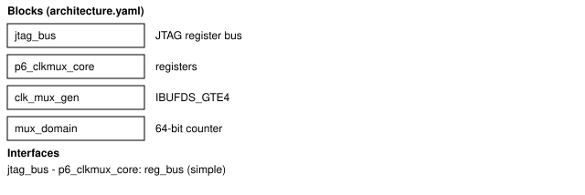

# p6_glitchfree_mux: P6 glitch-free clock multiplexer with self-checking muxed domain (KR260)

<!-- Generated from handover.yaml by flow/handover.py (brief 68). Edit handover.yaml, or the text between the prose markers, then run: python -m flow.handover write runs/20261126-175655-b2dc/p6_glitchfree_mux -->

The design selects between the 25 MHz board clock (clock A) and the SFP+ reference clock divided by B_DIV (clock B) with a BUFGCTRL. In the muxed domain it runs a 64-bit counter, an independent Gray-code twin and a checker, and it has a gated edge counter for frequency measurement. A JTAG register bus (jtag_bus.sv, unmodified) gives host access. The run stopped in rtl-design-creation after repeated failures of the design standards and report gates. No synthesis, implementation or hardware result exists, and verification reached V2 of V3.

Not in scope:

- Not a GT transceiver design. No GT channel is used and sfp_tx_disable is tied to 1.
- Not a design with a reset input. Every reset is a reconfiguration of the FPGA, plus a short power-up reset generated in the top.
- Not timed, placed or measured on a board. No build of this design passed its gates.

Kind: agent-run; produced by the agent (agent run `20261126-175655-b2dc`, [record](../summary.json)). State: rtl. For an agent: [AGENT.md](AGENT.md).

Run: model claude-sonnet-5-5 (deepagents harness), 8 loops, 211 turns, 9,281,970 tokens, 2709.8 s wall time, 7.30349 USD model cost (provider-reported), permission mode auto (8 distinct gated decisions listed in handover.yaml), stopped because: stage 2 visited more than 6 times; last failing gate: report gates, design standards; owned by the rtl role; the same failure on 2 consecutive visits (from the run record).

<!-- prose:what -->
<!-- /prose:what -->

## Technical parameters

| Item | Value |
|---|---|
| Part | `xck26-sfvc784-2LV-c` |
| Board | kr260 |
| Top | `p6_clkmux_top` |
| Tool | Vivado 2026.1 |

Clocks:

- `clk_c3`: 25 MHz (from `runs/20261126-175655-b2dc/p6_glitchfree_mux/design.xdc`)
- `gt_refclk_p`: 156.25 MHz (from `runs/20261126-175655-b2dc/p6_glitchfree_mux/design.xdc`)

Resets:

- `rst (internal)`, active high: There is no reset input port. rst_sr in rtl/p6_clkmux_top.sv starts at 4'hF and shifts out in 4 clk_c3 cycles; it is synchronous in clk_c3 and reaches the muxed domain through xpm_cdc_async_rst. Reset values are in the register map.

Interfaces:

- `clk_c3` (input clock, 25 MHz, pin C3 LVCMOS18): Register bus, gate and status clock; also clock A of the mux.
- `gt_refclk_p / gt_refclk_n` (differential input clock, 156.25 MHz, SFP+ MGTREFCLK0): design.xdc gives no PACKAGE_PIN for these; the GT reference clock site places them. They feed IBUFDS_GTE4 and BUFG_GT.
- `sfp_tx_disable` (output, pin Y10 LVCMOS33): Constant 1.
- `led` (output, 2 bits, pins F8 (led[0]) and E8 (led[1]) LVCMOS18): RTL drives led = {sel, sel != act_c3}, so led[0] is the SWITCHING condition and led[1] is SEL. The spec says led[0] = ACTIVE_SEL and led[1] = SWITCHING.

Registers (from spec.yaml; where the RTL differs, the gaps say so):

| Offset | Name | Access | Reset | Bits |
|---|---|---|---|---|
| 0 | `ID` | RO | 546701313 | [31:0] design ID |
| 4 | `BUILD` | RO | 0 | [31:0] USR_ACCESS word |
| 8 | `SCRATCH` | RW | 0 | [31:0] scratch |
| 16 | `SEL` | RW | 0 | [0] 0=clock A, 1=clock B |
| 20 | `STATUS` | RO | 0 | [0] SWITCHING, [1] ACTIVE_SEL |
| 24 | `B_DIV` | RO | 2 | [3:0] divide of GT clock, 1 to 8 |
| 28 | `GATE_LEN` | RW | 25000000 | [31:0] gate length in clk_c3 cycles |
| 32 | `FREQ_CTRL` | RW | 0 | [0] START self-clearing |
| 36 | `FREQ_STATUS` | RO | 0 | [0] BUSY, [1] DONE |
| 40 | `FREQ_COUNT` | RO | 0 | [31:0] edges in last gate |
| 44 | `MUX_ERRS` | RO | 0 | [31:0] error count |
| 48 | `MUX_COUNT` | RO | 0 | [31:0] counter low bits at last SNAPSHOT |
| 52 | `SWITCH_COUNT` | RO | 0 | [31:0] switches carried out |
| 56 | `SNAPSHOT` | WO | 0 | any write latches MUX_COUNT |

| Parameter | Value | Legal range | Note |
|---|---|---|---|
| `DESIGN_ID` | 546,701,313 | any 32-bit value; the spec fixes 546701313 (0x20960001) | Value returned by the ID register. |
| `B_DIV` | 2 | 1 to 8 | Divide of the GT reference clock, so clock B is 78.125 MHz at the default; the top drives BUFG_GT DIV with B_DIV-1. Fixed at build time and not simulated at other values. |
| `GATE_LEN_DEFAULT_CYCLES` | 25,000,000 | 1 to 4294967295 clk_c3 cycles | Reset value of GATE_LEN; 25000000 cycles of 25 MHz is 1 s. The benches ran it at 150, so the spec's value was not simulated. Spec timing: clk_c3 |
| `SYNC_STAGES` | 2 | 2 or more | Synchroniser depth of the XPM CDC cells in the core; the SEL crossing uses SYNC_STAGES + 1. |

| Quantity | Value | Source |
|---|---|---|
| Resources | not measured | [Known gaps](#known-gaps-and-limits) |
| Timing | not measured | [Known gaps](#known-gaps-and-limits) |
| Power | not measured | [Known gaps](#known-gaps-and-limits) |
| Latency | not measured | [Known gaps](#known-gaps-and-limits) |
| Throughput | not measured | [Known gaps](#known-gaps-and-limits) |

<!-- prose:parameters -->
<!-- /prose:parameters -->

## How to build, run and reproduce

| Step | Command | Heavy slot | Time |
|---|---|---|---|
| what changed since this handover (stale records, changed files, tool and knowledge-bank pins) | `python -m flow.handover fresh runs/20261126-175655-b2dc/p6_glitchfree_mux` | no | - |
| pick the work up again from the earliest stage the change or the staleness needs; needs a model (see docs/agent.md); Vivado for any stage from synthesis on | `python -m agent resume runs/20261126-175655-b2dc/p6_glitchfree_mux "<change request>"` | yes | - |
| run the Verifier's simulation tests; needs Icarus Verilog and cocotb, or the simulation container | `python -m pytest -q runs/20261126-175655-b2dc/p6_glitchfree_mux/tests/test_p6_glitchfree_mux_rtl.py` | no | - |
| re-run the Verilator coverage simulation and the verification gates (line, toggle, functional and cover results); needs Verilator 5.036 or later and cocotb (the simulation container has them) | `SIM=verilator FDA_COVERAGE=1 FDA_SIM_RESULTS_DIR=runs/20261126-175655-b2dc/p6_glitchfree_mux/build/verif/sim python -m pytest -q -x runs/20261126-175655-b2dc/p6_glitchfree_mux/tests/test_p6_glitchfree_mux_rtl.py && python3 flow/verif_gates.py runs/20261126-175655-b2dc/p6_glitchfree_mux --runs runs/20261126-175655-b2dc/p6_glitchfree_mux/build/verif/sim` | no | - |
| rebuild the bitstream with the flow; needs Vivado 2026.1 and a heavy slot; peak memory 3452 MiB (anonymous, the systemd scope) | `flow/run_vivado.sh runs/20261126-175655-b2dc/p6_glitchfree_mux base` | yes | about 2.5 min |

Tool: Vivado 2026.1. Build ID of the inputs at handover: `a6873cff` (`python flow/manifest.py show runs/20261126-175655-b2dc/p6_glitchfree_mux`: what a rebuild of today's sources and flow would carry; it changes when any build input or the flow changes, so it can differ from the build ID in an older evidence record). Knowledge-bank pin: `eaf6794`.

| File | What |
|---|---|
| [`runs/20261126-175655-b2dc/p6_glitchfree_mux/spec.md`](spec.md) | the request the run started from |
| [`runs/20261126-175655-b2dc/p6_glitchfree_mux/spec.yaml`](spec.yaml) | the specification the Clarifier wrote, approved automatically with no human review |
| [`runs/20261126-175655-b2dc/p6_glitchfree_mux/ARCHITECTURE.md`](ARCHITECTURE.md) | the architecture note, accepted automatically before any RTL (no human review) |
| [`runs/20261126-175655-b2dc/p6_glitchfree_mux/architecture.yaml`](architecture.yaml) | the machine-checked architecture: blocks, clocks, predicted resources |
| [`runs/20261126-175655-b2dc/p6_glitchfree_mux/rtl/mux_domain.sv`](rtl/mux_domain.sv) | RTL written by the Designer |
| [`runs/20261126-175655-b2dc/p6_glitchfree_mux/rtl/p6_clkmux_core.sv`](rtl/p6_clkmux_core.sv) | RTL written by the Designer |
| [`runs/20261126-175655-b2dc/p6_glitchfree_mux/rtl/p6_clkmux_top.sv`](rtl/p6_clkmux_top.sv) | RTL written by the Designer |
| [`runs/20261126-175655-b2dc/p6_glitchfree_mux/rtl/xilinx_sim_stubs.sv`](rtl/xilinx_sim_stubs.sv) | RTL written by the Designer |
| [`runs/20261126-175655-b2dc/p6_glitchfree_mux/design.xdc`](design.xdc) | pin, I/O standard and timing constraints |
| [`runs/20261126-175655-b2dc/p6_glitchfree_mux/build.yaml`](build.yaml) | the build description read by the flow |
| [`runs/20261126-175655-b2dc/p6_glitchfree_mux/model.py`](model.py) | the Modeller's reference model of the visible behaviour |
| [`runs/20261126-175655-b2dc/p6_glitchfree_mux/tests/bench_p6_glitchfree_mux.py`](tests/bench_p6_glitchfree_mux.py) | the Verifier's cocotb benches and pytest entries |
| [`runs/20261126-175655-b2dc/p6_glitchfree_mux/tests/test_p6_glitchfree_mux_rtl.py`](tests/test_p6_glitchfree_mux_rtl.py) | the Verifier's cocotb benches and pytest entries |
| [`runs/20261126-175655-b2dc/p6_glitchfree_mux/verif/testplan.yaml`](verif/testplan.yaml) | the test plan and mutant list read by the verification gates |
| [`runs/20261126-175655-b2dc/p6_glitchfree_mux/verif/checkers/v_macros.svh`](verif/checkers/v_macros.svh) | bound assertion and cover checkers |
| [`runs/20261126-175655-b2dc/p6_glitchfree_mux/build/review/02_rtl-design-creation.html`](build/review/02_rtl-design-creation.html) | the review page of stage rtl-design-creation: its exit gates and their failures at the last visit |

<!-- prose:build -->
<!-- /prose:build -->

## Verified

Requirement by requirement, with where each came from and its evidence: [REQUIREMENTS_REPORT.md](REQUIREMENTS_REPORT.md).

| ID | Activity | Result | What | Evidence | Conditions |
|---|---|---|---|---|---|
| E1 | review | partial | the specification and the architecture were approved automatically, with no human review (review off; the interview oracle claude-sonnet-5-5 only answered the interview questions); the interview asked 8 questions, 0 answered and 8 defaulted | [`runs/20261126-175655-b2dc/summary.json`](../summary.json) | - |
| E2 | simulation | partial | verification (flow/verif_gates.py) against the Modeller's reference model reached V2 of V3; the run asked for V2; V2 means simulation: seeded runs, a constrained-random test, bound assertions and formal tasks; V3 (coverage (line, toggle, functional bins, cover properties), three seeds and the mutation score) did not pass: functional bins pct 0.0 (0/0) (needs 100); cover properties pct 0.0 (needs 100); line pct not measured (needs 90); toggle pct not measured (needs 75); mutation score pct not measured (needs 70); cdc injection clean missing (needs pass); no board result (V-HW) is recorded | [`runs/20261126-175655-b2dc/p6_glitchfree_mux/build/verif/verif_gates.json`](build/verif/verif_gates.json) | - |
| E3 | build | fail | Vivado base build; flow stages that ran: rtl, post_synth | [`runs/20261126-175655-b2dc/p6_glitchfree_mux/build/base/gates.json`](build/base/gates.json) | - |

Gates at handover: `clarify` pass, `board-and-device-planning` pass, `rtl-design-creation` fail, `constraints` not-run, `synthesis` not-run, `implementation` not-run, `timing-closure` not-run, `power-closure` not-run, `drc-closure` not-run, `configuration-and-debug` not-run.

<!-- prose:verified -->
<!-- /prose:verified -->

## Measured

Every value is read from the record by `python -m flow.handover fill`, not typed.

| ID | What | Value | Runs | Source | Conditions |
|---|---|---|---|---|---|
| M1 | simulation seeds run | 3 | 1 | [`runs/20261126-175655-b2dc/p6_glitchfree_mux/build/verif/verif_gates.json`](build/verif/verif_gates.json) `stages.V3.checks.seeds_run.value` | Verilator coverage simulation of the RTL against the Modeller's model, every seed the bench ran |
| M2 | line coverage | not measured % | 1 | [`runs/20261126-175655-b2dc/p6_glitchfree_mux/build/verif/verif_gates.json`](build/verif/verif_gates.json) `stages.V3.checks.line_pct.value` | Verilator coverage simulation of the RTL against the Modeller's model, every seed the bench ran |
| M3 | toggle coverage | not measured % | 1 | [`runs/20261126-175655-b2dc/p6_glitchfree_mux/build/verif/verif_gates.json`](build/verif/verif_gates.json) `stages.V3.checks.toggle_pct.value` | Verilator coverage simulation of the RTL against the Modeller's model, every seed the bench ran |
| M4 | functional coverage bins hit | 0.0 (0/0) | 1 | [`runs/20261126-175655-b2dc/p6_glitchfree_mux/build/verif/verif_gates.json`](build/verif/verif_gates.json) `stages.V3.checks.functional_bins_pct.value` | Verilator coverage simulation of the RTL against the Modeller's model, every seed the bench ran |
| M5 | cover properties hit | 0.0 % | 1 | [`runs/20261126-175655-b2dc/p6_glitchfree_mux/build/verif/verif_gates.json`](build/verif/verif_gates.json) `stages.V3.checks.cover_properties_pct.value` | Verilator coverage simulation of the RTL against the Modeller's model, every seed the bench ran |
| M6 | model cost of the run, provider-reported | 7.30349 USD | 1 | [`runs/20261126-175655-b2dc/summary.json`](../summary.json) `cost_usd` | every role and the interview oracle, as the run summary records it |

<!-- prose:measured -->
<!-- /prose:measured -->

## Known gaps and limits

- **REQ-01**: REQ-01 has no passing evidence for every proof method: hardware (uart_tests) is pending: no bring-up result
- **REQ-02**: REQ-02 has no passing evidence for every proof method: hardware (uart_tests) is pending: no bring-up result
- **REQ-03**: REQ-03 has no passing evidence for every proof method: hardware (uart_tests) is pending: no bring-up result
- **REQ-24**: REQ-24 has no passing evidence for every proof method: hardware (uart_tests) is pending: no bring-up result
- **REQ-06**: REQ-06 has no passing evidence for every proof method: hardware (uart_tests) is pending: no bring-up result
- **REQ-26**: REQ-26 has no passing evidence for every proof method: hardware (uart_tests) is pending: no bring-up result
- **REQ-07**: REQ-07 has no passing evidence for every proof method: hardware (uart_tests) is pending: no bring-up result
- **REQ-27**: REQ-27 has no passing evidence for every proof method: hardware (uart_tests) is pending: no bring-up result
- **REQ-08**: REQ-08 has no passing evidence for every proof method: analysis (post_route:setup) is not run (the stage that makes this evidence did not run): gate post_route:setup = None; hardware (ila_captures) is pending: no bring-up result
- **REQ-09**: REQ-09 has no passing evidence for every proof method: hardware (uart_tests) is pending: no bring-up result
- **REQ-10**: REQ-10 has no passing evidence for every proof method: hardware (uart_tests) is pending: no bring-up result
- **REQ-12**: REQ-12 has no passing evidence for every proof method: hardware (uart_tests) is pending: no bring-up result
- **REQ-15**: REQ-15 has no passing evidence for every proof method: hardware (uart_tests) is pending: no bring-up result
- **REQ-19**: REQ-19 has no passing evidence for every proof method: hardware (uart_tests) is pending: no bring-up result
- **REQ-20**: REQ-20 has no passing evidence for every proof method: hardware (uart_tests) is pending: no bring-up result
- **REQ-22**: REQ-22 has no passing evidence for every proof method: analysis (post_route:setup) is not run (the stage that makes this evidence did not run): gate post_route:setup = None
- **E1**: review evidence is partial: the specification and the architecture were approved automatically, with no human review (review off; the interview oracle claude-sonnet-5-5 only answered the interview questions); the interview asked 8 questions, 0 answered and 8 defaulted
- **E2**: simulation evidence is partial: verification reached V2 of V3 (the run asked for V2); the checks that did not pass or did not run are listed in the evidence row
- **E3**: build evidence is fail: Vivado base build; flow stages that ran: rtl, post_synth
- **rtl-design-creation**: stage rtl-design-creation did not pass its gates in this run; at its last visit: standards STD-ARCH-00: :0: the checker could not read the design: KeyError: 'id' FAIL report gate RPT-LL-02 timing_summary_synth.rpt:u_core/u_mux_dom/gry_reg[58]/C->u_core/u_mux_dom/gry_reg[61]/D: setup path u_core/u_mux_dom/gry_reg[58]/C to u_core/u_mux_dom/gry_reg[61]/D (sys_clk_pin, requirement 1.6 ns) has slack -4.051 ns with 3.255 ns of net delay; with the net delay removed it is still -0.796 ...
- **constraints**: stage constraints was not run: the run stopped before this stage (stage 2 visited more than 6 times; last failing gate: report gates, design standards; owned by the rtl role; the same failure on 2 consecutive visits)
- **synthesis**: stage synthesis was not run: the run stopped before this stage (stage 2 visited more than 6 times; last failing gate: report gates, design standards; owned by the rtl role; the same failure on 2 consecutive visits)
- **implementation**: stage implementation was not run: the run stopped before this stage (stage 2 visited more than 6 times; last failing gate: report gates, design standards; owned by the rtl role; the same failure on 2 consecutive visits)
- **timing-closure**: stage timing-closure was not run: the run stopped before this stage (stage 2 visited more than 6 times; last failing gate: report gates, design standards; owned by the rtl role; the same failure on 2 consecutive visits)
- **power-closure**: stage power-closure was not run: the run stopped before this stage (stage 2 visited more than 6 times; last failing gate: report gates, design standards; owned by the rtl role; the same failure on 2 consecutive visits)
- **drc-closure**: stage drc-closure was not run: the run stopped before this stage (stage 2 visited more than 6 times; last failing gate: report gates, design standards; owned by the rtl role; the same failure on 2 consecutive visits)
- **configuration-and-debug**: stage configuration-and-debug was not run: the run stopped before this stage (stage 2 visited more than 6 times; last failing gate: report gates, design standards; owned by the rtl role; the same failure on 2 consecutive visits)
- **formal**: formal checks were planned for REQ-05, REQ-20 and did not run; each was replaced by a simulation check (verif/testplan.yaml replan). Reason recorded: SymbiYosys is not installed here
- **simulated_parameters**: the benches simulate at values other than the spec's (scaled for simulation speed or otherwise): GATE_LEN_DEFAULT_CYCLES is simulated at 150 (runs/20261126-175655-b2dc/p6_glitchfree_mux/tests/test_p6_glitchfree_mux_rtl.py:9) while spec.yaml gives 25000000. Behaviour that depends on the spec's value, such as a divider's timing against the clock, was not simulated at that value; it is stated here, not shown, unless another record covers it
- **resources**: resources not measured: no current Vivado build of this design has been recorded
- **timing**: timing not measured: no current Vivado build of this design has been recorded
- **power**: power not measured: no current Vivado build of this design has been recorded
- **latency**: latency not measured: the run measured no latency; the spec's latency promise is checked only by the benches
- **throughput**: throughput not measured: the run measured no throughput
- **led_order**: spec.yaml says led[0] = ACTIVE_SEL and led[1] = SWITCHING; rtl/p6_clkmux_core.sv drives led = {sel, sel != act_c3}, so led[0] is SWITCHING and led[1] is the requested SEL, not ACTIVE_SEL. The RTL is what was built. design.xdc maps led[0] to F8 and led[1] to E8.
- **status_and_read_path**: STATUS bit 0 is SWITCHING, computed as sel != act_c3, and bit 1 is ACTIVE_SEL, as in the register map. A read loads h_rdata from the addressed register on the clk_c3 edge that sees h_re, so the data is valid the clock after h_re, inside the spec's 2 clocks (rtl/p6_clkmux_core.sv; jtag_bus.sv was not simulated). A write to a mapped address is visible the clock after h_we.
- **unmapped_and_wo_reads**: Reads of any address not listed in the read case, including SNAPSHOT (0x038), FREQ_CTRL (0x020) and every unmapped address, return 0 (default branch in rtl/p6_clkmux_core.sv). Writes to RO or unmapped addresses are ignored because only the SCRATCH, SEL, GATE_LEN, FREQ_CTRL and SNAPSHOT strobes exist. FREQ_CTRL START is not stored, so it reads back 0.
- **snapshot_semantics**: A SNAPSHOT write copies rep_data_c[31:0], the last counter value delivered by the free-running report handshake in the muxed domain, into MUX_COUNT. It is not a counter sample taken at the write itself, so MUX_COUNT can be older than the write. MUX_ERRS is refreshed by the same report channel.
- **sel_while_switching**: A SEL write is taken immediately, even while SWITCHING is 1, and goes straight to the BUFGCTRL select pins with no synchroniser. The mux follows the latest value. This case is untested, per the assumption recorded for it.
- **switch_count_source**: SWITCH_COUNT increments on each change of the synchronised ACTIVE_SEL seen in clk_c3, so a SEL write equal to the current selection does not count. A switch back and forth faster than the synchroniser can pass may merge into one or no count.
- **freq_gate_behaviour**: START is ignored while BUSY or while the edge count is still awaited. GATE_LEN is sampled at START and 0 is treated as 1. FREQ_COUNT is cleared at START. BUSY drops after the remaining counter reaches 0, which is longer than GATE_LEN clk_c3 cycles by the counter's final step, and DONE is set only when the edge count returns through the handshake, so DONE comes later than BUSY falling. The spec's plus-or-minus 2 count accuracy is untested against these exact lengths.
- **reset_style**: spec.yaml says the muxed domain reset is synchronised; the RTL uses xpm_cdc_async_rst (asserted asynchronously, released synchronously) feeding a synchronous reset in mux_domain.sv. The register reset in the core is synchronous in clk_c3. rtl/p6_clkmux_top.sv generates the reset itself; jtag_bus does not hold it, so the spec's wording about jtag_bus is not what was built.
- **sat_error_counter**: MUX_ERRS saturates at 0xFFFFFFFF. The checker is pipelined over three register stages, so an error is counted a few clk_mux cycles after it happens.
- **assumption_clock_groups**: design.xdc declares sys_clk_pin and gt_refclk asynchronous. The BUFGCTRL output clk_mux is not declared as a separate clock, so its paths are derived by the tool from the two source clocks. This was not checked in a build.
- **timing_risk**: The synthesis timing report in the last visit failed on the Gray twin in mux_domain.sv (gry_reg[58] to gry_reg[61], slack -4.051 ns against a 1.6 ns requirement). The tool treats it as a path in sys_clk_pin, which suggests the clk_mux domain is analysed at a tighter period than the 25 MHz clock. Verify this in a new build.

<!-- prose:gaps -->
<!-- /prose:gaps -->

## Assumptions you did not confirm

The agent settled these questions with its own default (nobody answered, or the answer was waived). A passing test shows the design matches the assumption, not that the assumption is what you want. Check the high-risk rows first.

| Risk | Question | The design used | How it was settled |
|---|---|---|---|
| high | Which divide should be applied to the GT reference clock for clock B? | 2 (78.125 MHz), fixed at build time | defaulted: nobody answered |
| high | What happens when SEL is written while SWITCHING is 1? | The new value is taken and the mux follows the latest SEL once the current handshake ends | defaulted: nobody answered |
| high | What happens when START is written while BUSY, or GATE_LEN is 0 or changed during a gate? | START while BUSY is ignored; GATE_LEN is sampled at START; GATE_LEN 0 is treated as 1 | defaulted: nobody answered |
| high | Should SWITCH_COUNT count a write of the SEL value already selected? | No, only real changes of ACTIVE_SEL count | defaulted: nobody answered |
| high | What is the exact register map? | As listed in registers.map, taken from spec.md (all offsets given) | defaulted: nobody answered |
| high | Width of the muxed counter and error counter saturation? | 64-bit counter, 32-bit saturating error count | defaulted: nobody answered |
| high | This design has no reset input. Is every reset a reconfiguration of the FPGA (the device is reprogrammed, so every register starts from its initial value), or does something restart the running design (then it needs a reset input)? | Every reset is a reconfiguration of the FPGA (reset model: reprogram): registers get initial values, control state included, and the design has no reset input. Record it in spec.yaml as reset: {model: reprogram}; a design that restarts while it runs is reset: {model: reset} with a reset port. | defaulted: nobody answered |
| medium | What do the LEDs show? | led[0] = ACTIVE_SEL, led[1] = SWITCHING | defaulted: nobody answered |

## Next steps

1. Fix the earliest failure first, in rtl-design-creation, before any rebuild or new stimulus. Find why the design standards checker raised KeyError 'id', and shorten the Gray twin toggle logic in mux_domain.sv that failed setup. Then resume with python -m agent resume.
2. Compare the cover results with the functional coverage before adding stimulus, because functional bins show 0 of 0 and cover properties show 0.0. Then re-run the Verilator coverage simulation and the verification gates to reach V3.
3. Decide the LED order and the SNAPSHOT semantics (see open questions), update spec.yaml or the RTL so they agree, and re-run the benches.
4. When the flow reaches the build again, run synthesis and implementation, then record resources, timing and power. Hardware bring-up and the unfinished REQ items follow.

Open questions:

- Should led[0] show ACTIVE_SEL and led[1] SWITCHING as the spec says, or keep the RTL order in rtl/p6_clkmux_core.sv?
- Should a SNAPSHOT write capture the counter at the write, or is the last value from the report handshake acceptable?
- Which clock constraint should cover the BUFGCTRL output clk_mux, since design.xdc defines none for it?

<!-- prose:next -->
<!-- /prose:next -->

## History

| Date | Brief | PR | What |
|---|---|---|---|
| 2026-11-26 | agent run | - | produced by the agent graph; stages that passed: clarify, board-and-device-planning |

<!-- prose:history -->
<!-- /prose:history -->
