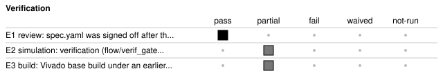

# t1_dimmer_counter: T1 LED dimmer and push-button counter for the Nexys A7-100T

<!-- Generated from handover.yaml by flow/handover.py (brief 68). Edit handover.yaml, or the text between the prose markers, then run: python -m flow.handover write results/68_agent_docs/20261102-114228-5a32/t1_dimmer_counter -->

The design keeps a 16-bit up/down counter that three debounced push-buttons change (up, down, centre-clear) and that a UART register window can read and write. The counter drives 16 LEDs gated by an 8-bit linear PWM, and the counter and the active brightness are shown on the eight-digit seven-segment display. The brightness comes either from a UART register or from the eight switches, and the registers are reached through the repository test shell at 115200 baud. The run reached a base bitstream under an earlier Vivado release than the pinned one, so no build number is published. Verification reached V1 of V3 and the debug build with the ILA did not complete.

Not in scope:

- Not a general PWM or display core. It is one board-level top for the Nexys A7-100T and its pins are fixed in design.xdc.
- Not a gamma-corrected dimmer. Brightness is linear 8-bit duty.
- No auto-repeat on a held button, and no use of the decimal points or of the UART beyond the shell register window.
- Not verified on hardware. No board result is recorded, and no ILA debug build result exists.

Kind: agent-run; produced by the agent (agent run `20261102-114228-5a32`, [record](../summary.json)). State: built. For an agent: [AGENT.md](AGENT.md).

Run: model openai/gpt-6-luna (deepagents harness), 5 loops, 223 turns, 5,771,205 tokens, 3855.3 s wall time, 0.170661 USD model cost (provider-reported), stopped because: stage 6 visited more than 4 times (from the run record).

<!-- prose:what -->
<!-- /prose:what -->

## Technical parameters

| Item | Value |
|---|---|
| Part | `xc7a100tcsg324-1` |
| Board | nexys_a7_100t |
| Top | `t1_led_dimmer_counter` |
| Tool | Vivado 2026.1 |

Clocks:

- `clk`: 100 MHz (from `results/68_agent_docs/20261102-114228-5a32/t1_dimmer_counter/design.xdc`)

Resets:

- `cpu_reset_n`, active low: Asserts asynchronously and releases after two clk edges, through reset_meta and reset_sync inside t1_led_dimmer_counter.sv (the shell's reset_sync module is not used). Every other register uses this as a synchronous reset, including the shell, whose reset input is this signal.

Interfaces:

- `clk` (input, 100 MHz clock): Pin E3, LVCMOS33, 10.00 ns period in design.xdc. The only clock; all intervals are clock enables or counters.
- `cpu_reset_n` (input, active-low reset): Pin C12, the CPU reset button. See resets.
- `button_up` (input, active-high push-button): Pin M18. Two-flop synchroniser, then debounce.
- `button_down` (input, active-high push-button): Pin P18. Same path as button_up.
- `button_center` (input, active-high push-button): Pin N17. Same path as button_up.
- `switches` (input, 8 bits): SW0 to SW7 on J15, L16, M13, R15, R17, T18, U18, R13. Sampled by one register stage.
- `uart_rx` (input, serial): Pin C4 in design.xdc (USB-UART TX to FPGA), one start bit, eight data bits and one stop bit at the shell baud divider. ARCHITECTURE.md lists D4 and disagrees.
- `uart_tx` (output, serial): Pin D4 in design.xdc (FPGA to USB-UART RX). ARCHITECTURE.md lists C4 and disagrees.
- `leds` (output, 16 bits, active high): LD0 on H17 through LD15 on V11, as assigned in design.xdc. Registered output.
- `segments_n` (output, 8 bits, active low): CA to CG are bits 0 to 6, DP is bit 7, on T10, R10, K16, K13, P15, T11, L18, H15. Registered output; DP is always off.
- `digit_enable_n` (output, 8 bits, active low): AN0 to AN7 on J17, J18, T9, J14, P14, T14, K2, U13. Registered output.

| Parameter | Value | Legal range | Note |
|---|---|---|---|
| `DEBOUNCE_CYCLES` | 1,000,000 | Positive integer in clk cycles. The value 1 or less makes the filter pass a change after one cycle. The counter width is $clog2 of the value. | About 10 ms at 100 MHz. A button must stay changed for this many cycles, and the same interval filters release. Spec timing: DEBOUNCE_CYCLES = 1,000,000 cycles, approximately 10 ms at 100 MHz. |
| `PWM_PERIOD_CYCLES` | 256 | Built and specified at 256. Other values use a scaled compare in the RTL that the run did not exercise. A power of two below 256 would truncate the full-duty compare constant. | The PWM phase counter advances every clk, so the period is 256 cycles, about 390.625 kHz at 100 MHz, above visible flicker. Spec timing: PWM_PERIOD_CYCLES = 256 cycles, approximately 390.625 kHz at 100 MHz; this is above visible flicker rates. |
| `DISPLAY_SCAN_CYCLES` | 100,000 | Positive integer in clk cycles. | Cycles each digit stays selected. A full eight-digit frame takes 8 times this value, about 125 Hz at 100 MHz. Spec timing: DISPLAY_SCAN_CYCLES = 100,000 cycles per digit selection, approximately 125 Hz full-frame refresh for eight digits at 100 MHz. |
| `UART_BAUD_DIVIDER` | 868 | Positive integer, clk cycles per UART bit. It must match the host baud rate. The shell receiver halves it to sample the start bit, so very small values are unsupported. | Passed to the shell as CLKS_PER_BIT: about 115207 baud at 100 MHz, close to 115200 baud. The shell frame timeout is fixed at 100000 cycles in the RTL. Spec timing: UART_BAUD_DIVIDER = 868 clk cycles per bit, approximately 115207 baud at 100 MHz, close to 115200 baud. |

| Quantity | Value | Source |
|---|---|---|
| Resources | not measured | [Known gaps](#known-gaps-and-limits) |
| Timing | not measured | [Known gaps](#known-gaps-and-limits) |
| Power | not measured | [Known gaps](#known-gaps-and-limits) |
| Latency | not measured | [Known gaps](#known-gaps-and-limits) |
| Throughput | not measured | [Known gaps](#known-gaps-and-limits) |

<!-- prose:parameters -->
<!-- /prose:parameters -->

## How to build, run and reproduce

| Step | Command | Heavy slot | Time |
|---|---|---|---|
| what changed since this handover (stale records, changed files, tool and knowledge-bank pins) | `python -m flow.handover fresh results/68_agent_docs/20261102-114228-5a32/t1_dimmer_counter` | no | - |
| pick the work up again from the earliest stage the change or the staleness needs; needs a model (see docs/agent.md); Vivado for any stage from synthesis on | `python -m agent resume results/68_agent_docs/20261102-114228-5a32/t1_dimmer_counter "<change request>"` | yes | - |
| run the Verifier's simulation tests; needs Icarus Verilog and cocotb, or the simulation container | `python -m pytest -q results/68_agent_docs/20261102-114228-5a32/t1_dimmer_counter/tests/test_t1_dimmer_counter_rtl.py` | no | - |
| rebuild the bitstream with the flow; needs Vivado 2026.1 and a heavy slot | `flow/run_vivado.sh results/68_agent_docs/20261102-114228-5a32/t1_dimmer_counter base` | yes | - |

Tool: Vivado 2026.1. Build ID of the inputs at handover: `b566fd35` (`python flow/manifest.py show results/68_agent_docs/20261102-114228-5a32/t1_dimmer_counter`: what a rebuild of today's sources and flow would carry; it changes when any build input or the flow changes, so it can differ from the build ID in an older evidence record). Knowledge-bank pin: `aa71844`.

| File | What |
|---|---|
| [`results/68_agent_docs/20261102-114228-5a32/t1_dimmer_counter/spec.md`](spec.md) | the request the run started from |
| [`results/68_agent_docs/20261102-114228-5a32/t1_dimmer_counter/spec.yaml`](spec.yaml) | the signed-off specification written by the Clarifier |
| [`results/68_agent_docs/20261102-114228-5a32/t1_dimmer_counter/ARCHITECTURE.md`](ARCHITECTURE.md) | the architecture note approved before any RTL |
| [`results/68_agent_docs/20261102-114228-5a32/t1_dimmer_counter/rtl/t1_led_dimmer_counter.sv`](rtl/t1_led_dimmer_counter.sv) | RTL written by the Designer |
| [`results/68_agent_docs/20261102-114228-5a32/t1_dimmer_counter/design.xdc`](design.xdc) | pin, I/O standard and timing constraints |
| [`results/68_agent_docs/20261102-114228-5a32/t1_dimmer_counter/build.yaml`](build.yaml) | the build description read by the flow; its sources also include shared shell files the agent did not write (read from the repository, not copied here): shell/rtl/fpga_shell.sv, shell/rtl/reset_sync.sv, shell/rtl/shell_core.sv, shell/rtl/sync2.sv, shell/rtl/uart_rx.sv, shell/rtl/uart_tx.sv |
| [`results/68_agent_docs/20261102-114228-5a32/t1_dimmer_counter/model.py`](model.py) | the Modeller's reference model of the visible behaviour |
| [`results/68_agent_docs/20261102-114228-5a32/t1_dimmer_counter/tests/test_t1_dimmer_counter_rtl.py`](tests/test_t1_dimmer_counter_rtl.py) | the Verifier's cocotb benches and pytest entries |
| [`results/68_agent_docs/20261102-114228-5a32/t1_dimmer_counter/verif/testplan.yaml`](verif/testplan.yaml) | the test plan and mutant list read by the verification gates |
| [`results/68_agent_docs/20261102-114228-5a32/t1_dimmer_counter/build/review/09_configuration-and-debug.html`](build/review/09_configuration-and-debug.html) | the review page of stage configuration-and-debug: its exit gates and their failures at the last visit |

<!-- prose:build -->
<!-- /prose:build -->

## Verified

| ID | Activity | Result | What | Evidence | Conditions |
|---|---|---|---|---|---|
| E1 | review | pass | spec.yaml was signed off after the interview; the questions asked, answered and defaulted are in the run summary | [`results/68_agent_docs/20261102-114228-5a32/summary.json`](../summary.json) | - |
| E2 | simulation | partial | verification (flow/verif_gates.py) against the Modeller's reference model reached V1 of V3; the run asked for V1; V1 means every spec item is traced to a check and the benches use the blind model; V2 (simulation: seeded runs, a constrained-random test, bound assertions and formal tasks) did not pass: seeds run none (needs >=1); constrained random test ran False (needs True); assertions bound zero failures none (needs bound in the run; no failure); V3 (coverage (line, toggle, functional bins, cover properties), three seeds and the mutation score) did not pass: seeds run 0 (needs >=3); functional bins pct 0.0 (0/0) (needs 100); cover properties pct 0.0 (needs 100); line pct not measured (needs 95); toggle pct not measured (needs 80); mutation score pct not measured (needs 80); no board result (V-HW) is recorded | [`results/68_agent_docs/20261102-114228-5a32/t1_dimmer_counter/build/verif/verif_gates.json`](build/verif/verif_gates.json) | - |
| E3 | build | partial | Vivado base build under an earlier Vivado release than the pinned one: it reached bitstream, the gates of the stages it ran all passed and its timing was met; every number from that build is withdrawn (it cannot be re-measured on Vivado 2026.1 without a rebuild), so none is published | [`results/68_agent_docs/20261102-114228-5a32/t1_dimmer_counter/build/base/gates.json`](build/base/gates.json) | - |

Gates at handover: `clarify` pass, `board-and-device-planning` pass, `rtl-design-creation` pass, `constraints` pass, `synthesis` pass, `implementation` pass, `timing-closure` pass, `power-closure` pass, `drc-closure` pass, `configuration-and-debug` fail.

<!-- prose:verified -->
<!-- /prose:verified -->

## Measured

Every value is read from the record by `python -m flow.handover fill`, not typed.

| ID | What | Value | Runs | Source | Conditions |
|---|---|---|---|---|---|
| M1 | model cost of the run, provider-reported | 0.170661 USD | 1 | [`results/68_agent_docs/20261102-114228-5a32/summary.json`](../summary.json) `cost_usd` | every role and the interview oracle, as the run summary records it |

<!-- prose:measured -->
<!-- /prose:measured -->

## Known gaps and limits

- **E3**: the base build was made under an earlier Vivado release than 2026.1: its result is not current and no number from it is published. Re-measure first, with the resume command in How to build (python -m agent resume), and only then rely on its gates
- **E2**: simulation evidence is partial: verification reached V1 of V3 (the run asked for V1); the checks that did not pass or did not run are listed in the evidence row
- **configuration-and-debug**: stage configuration-and-debug did not pass its gates in this run; at its last visit: bitstream: did not run FAIL. Build records: build/base/gates.json shows the base build's bitstream stage ran and its bitstream_present gate is true; there is no build/ila record, so the debug build with the ILA left no result. The build that did not complete is the debug build with the ILA, not the base build.
- **resources**: resources not measured: no current Vivado build of this design has been recorded
- **timing**: timing not measured: no current Vivado build of this design has been recorded
- **power**: power not measured: no current Vivado build of this design has been recorded
- **latency**: latency not measured: the run measured no latency; the spec's latency promise is checked only by the benches
- **throughput**: throughput not measured: the run measured no throughput
- **reset_values**: Spec disagrees with the RTL. spec.yaml's register map and the assumptions give zero for brightness and control with the display enabled, while its resolved answer says brightness resets to 0x40 and CONTROL to 0x2. t1_led_dimmer_counter.sv resets counter, BRIGHTNESS, CONTROL and the three press counts to zero, so the display starts enabled and the UART brightness source is selected. After reset the read data register is zero, leds are off, segments_n and digit_enable_n are all high (blank), and the debounced button levels and the switch sample are zero until the first clocks after release.
- **uart_pins**: ARCHITECTURE.md lists uart_rx on D4 and uart_tx on C4. design.xdc, which was built, puts uart_rx on C4 and uart_tx on D4, as spec.yaml does.
- **pwm_rate**: Spec disagrees with the RTL. spec.yaml's resolved answer describes 1024 system-clock cycles per PWM period (a prescale) at about 97.7 kHz, but its timing section and the RTL use a 256-cycle period with the phase counter advancing every clk (about 390.625 kHz); there is no prescale in t1_led_dimmer_counter.sv. Duty is brightness/256 for brightness below 255 (0 is always off), and 255 bypasses the PWM and is continuously on.
- **brightness_source**: The BRIGHTNESS register always returns the stored UART value, never the switch value. In switch mode (CONTROL bit 0) the switches set the active brightness for the LEDs and the two brightness digits, and the stored value is neither overwritten nor shown.
- **unmapped_access**: Register window accesses use the exact byte offset. Writes to DESIGN_ID, the read-only registers, reserved offsets and non-multiples of four are ignored, and the shell still answers status OK echoing the data, so a host cannot see the write was dropped. Reads of reserved or unaligned offsets return zero. Reads have no side effects, and press counts are not cleared by reading.
- **partial_writes**: COUNTER keeps only the low 16 bits and BRIGHTNESS the low 8 bits of a write. CONTROL stores all 32 written bits and reads them back, although only bits 0 and 1 have any effect. Narrow registers read zero-extended.
- **same_cycle_priority**: Counter updates: a UART write to COUNTER in the same cycle beats any button event on the counter, then centre-clear beats up and down, and a simultaneous up and down event cancels. The press counts are incremented for every debounced press regardless of these priorities. Up/down events during a hold do not repeat; only the debounced rising edge counts.
- **switch_sampling**: Switches pass through one register stage (switches_sync), while buttons pass through two. The spec asks for synchronisation without saying how many stages, so a switch change can in principle be captured metastable. The input paths are marked false-path in design.xdc.
- **display_blanking**: AN5 and AN4 are enabled in turn but with all segments off, and the decimal point is never lit. CONTROL bit 1 set turns every digit enable off.
- **latency_count**: Counted from the RTL: a button event is raised when the debounce counter reaches DEBOUNCE_CYCLES minus one, after the two synchroniser flops, and the counter register changes on the next edge. leds, segments_n and digit_enable_n are registered, adding one more clock. A UART read captures win_rdata from the register that was loaded in the win_rd cycle. A full display frame takes 8 times DISPLAY_SCAN_CYCLES clocks, as promised. UART response time was not counted.
- **assumption_shell_window**: The Designer decoded the shell window as a 7-bit offset (host address 0x80 plus the offset), as ARCHITECTURE.md describes, and relied on the shell's fixed 100000-cycle frame timeout rather than a parameter.

<!-- prose:gaps -->
<!-- /prose:gaps -->

## Next steps

1. Re-measure with python -m agent resume results/68_agent_docs/20261102-114228-5a32/t1_dimmer_counter "<change request>" so the build is current under Vivado 2026.1. Publish no number before that.
2. Decide the reset-value and PWM-rate disagreements between spec.yaml and the RTL (see the reset_values and pwm_rate gaps), then align the spec or the RTL, and fix the UART pin table in ARCHITECTURE.md.
3. Run the Verifier's simulation tests and check them against the RTL behaviours in the gaps above (priorities, unmapped accesses, reset values).
4. Bring verification to V2 and V3: seeded runs, a constrained-random test, bound assertions, coverage and the mutation score.
5. Find why the debug build with the ILA did not complete (stage configuration-and-debug, review page 09), and add a board check.

Open questions:

- Should the reset values follow the resolved answer in spec.yaml (brightness 0x40, CONTROL 0x2) or stay at zero as in the RTL and the register map?
- Should the PWM period be prescaled to about 97.7 kHz as the resolved answer says, or stay at 256 clk cycles as built?

<!-- prose:next -->
<!-- /prose:next -->

## History

| Date | Brief | PR | What |
|---|---|---|---|
| 2026-11-02 | agent run | - | produced by the agent graph; stages that passed: clarify, board-and-device-planning, rtl-design-creation, constraints, synthesis, implementation, timing-closure, power-closure, drc-closure; the final entry into stage timing-closure was refused by the visit limit before any gate ran (summary stop), and the build records show its gates passing, so it is counted as passed |

<!-- prose:history -->
<!-- /prose:history -->
