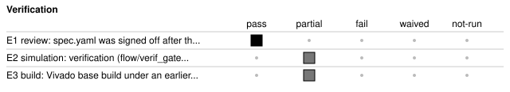

# t1_dimmer_counter: T1 LED dimmer and push-button counter for the Nexys A7-100T

<!-- Generated from handover.yaml by flow/handover.py (brief 68). Edit handover.yaml, or the text between the prose markers, then run: python -m flow.handover write results/68_agent_docs/20261102-114228-5a32/t1_dimmer_counter -->

The design drives 16 LEDs with a 16-bit up/down counter gated by 8-bit PWM brightness, and shows the counter and the active brightness on the eight-digit seven-segment display. Three debounced buttons change the counter (up, down, centre clear) and keep their own 32-bit press counts. Registers are reachable over the repository test shell on the USB-UART, which gives access to the counter, brightness, control, button and switch state, and press counts. The run reached a bitstream under an earlier Vivado release than the pinned one, so that build is not current. Verification reached V1 of V3, the configuration-and-debug stage did not pass, and nothing has been run on a board.

Not in scope:

- not a general-purpose UART core; the serial link exists only for the repository test shell protocol
- no auto-repeat on a held button; each debounced rising edge counts once
- no decimal-point or AN5/AN4 output; the decimal point stays off and AN5 and AN4 show nothing
- not board-tested, and no ILA debug build was attempted or recorded

Kind: agent-run; produced by the agent (agent run `20261102-114228-5a32`, [record](../summary.json)). State: built. For an agent: [AGENT.md](AGENT.md).

Run: model openai/gpt-6-luna (deepagents harness), 5 loops, 223 turns, 5,771,205 tokens, 3855.3 s wall time, 0.170661 USD model cost (provider-reported), stopped because: stage 6 visited more than 4 times (from the run record).

<!-- prose:what -->
<!-- /prose:what -->

## Technical parameters

| Item | Value |
|---|---|
| Part | `xc7a100tcsg324-1` |
| Board | nexys_a7_100t |
| Top | `t1_led_dimmer_counter` |
| Tool | Vivado 2026.1 |

Clocks:

- `clk`: 100 MHz (from `results/68_agent_docs/20261102-114228-5a32/t1_dimmer_counter/design.xdc`)

Resets:

- `cpu_reset_n`, active low: In rtl/t1_led_dimmer_counter.sv it asserts asynchronously and releases through two flops on clk. The resulting internal active-high reset is synchronous and also resets the shell. Every register in the register map resets to its listed value, leds to 0, and segments_n and digit_enable_n to all ones (display dark) until the first clock after release.

Interfaces:

- `clk` (clock input): Pin E3, LVCMOS33, 10.00 ns period in design.xdc.
- `cpu_reset_n` (reset input): Pin C12, active-low push-button. design.xdc sets input delays and a false path from it.
- `button_up` (input, 1 bit): Pin M18, active high. Two-flop synchroniser, then debounce.
- `button_down` (input, 1 bit): Pin P18, active high. Two-flop synchroniser, then debounce.
- `button_center` (input, 1 bit): Pin N17, active high. Two-flop synchroniser, then debounce.
- `switches` (input, 8 bits): SW0..SW7 on J15, L16, M13, R15, R17, T18, U18, R13. Passed through a single register stage in the RTL.
- `uart_rx` (input, 1 bit): Pin C4 (UART_TXD_IN) in design.xdc, to the shell receiver at UART_BAUD_DIVIDER clocks per bit.
- `uart_tx` (output, 1 bit): Pin D4 (UART_RXD_OUT) in design.xdc, from the shell transmitter. Registered output, idle high.
- `leds` (output, 16 bits): LD0..LD15 on H17, K15, J13, N14, R18, V17, U17, U16, V16, T15, U14, T16, V15, V14, V12, V11, active high. Registered.
- `segments_n` (output, 8 bits): Active low and registered. Bit 0 is CA (T10) through bit 6 CG (L18), bit 7 is DP (H15). The glyph table in the RTL uses the same order, with bit 0 as segment a.
- `digit_enable_n` (output, 8 bits): Bit n drives AN[n] (J17, J18, T9, J14, P14, T14, K2, U13), active low. AN3..AN0 show the counter with the most significant nibble at AN3, AN7 and AN6 show the active brightness with the high nibble at AN7, and AN5 and AN4 are enabled with all segments off.

Registers (from spec.yaml; where the RTL differs, the gaps say so):

| Offset | Name | Access | Reset | Bits |
|---|---|---|---|---|
| 0 | `DESIGN_ID` | R | 1412514883 | 31:0, ASCII T1DC |
| 4 | `COUNTER` | RW | 0 | 15:0 |
| 8 | `BRIGHTNESS` | RW | 0 | 7:0 |
| 12 | `CONTROL` | RW | 0 | bit 0 selects switch brightness; bit 1 disables seven-segment display; other bits reserved |
| 16 | `BUTTON_STATE` | R | 0 | bit 0 up, bit 1 down, bit 2 centre; debounced levels |
| 20 | `SWITCH_STATE` | R | 0 | bits 7:0 are SW7:SW0 |
| 24 | `UP_PRESS_COUNT` | R | 0 | 31:0 |
| 28 | `DOWN_PRESS_COUNT` | R | 0 | 31:0 |
| 32 | `CENTRE_PRESS_COUNT` | R | 0 | 31:0 |

| Parameter | Value | Legal range | Note |
|---|---|---|---|
| `DEBOUNCE_CYCLES` | 1,000,000 | integer of 1 or more; 0 or 1 removes the qualification delay | Spec rate: approximately 10 ms at 100 MHz. The benches simulate it at 4, so the spec's value was not simulated. Spec timing: DEBOUNCE_CYCLES = 1,000,000 cycles, approximately 10 ms at 100 MHz. |
| `PWM_PERIOD_CYCLES` | 256 | integer of 2 or more; only 256 uses the direct brightness-to-phase compare, other values use a scaled threshold | Spec rate: approximately 390.625 kHz at 100 MHz, above visible flicker. The benches simulate it at 16, so the spec's value was not simulated. Spec timing: PWM_PERIOD_CYCLES = 256 cycles, approximately 390.625 kHz at 100 MHz; this is above visible flicker rates. |
| `DISPLAY_SCAN_CYCLES` | 100,000 | integer of 1 or more | Spec rate: 100,000 cycles per digit, approximately 125 Hz full-frame refresh for eight digits at 100 MHz. The benches simulate it at 3, so the spec's value was not simulated. Spec timing: DISPLAY_SCAN_CYCLES = 100,000 cycles per digit selection, approximately 125 Hz full-frame refresh for eight digits at 100 MHz. |
| `UART_BAUD_DIVIDER` | 868 | integer of 2 or more, because the receiver samples at half a bit | Spec rate: 868 clk cycles per bit, approximately 115207 baud at 100 MHz. The benches simulate it at 8, so the spec's value was not simulated. Spec timing: UART_BAUD_DIVIDER = 868 clk cycles per bit, approximately 115207 baud at 100 MHz, close to 115200 baud. |

| Quantity | Value | Source |
|---|---|---|
| Resources | not measured | [Known gaps](#known-gaps-and-limits) |
| Timing | not measured | [Known gaps](#known-gaps-and-limits) |
| Power | not measured | [Known gaps](#known-gaps-and-limits) |
| Latency | not measured | [Known gaps](#known-gaps-and-limits) |
| Throughput | not measured | [Known gaps](#known-gaps-and-limits) |

<!-- prose:parameters -->
<!-- /prose:parameters -->

## How to build, run and reproduce

| Step | Command | Heavy slot | Time |
|---|---|---|---|
| what changed since this handover (stale records, changed files, tool and knowledge-bank pins) | `python -m flow.handover fresh results/68_agent_docs/20261102-114228-5a32/t1_dimmer_counter` | no | - |
| pick the work up again from the earliest stage the change or the staleness needs; needs a model (see docs/agent.md); Vivado for any stage from synthesis on | `python -m agent resume results/68_agent_docs/20261102-114228-5a32/t1_dimmer_counter "<change request>"` | yes | - |
| run the Verifier's simulation tests; needs Icarus Verilog and cocotb, or the simulation container | `python -m pytest -q results/68_agent_docs/20261102-114228-5a32/t1_dimmer_counter/tests/test_t1_dimmer_counter_rtl.py` | no | - |
| re-run the Verilator coverage simulation and the verification gates (line, toggle, functional and cover results); needs Verilator 5.036 or later and cocotb (the simulation container has them) | `SIM=verilator FDA_COVERAGE=1 FDA_SIM_RESULTS_DIR=results/68_agent_docs/20261102-114228-5a32/t1_dimmer_counter/build/verif/sim python -m pytest -q -x results/68_agent_docs/20261102-114228-5a32/t1_dimmer_counter/tests/test_t1_dimmer_counter_rtl.py && python3 flow/verif_gates.py results/68_agent_docs/20261102-114228-5a32/t1_dimmer_counter --runs results/68_agent_docs/20261102-114228-5a32/t1_dimmer_counter/build/verif/sim` | no | - |
| rebuild the bitstream with the flow; needs Vivado 2026.1 and a heavy slot | `flow/run_vivado.sh results/68_agent_docs/20261102-114228-5a32/t1_dimmer_counter base` | yes | - |

Tool: Vivado 2026.1. Build ID of the inputs at handover: `8ab2611c` (`python flow/manifest.py show results/68_agent_docs/20261102-114228-5a32/t1_dimmer_counter`: what a rebuild of today's sources and flow would carry; it changes when any build input or the flow changes, so it can differ from the build ID in an older evidence record). Knowledge-bank pin: `0959c27`.

| File | What |
|---|---|
| [`results/68_agent_docs/20261102-114228-5a32/t1_dimmer_counter/spec.md`](spec.md) | the request the run started from |
| [`results/68_agent_docs/20261102-114228-5a32/t1_dimmer_counter/spec.yaml`](spec.yaml) | the specification the Clarifier wrote, approved automatically with no human review |
| [`results/68_agent_docs/20261102-114228-5a32/t1_dimmer_counter/ARCHITECTURE.md`](ARCHITECTURE.md) | the architecture note, accepted automatically before any RTL (no human review) |
| [`results/68_agent_docs/20261102-114228-5a32/t1_dimmer_counter/rtl/t1_led_dimmer_counter.sv`](rtl/t1_led_dimmer_counter.sv) | RTL written by the Designer |
| [`results/68_agent_docs/20261102-114228-5a32/t1_dimmer_counter/design.xdc`](design.xdc) | pin, I/O standard and timing constraints |
| [`results/68_agent_docs/20261102-114228-5a32/t1_dimmer_counter/build.yaml`](build.yaml) | the build description read by the flow; its sources also include shared shell files the agent did not write (read from the repository, not copied here): shell/rtl/fpga_shell.sv, shell/rtl/reset_sync.sv, shell/rtl/shell_core.sv, shell/rtl/sync2.sv, shell/rtl/uart_rx.sv, shell/rtl/uart_tx.sv |
| [`results/68_agent_docs/20261102-114228-5a32/t1_dimmer_counter/model.py`](model.py) | the Modeller's reference model of the visible behaviour |
| [`results/68_agent_docs/20261102-114228-5a32/t1_dimmer_counter/tests/test_t1_dimmer_counter_rtl.py`](tests/test_t1_dimmer_counter_rtl.py) | the Verifier's cocotb benches and pytest entries |
| [`results/68_agent_docs/20261102-114228-5a32/t1_dimmer_counter/verif/testplan.yaml`](verif/testplan.yaml) | the test plan and mutant list read by the verification gates |
| [`results/68_agent_docs/20261102-114228-5a32/t1_dimmer_counter/build/review/09_configuration-and-debug.html`](build/review/09_configuration-and-debug.html) | the review page of stage configuration-and-debug: its exit gates and their failures at the last visit |

<!-- prose:build -->
<!-- /prose:build -->

## Verified

| ID | Activity | Result | What | Evidence | Conditions |
|---|---|---|---|---|---|
| E1 | review | partial | the specification and the architecture were approved automatically, with no human review (review off; the interview oracle not recorded only answered the interview questions); the interview asked 10 questions, 4 answered and 6 defaulted | [`results/68_agent_docs/20261102-114228-5a32/summary.json`](../summary.json) | - |
| E2 | simulation | partial | verification (flow/verif_gates.py) against the Modeller's reference model reached V1 of V3; the run asked for V1; V1 means every spec item is traced to a check and the benches use the blind model; V2 (simulation: seeded runs, a constrained-random test, bound assertions and formal tasks) did not pass: seeds run none (needs >=1); constrained random test ran False (needs True); assertions bound zero failures none (needs bound in the run; no failure); V3 (coverage (line, toggle, functional bins, cover properties), three seeds and the mutation score) did not pass: seeds run 0 (needs >=3); functional bins pct 0.0 (0/0) (needs 100); cover properties pct 0.0 (needs 100); line pct not measured (needs 95); toggle pct not measured (needs 80); mutation score pct not measured (needs 80); no board result (V-HW) is recorded | [`results/68_agent_docs/20261102-114228-5a32/t1_dimmer_counter/build/verif/verif_gates.json`](build/verif/verif_gates.json) | - |
| E3 | build | partial | Vivado base build under an earlier Vivado release than the pinned one: it reached bitstream, the gates of the stages it ran all passed and its timing was met; every number from that build is withdrawn (it cannot be re-measured on Vivado 2026.1 without a rebuild), so none is published | [`results/68_agent_docs/20261102-114228-5a32/t1_dimmer_counter/build/base/gates.json`](build/base/gates.json) | - |

Gates at handover: `clarify` pass, `board-and-device-planning` pass, `rtl-design-creation` pass, `constraints` pass, `synthesis` pass, `implementation` pass, `timing-closure` pass (Build records: summary.json records this stage as failed only because the visit limit refused its final entry before any gate ran; build/base/gates.json shows its gates passing), `power-closure` pass, `drc-closure` pass, `configuration-and-debug` fail.

<!-- prose:verified -->
<!-- /prose:verified -->

## Measured

Every value is read from the record by `python -m flow.handover fill`, not typed.

| ID | What | Value | Runs | Source | Conditions |
|---|---|---|---|---|---|
| M1 | model cost of the run, provider-reported | 0.170661 USD | 1 | [`results/68_agent_docs/20261102-114228-5a32/summary.json`](../summary.json) `cost_usd` | every role and the interview oracle, as the run summary records it |

<!-- prose:measured -->
<!-- /prose:measured -->

## Known gaps and limits

- **E3**: the base build was made under an earlier Vivado release than 2026.1: its result is not current and no number from it is published. Re-measure it, when the flow reaches the build again, with the resume command in How to build (python -m agent resume), and only then rely on its gates
- **E1**: review evidence is partial: the specification and the architecture were approved automatically, with no human review (review off; the interview oracle not recorded only answered the interview questions); the interview asked 10 questions, 4 answered and 6 defaulted
- **E2**: simulation evidence is partial: verification reached V1 of V3 (the run asked for V1); the checks that did not pass or did not run are listed in the evidence row
- **configuration-and-debug**: stage configuration-and-debug did not pass its gates in this run; at its last visit: bitstream: did not run FAIL. Build records: build/base/gates.json shows the base build's bitstream stage ran and its bitstream_present gate is true; there is no build/ila record and no probes.yaml, so the records show no debug build with the ILA was attempted or recorded. The base build is not the one that failed.
- **simulated_parameters**: the benches simulate at values other than the spec's (scaled for simulation speed or otherwise): DEBOUNCE_CYCLES is simulated at 4 (results/68_agent_docs/20261102-114228-5a32/t1_dimmer_counter/tests/test_t1_dimmer_counter_rtl.py:11) while spec.yaml gives 1000000; PWM_PERIOD_CYCLES is simulated at 16 (results/68_agent_docs/20261102-114228-5a32/t1_dimmer_counter/tests/test_t1_dimmer_counter_rtl.py:12) while spec.yaml gives 256; DISPLAY_SCAN_CYCLES is simulated at 3 (results/68_agent_docs/20261102-114228-5a32/t1_dimmer_counter/tests/test_t1_dimmer_counter_rtl.py:13) while spec.yaml gives 100000; UART_BAUD_DIVIDER is simulated at 8 (results/68_agent_docs/20261102-114228-5a32/t1_dimmer_counter/tests/test_t1_dimmer_counter_rtl.py:14) while spec.yaml gives 868. Behaviour that depends on the spec's value, such as a divider's timing against the clock, was not simulated at that value; it is stated here, not shown, unless another record covers it
- **resources**: resources not measured: no current Vivado build of this design has been recorded
- **timing**: timing not measured: no current Vivado build of this design has been recorded
- **power**: power not measured: no current Vivado build of this design has been recorded
- **latency**: latency not measured: the run measured no latency; the spec's latency promise is checked only by the benches
- **throughput**: throughput not measured: the run measured no throughput
- **uart_pins**: ARCHITECTURE.md lists uart_rx on D4 and uart_tx on C4. design.xdc, which is what was built, and spec.yaml put uart_rx on C4 (UART_TXD_IN) and uart_tx on D4 (UART_RXD_OUT). Trust the XDC; the architecture table is wrong.
- **reset_values**: the interview answer says BRIGHTNESS resets to 0x40 and CONTROL to 0x2. spec.yaml's register map and rtl/t1_led_dimmer_counter.sv reset both to 0, and CONTROL bit 1 set means display disabled, so the display is enabled after reset. The RTL is what was built.
- **pwm_period**: the interview answer says a 256-count phase with a prescale gives 1024 clock cycles and about 97.7 kHz. The RTL has no prescale: the phase counter advances every clock and wraps at PWM_PERIOD_CYCLES, so the period is 256 clocks, which matches the spec timing section.
- **pwm_scale**: with PWM_PERIOD_CYCLES at 256 the LEDs are on while phase < brightness, so brightness b gives duty b/256 for b below 255. Brightness 255 is a special case that keeps the LEDs on continuously and 0 is always off. The scale is therefore not exactly linear over the whole brightness range.
- **pwm_threshold_wrap**: for PWM_PERIOD_CYCLES other than 256, the scaled threshold is cast to the phase counter width. When the period is a power of two, brightness values just below 255 give a threshold equal to the period, which wraps to 0, so the LEDs would go off at high brightness. Read from the RTL only, not simulated at the spec's value, and the spec gives no other period.
- **button_events**: each button gives one event per debounced rising edge; releases are debounced but make no event. Centre clear beats simultaneous up and down; simultaneous up and down cancel, so the counter is unchanged. Every simultaneous event still increments its own press count. A UART write to COUNTER in the same cycle beats any button change to the counter. A button held through reset release produces one press after the debounce interval, because the debounced level resets to 0.
- **unmapped_accesses**: a window read of any offset not in the register map returns 0 with an OK status. A window write to a read-only or unmapped offset is ignored and the shell still answers OK; the READ_ONLY status applies only to the shell's own registers below 0x80. Host address is 0x80 plus the register offset.
- **register_widths**: a COUNTER write keeps bits 15:0 and a BRIGHTNESS write keeps bits 7:0. CONTROL stores all 32 written bits and reads them back, though only bits 0 and 1 have an effect. Reads of BRIGHTNESS return the stored UART value, not the switch-selected active brightness; in switch mode the stored value is kept and the display shows the switch value.
- **latency_count**: counted from the RTL: a button press reaches the counter register DEBOUNCE_CYCLES plus 2 clocks after the pin changes (two synchroniser flops, then the debounce count), and leds and the display outputs follow one clock later (registered). A full display frame is 8 times DISPLAY_SCAN_CYCLES clocks, as the spec says. Not measured on hardware.
- **switch_sync**: switches pass through one register stage (switches_sync) in the RTL, whereas the buttons use two flops. Asynchronous switch changes therefore have less metastability margin than the spec's synchronisation wording suggests.
- **xdc_io_constraints**: design.xdc false-paths all asynchronous inputs and sets output delays of max -3.000 and min 0.000 ns on the outputs. The negative max output delay was not reviewed and no current timing run has checked it.
- **unused_reset_module**: build.yaml reads shell/rtl/reset_sync.sv and sync2.sv, but the top-level RTL builds its own two-flop reset bridge and one-flop switch stage; only the shell's UART receiver uses sync2.

<!-- prose:gaps -->
<!-- /prose:gaps -->

## Next steps

1. Verification first: compare the cover results with the functional coverage before any new stimulus, then re-run the Verilator coverage command in the commands list. Get seeded runs, the constrained-random test and bound assertions (V2), then three seeds, 100 percent functional bins and cover properties, and line, toggle and mutation scores (V3). Add a check for the spec parameter values, or a long enough run at them, since the benches use scaled values.
2. Fix or document the PWM threshold wrap for periods other than 256, and settle the ARCHITECTURE.md and interview disagreements (UART pins, reset values, PWM period) in those documents so they match the RTL.
3. Resume the flow with python -m agent resume when it reaches the build again, so the base build is re-measured on Vivado 2026.1. Publish resources, timing and power only from that build.
4. Then work on stage configuration-and-debug: get its bitstream gate to run, and decide whether an ILA debug build is wanted.
5. Load the bitstream on a Nexys A7-100T and check the register map over the UART, the button counts and the display digit order by hand.

Open questions:

- Is any PWM_PERIOD_CYCLES other than 256 meant to be supported? The spec gives only 256, and the scaled path has the wrap noted in the gaps.

<!-- prose:next -->
<!-- /prose:next -->

## History

| Date | Brief | PR | What |
|---|---|---|---|
| 2026-11-02 | agent run | - | produced by the agent graph; stages that passed: clarify, board-and-device-planning, rtl-design-creation, constraints, synthesis, implementation, timing-closure, power-closure, drc-closure; the final entry into stage timing-closure was refused by the visit limit before any gate ran (summary stop), and the build records show its gates passing, so it is counted as passed |

<!-- prose:history -->
<!-- /prose:history -->
