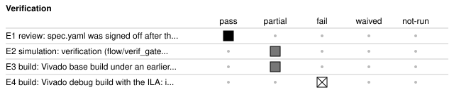

# t1_dimmer_counter: T1 LED dimmer and push-button counter for the Nexys A7-100T

<!-- Generated from handover.yaml by flow/handover.py (brief 68). Edit handover.yaml, or the text between the prose markers, then run: python -m flow.handover write results/68_agent_docs/20261102-135505-a8f2/t1_dimmer_counter -->

A single-clock design for the Nexys A7-100T. A 16-bit counter is stepped by three debounced push-buttons (up, down, centre-clear) or set by a register write. The counter value is shown on the 16 LEDs gated by a PWM waveform, and as four hexadecimal digits on the seven-segment display, with the selected 8-bit brightness shown on the two leftmost digits. Brightness comes from a register or from the eight switches, chosen by CONTROL bit 0. A USB-UART test shell (the fpga_shell module) gives read and write access to an eight-register map: counter, brightness, control, input status, three press counts and a design ID. How far the run got: the specification, planning, RTL, constraints, synthesis, implementation, timing, power and DRC stages passed their gates, and the Verifier's simulation reached V1 (E2, pass). Stage configuration-and-debug failed its gates (the bitstream did not run in that stage). The base and debug builds were made with an earlier Vivado release than 2026.1, so no current resource, timing or power figure exists.

Not in scope:

- It is not a verified hardware result: no current Vivado build, no passing bitstream gate and no on-board test is recorded.
- It does not define UART framing or test-shell command syntax itself; that lives in the external fpga_shell module, whose source is not in this run's file list.
- It has one clock domain only (clk); there are no derived clocks and no clock-domain crossings other than the input synchronizers.
- It does not use block RAM or DSP blocks; the register storage is flip-flops.
- It does not drive the decimal point or the middle display digits AN[5:4]; both stay off.

Kind: agent-run; produced by the agent (agent run `20261102-135505-a8f2`, [record](../summary.json)). State: built. For an agent: [AGENT.md](AGENT.md).

<!-- prose:what -->
<!-- /prose:what -->

## Technical parameters

| Item | Value |
|---|---|
| Part | `xc7a100tcsg324-1` |
| Board | nexys_a7_100t |
| Top | `t1_led_dimmer_counter` |
| Tool | Vivado 2026.1 |

Clocks:

- `clk`: 100 MHz (from `results/68_agent_docs/20261102-135505-a8f2/t1_dimmer_counter/design.xdc`)

Resets:

- `cpu_resetn`, active low: Board CPU reset button. In rtl/t1_led_dimmer_counter.sv the counter, brightness, control, press counts, debouncers, PWM and display scan reset synchronously on clk from ~cpu_resetn (not synchronized, so assertion and release are sampled by clk). A two-flop synchronizer (async assert, synchronous release) drives only the shell reset. Reset values: COUNTER 0, BRIGHTNESS 255, CONTROL 0, all press counts 0, display enabled.

Interfaces:

- `clk` (clock input): 100 MHz board oscillator; the XDC maps it to pin E3 and creates clock sys_clk_pin with a 10.00 ns period.
- `cpu_resetn` (reset input): Active-low CPU reset button, pin C12.
- `btn_up, btn_down, btn_center` (push-button inputs): BTNU, BTND and BTNC, assumed active high. Each passes a two-stage synchronizer and a stable-count debouncer before it counts as a press.
- `switches` (slide-switch input, 8 bits): SW[7:0]. They give the effective brightness when CONTROL bit 0 is set and are readable in INPUT_STATUS bits 7:0.
- `leds` (LED output, 16 bits): Counter bits gated by the PWM waveform; all off when the effective brightness is zero.
- `seg, dp, an` (seven-segment display outputs (7, 1 and 8 bits)): All active low. seg holds segments a to g, dp is held high (off), an selects one digit at a time. The XDC pins are the board ones.
- `uart_rxd, uart_txd` (UART): USB-UART into and out of the FPGA, pins C4 and D4. Both are connected to the fpga_shell instance; CLKS_PER_BIT is set from UART_BAUD_DIVIDER_CYCLES.

| Parameter | Value | Legal range | Note |
|---|---|---|---|
| `DEBOUNCE_CYCLES` | 1,000,000 | positive integer count of clk cycles; only the built value was exercised | Number of consecutive stable clk cycles before a button change is accepted (about 10 ms at 100 MHz). It also sets the debounce counter width. |
| `PWM_PERIOD_CYCLES` | 4096 | positive integer count of clk cycles; only the built value was exercised | Length of one PWM period in clk cycles. The on-time threshold is the brightness scaled to this period and rounded up; brightness 255 is always on and 0 always off. |
| `DISPLAY_DIGIT_CYCLES` | 100,000 | positive integer count of clk cycles; only the built value was exercised | Time each of the eight digit slots stays active. The interview answer asked for 131072 instead; the RTL keeps 100000 (see gaps). |
| `UART_BAUD_DIVIDER_CYCLES` | 868 | positive integer; 868 gives 115200 baud from 100 MHz | Passed to the shell as CLKS_PER_BIT. Change it only together with the clock frequency. |

| Quantity | Value | Source |
|---|---|---|
| Resources | not measured | [Known gaps](#known-gaps-and-limits) |
| Timing | not measured | [Known gaps](#known-gaps-and-limits) |
| Power | not measured | [Known gaps](#known-gaps-and-limits) |
| Latency | not measured | [Known gaps](#known-gaps-and-limits) |
| Throughput | not measured | [Known gaps](#known-gaps-and-limits) |

<!-- prose:parameters -->
<!-- /prose:parameters -->

## How to build, run and reproduce

| Step | Command | Heavy slot | Time |
|---|---|---|---|
| what changed since this handover (stale records, changed files, tool and knowledge-bank pins) | `python -m flow.handover fresh results/68_agent_docs/20261102-135505-a8f2/t1_dimmer_counter` | no | - |
| pick the work up again from the earliest stage the change or the staleness needs; needs a model (see docs/agent.md); Vivado for any stage from synthesis on | `python -m agent resume results/68_agent_docs/20261102-135505-a8f2/t1_dimmer_counter "<change request>"` | yes | - |
| run the Verifier's simulation tests; needs Icarus Verilog and cocotb, or the simulation container | `python -m pytest -q results/68_agent_docs/20261102-135505-a8f2/t1_dimmer_counter/tests/test_t1_dimmer_counter_rtl.py` | no | - |
| rebuild the bitstream with the flow; needs Vivado 2026.1 and a heavy slot | `flow/run_vivado.sh results/68_agent_docs/20261102-135505-a8f2/t1_dimmer_counter base` | yes | - |

Tool: Vivado 2026.1. Build ID of the inputs at handover: `f966b384` (`python flow/manifest.py show results/68_agent_docs/20261102-135505-a8f2/t1_dimmer_counter`: what a rebuild of today's sources and flow would carry; it changes when any build input or the flow changes, so it can differ from the build ID in an older evidence record). Knowledge-bank pin: `1fc7ed8`.

| File | What |
|---|---|
| [`results/68_agent_docs/20261102-135505-a8f2/t1_dimmer_counter/spec.md`](spec.md) | the request the run started from |
| [`results/68_agent_docs/20261102-135505-a8f2/t1_dimmer_counter/spec.yaml`](spec.yaml) | the signed-off specification written by the Clarifier |
| [`results/68_agent_docs/20261102-135505-a8f2/t1_dimmer_counter/ARCHITECTURE.md`](ARCHITECTURE.md) | the architecture note approved before any RTL |
| [`results/68_agent_docs/20261102-135505-a8f2/t1_dimmer_counter/rtl/t1_led_dimmer_counter.sv`](rtl/t1_led_dimmer_counter.sv) | RTL written by the Designer |
| [`results/68_agent_docs/20261102-135505-a8f2/t1_dimmer_counter/design.xdc`](design.xdc) | pin, I/O standard and timing constraints |
| [`results/68_agent_docs/20261102-135505-a8f2/t1_dimmer_counter/build.yaml`](build.yaml) | the build description read by the flow |
| [`results/68_agent_docs/20261102-135505-a8f2/t1_dimmer_counter/model.py`](model.py) | the Modeller's reference model of the visible behaviour |
| [`results/68_agent_docs/20261102-135505-a8f2/t1_dimmer_counter/tests/t1_dimmer_counter_bench.py`](tests/t1_dimmer_counter_bench.py) | the Verifier's cocotb benches and pytest entries |
| [`results/68_agent_docs/20261102-135505-a8f2/t1_dimmer_counter/tests/test_t1_dimmer_counter_rtl.py`](tests/test_t1_dimmer_counter_rtl.py) | the Verifier's cocotb benches and pytest entries |
| [`results/68_agent_docs/20261102-135505-a8f2/t1_dimmer_counter/verif/testplan.yaml`](verif/testplan.yaml) | the test plan and mutant list read by the verification gates |
| [`results/68_agent_docs/20261102-135505-a8f2/t1_dimmer_counter/probes.yaml`](probes.yaml) | the ILA probe list of the debug build |
| [`results/68_agent_docs/20261102-135505-a8f2/t1_dimmer_counter/build/review/09_configuration-and-debug.html`](build/review/09_configuration-and-debug.html) | the review page of stage configuration-and-debug: its exit gates and their failures at the last visit |

<!-- prose:build -->
<!-- /prose:build -->

## Verified

| ID | Activity | Result | What | Evidence | Conditions |
|---|---|---|---|---|---|
| E1 | review | pass | spec.yaml was signed off after the interview; the questions asked, answered and defaulted are in the run summary | [`results/68_agent_docs/20261102-135505-a8f2/summary.json`](../summary.json) | - |
| E2 | simulation | pass | verification stages (flow/verif_gates.py) against the Modeller's reference model; reached V1, the run asked for V1 | [`results/68_agent_docs/20261102-135505-a8f2/t1_dimmer_counter/build/verif/verif_gates.json`](build/verif/verif_gates.json) | - |
| E3 | build | partial | Vivado base build; flow stages that ran: rtl, post_synth, post_place, post_route, bitstream; built with an earlier Vivado release than the pinned one, so the result is not current | [`results/68_agent_docs/20261102-135505-a8f2/t1_dimmer_counter/build/base/gates.json`](build/base/gates.json) | - |
| E4 | build | partial | Vivado debug build with the ILA; flow stages that ran: none; built with an earlier Vivado release than the pinned one, so the result is not current | [`results/68_agent_docs/20261102-135505-a8f2/t1_dimmer_counter/build/ila/gates.json`](build/ila/gates.json) | - |

Gates at handover: `clarify` pass, `board-and-device-planning` pass, `rtl-design-creation` pass, `constraints` pass, `synthesis` pass, `implementation` pass, `timing-closure` pass, `power-closure` pass, `drc-closure` pass, `configuration-and-debug` fail.

<!-- prose:verified -->
<!-- /prose:verified -->

## Measured

Every value is read from the record by `python -m flow.handover fill`, not typed.

| ID | What | Value | Runs | Source | Conditions |
|---|---|---|---|---|---|
| M1 | model cost of the run, provider-reported | 0.164748 USD | 1 | [`results/68_agent_docs/20261102-135505-a8f2/summary.json`](../summary.json) `cost_usd` | every role and the interview oracle, as the run summary records it |

<!-- prose:measured -->
<!-- /prose:measured -->

## Known gaps and limits

- **E3**: the base build was made with an earlier Vivado release than 2026.1: rebuild it before relying on its gates or numbers
- **E4**: the debug build with the ILA was made with an earlier Vivado release than 2026.1: rebuild it before relying on its gates or numbers
- **configuration-and-debug**: stage configuration-and-debug did not pass its gates in this run; at its last visit: bitstream: did not run FAIL
- **resources**: resources not measured: no current Vivado build of this design has been recorded
- **timing**: timing not measured: no current Vivado build of this design has been recorded
- **power**: power not measured: no current Vivado build of this design has been recorded
- **latency**: latency not measured: the run measured no latency; the spec's latency promise is checked only by the benches
- **throughput**: throughput not measured: the run measured no throughput
- **clock_pin**: spec.yaml gives the clock board pin as W5; design.xdc, which was built, places clk on E3 (CLK100MHZ) with a 10.00 ns period. Treat E3 as what the build uses and correct the spec.
- **display_scan_period**: the interview answer asked for 2^17 (131072) clk cycles per digit, but spec.yaml, ARCHITECTURE.md and the RTL use DISPLAY_DIGIT_CYCLES = 100000. The RTL scans at 100000 cycles per digit; the spec disagrees with itself.
- **press_count_width**: an interview answer asked for 8-bit press counts wrapping at 256, but spec.yaml and the RTL use 32-bit counts (up_count, down_count, center_count) wrapping modulo 2^32. The RTL is what was built.
- **reset_style**: spec.yaml says asynchronous assertion with synchronized deassertion for all design state. In the RTL only the shell reset (shell_rst, from the two-flop reset_sync) has that style. The counter, registers, debouncers, PWM and display scan use a synchronous reset on rst = ~cpu_resetn, which is not synchronized, so releasing the button near a clk edge is unprotected for that logic. Constraints mark cpu_resetn as a false path, so timing analysis does not check it.
- **io_timing_constraints**: design.xdc sets input and output delays but then declares false paths from every input and to every output, so static timing analysis does not check the board I/O paths.
- **reset_values**: after reset: COUNTER 0, BRIGHTNESS 255 (0xFF), CONTROL 0 (switch brightness off, display enabled), all three press counts 0, win_rdata 0. DESIGN_ID always reads 1412514883 (0x54314443, ASCII T1DC).
- **unmapped_registers**: a read of any offset other than 0, 4, 8, 12, 16, 20, 24 or 28 returns 0. A write to an unmapped offset or to a read-only register (INPUT_STATUS, the press counts, DESIGN_ID) changes no register.
- **write_blocks_buttons**: in the RTL any write strobe (win_wr), even to an unmapped or read-only offset, takes the priority branch and suppresses the button update of COUNTER in that cycle. Press counts still increment. A write to COUNTER wins over buttons as spec.yaml says; a write to another address also costs a coincident button step.
- **button_priority**: when several buttons qualify in the same cycle, COUNTER follows centre first, then up, then down; the losing buttons still increment their own press counts. Presses are counted when the press is accepted (after DEBOUNCE_CYCLES stable cycles), not on release, and the counter changes in that same cycle.
- **input_status_raw**: INPUT_STATUS reads bits 7:0 as the switches, bit 8 as btn_up, bit 9 as btn_down and bit 10 as btn_center, taken directly from the top-level pins: they are neither synchronized nor debounced. Upper bits read 0.
- **partial_writes**: writes use the low bits only: COUNTER takes bits 15:0, BRIGHTNESS bits 7:0, CONTROL bits 1:0. Higher write-data bits are ignored. Reads are zero-extended to 32 bits.
- **read_latency**: win_rdata is a register loaded in the cycle win_rd is high, so read data is valid the cycle after the read strobe. It holds its value until the next read, and is cleared by reset.
- **brightness_display**: the seven-segment display and the LED PWM both use the effective brightness, so with CONTROL bit 0 set the two leftmost digits show the switch value, while BRIGHTNESS keeps its stored value. Digit AN[7] shows the high nibble and AN[6] the low nibble; AN[3:0] show the counter, AN[0] the lowest nibble.
- **fpga_shell_source**: the RTL instantiates fpga_shell with TIMEOUT_CYCLES 100000 and BUILD_STAMP 0, but the shell source is not in this run's file list. UART framing and command syntax come from that module and were not reviewed here.
- **assumption_buttons**: assumption carried from the spec: BTNU, BTND and BTNC are active high; 8-N-1 framing and the nearest integer baud divider are assumed; the register map is byte-addressed with 32-bit alignment.

<!-- prose:gaps -->
<!-- /prose:gaps -->

## Next steps

1. Run python -m flow.handover fresh on the run directory, then rebuild the base build with Vivado 2026.1 (flow/run_vivado.sh ... base) so that E3 is current and resources, timing and power can be recorded.
2. Rebuild the debug build with the ILA and read build/review/09_configuration-and-debug.html to find why the bitstream did not run in stage configuration-and-debug.
3. Decide the open spec disagreements (clock pin, display scan period, press-count width, reset style), then fix spec.yaml and ARCHITECTURE.md or the RTL so they agree.
4. Locate the fpga_shell source, review its framing and timeout behaviour, and add it to the file list.
5. Re-run the Verifier's simulation tests and check that they cover a write to an unmapped offset coinciding with a button press.
6. Test on the board: UART register reads and writes, button counting, PWM brightness from the switches, and display scan.

Open questions:

- Should the display scan interval be 100000 cycles (as built) or 131072 cycles (as in the interview answer)?
- Should the press counts be 32-bit (as built) or 8-bit with wrap at 256?
- Should the counter, registers and debouncers use a synchronized reset release, as spec.yaml requires, rather than the unsynchronized synchronous reset in the RTL?
- Should a write to an unmapped or read-only address still suppress a coincident button update of COUNTER?

<!-- prose:next -->
<!-- /prose:next -->

## History

| Date | Brief | PR | What |
|---|---|---|---|
| 2026-11-02 | agent run | - | produced by the agent graph; stages that passed: clarify, board-and-device-planning, rtl-design-creation, constraints, synthesis, implementation, timing-closure, power-closure, drc-closure |

<!-- prose:history -->
<!-- /prose:history -->
