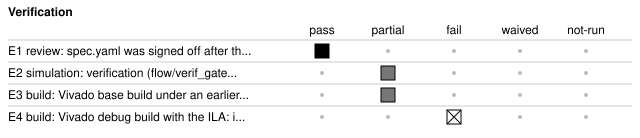

# t1_dimmer_counter: T1 LED dimmer and push-button counter

<!-- Generated from handover.yaml by flow/handover.py (brief 68). Edit handover.yaml, or the text between the prose markers, then run: python -m flow.handover write results/68_agent_docs/20261102-135505-a8f2/t1_dimmer_counter -->

A Nexys A7-100T design with a 16-bit up/down counter driven by three debounced push-buttons (up, down, centre-clear) and by UART register writes. The counter is shown on 16 PWM-dimmed LEDs and as hexadecimal on a scanned seven-segment display, which also shows the brightness. Registers are reached through the shared UART test shell. The run stopped because stage 9 was visited more than 4 times: the base build reached a bitstream under an earlier Vivado release and the debug build with the ILA did not complete. Verification reached V1 of V3 and no board run was recorded.

Not in scope:

- Not a general-purpose PWM or display core. The glyph table, the digit layout and the register map are fixed in t1_led_dimmer_counter.sv.
- Not a UART protocol implementation of its own. Framing and commands come from the shared shell (shell/rtl), and the spec leaves them unspecified.
- Not timing-, power- or resource-characterised on the pinned Vivado release. No current numbers exist.
- Not verified on a board, and the seven-segment glyphs were not checked against the pins.

Kind: agent-run; produced by the agent (agent run `20261102-135505-a8f2`, [record](../summary.json)). State: built. For an agent: [AGENT.md](AGENT.md).

Run: model openai/gpt-6-luna (deepagents harness), 5 loops, 208 turns, 6,466,831 tokens, 3623.4 s wall time, 0.164748 USD model cost (provider-reported), stopped because: stage 9 visited more than 4 times (from the run record).

<!-- prose:what -->
<!-- /prose:what -->

## Technical parameters

| Item | Value |
|---|---|
| Part | `xc7a100tcsg324-1` |
| Board | nexys_a7_100t |
| Top | `t1_led_dimmer_counter` |
| Tool | Vivado 2026.1 |

Clocks:

- `clk`: 100 MHz (from `results/68_agent_docs/20261102-135505-a8f2/t1_dimmer_counter/design.xdc`)

Resets:

- `cpu_resetn`, active low: In t1_led_dimmer_counter.sv the design registers are reset synchronously by rst = ~cpu_resetn with no synchroniser, so the button release is not aligned to clk. Only the shell receives the two-flop reset_sync (shell_rst, asserted asynchronously, released synchronously). The spec asks for synchronised release everywhere.

Interfaces:

- `clk` (100 MHz clock input, pin E3 in design.xdc (period 10.00 ns)): The spec says W5; design.xdc is what was built.
- `btn_up, btn_down, btn_center` (three active-high push-button inputs (BTNU, BTND, BTNC)): Synchronised by two flops, then debounced. The INPUT_STATUS bits read the raw pins instead.
- `switches` (8-bit input, SW[7:0]): Brightness source when CONTROL bit 0 is set. Not synchronised in RTL.
- `leds` (16-bit output, LED[15:0]): Counter bits gated by the PWM waveform.
- `seg` (7-bit active-low output, seg[0] is CA and seg[6] is CG): See the seg_bit_order gap.
- `dp` (1-bit output): Held at 1, which is inactive (active low).
- `an` (8-bit active-low digit enables): AN[3:0] show the counter, AN[7:6] show the brightness, AN[5:4] are always off.
- `uart_rxd` (serial input, pin C4): Goes to the shared fpga_shell (8-N-1, 115200 baud).
- `uart_txd` (serial output, pin D4): Driven by the shared fpga_shell.

Registers (from spec.yaml; where the RTL differs, the gaps say so):

| Offset | Name | Access | Reset | Bits |
|---|---|---|---|---|
| 0 | `COUNTER` | RW | 0 | 16 |
| 4 | `BRIGHTNESS` | RW | 255 | 8 |
| 8 | `CONTROL` | RW | 0 | 2 |
| 12 | `INPUT_STATUS` | RO | 0 | 11 |
| 16 | `UP_PRESS_COUNT` | RO | 0 | 32 |
| 20 | `DOWN_PRESS_COUNT` | RO | 0 | 32 |
| 24 | `CENTRE_PRESS_COUNT` | RO | 0 | 32 |
| 28 | `DESIGN_ID` | RO | 1412514883 | 32 |

| Parameter | Value | Legal range | Note |
|---|---|---|---|
| `DEBOUNCE_CYCLES` | 1,000,000 | Integer of 2 or more. The RTL does not range-check it. | A button level must be stable for this many sys_clk cycles, about 10 ms at 100 MHz. The same count applies to release. Spec timing: 1000000 sys_clk cycles of stable input, approximately 10 ms at 100 MHz. |
| `PWM_PERIOD_CYCLES` | 4096 | Integer of 2 or more. Only 4096 is specified, and the RTL does not range-check it. | PWM period in sys_clk cycles, about 24.4 kHz at 100 MHz. LEDs are on while the phase is below ceil(brightness*period/255); brightness 255 is always on and 0 is always off. Spec timing: 4096 sys_clk cycles, approximately 24.4 kHz at 100 MHz; selected to avoid visible flicker. |
| `DISPLAY_DIGIT_CYCLES` | 100,000 | Integer of 2 or more. The RTL does not range-check it. | Cycles per digit slot, about 1 ms per digit and 125 Hz for the eight-slot scan at 100 MHz. The interview answer asked for 2^17 cycles, but the RTL and spec use this value. Spec timing: 100000 sys_clk cycles per digit, approximately 1 ms per digit and 125 Hz for an eight-digit scan. |
| `UART_BAUD_DIVIDER_CYCLES` | 868 | Integer of 2 or more. The shell's receiver uses half of it. | sys_clk cycles per UART bit, 115200 baud at 100 MHz. The shell's frame timeout stays fixed at 100000 cycles in the RTL. Spec timing: 115200 baud with UART_BAUD_DIVIDER_CYCLES=868, the nearest integer divider for a 100 MHz clock. |

| Quantity | Value | Source |
|---|---|---|
| Resources | not measured | [Known gaps](#known-gaps-and-limits) |
| Timing | not measured | [Known gaps](#known-gaps-and-limits) |
| Power | not measured | [Known gaps](#known-gaps-and-limits) |
| Latency | not measured | [Known gaps](#known-gaps-and-limits) |
| Throughput | not measured | [Known gaps](#known-gaps-and-limits) |

<!-- prose:parameters -->
<!-- /prose:parameters -->

## How to build, run and reproduce

| Step | Command | Heavy slot | Time |
|---|---|---|---|
| what changed since this handover (stale records, changed files, tool and knowledge-bank pins) | `python -m flow.handover fresh results/68_agent_docs/20261102-135505-a8f2/t1_dimmer_counter` | no | - |
| pick the work up again from the earliest stage the change or the staleness needs; needs a model (see docs/agent.md); Vivado for any stage from synthesis on | `python -m agent resume results/68_agent_docs/20261102-135505-a8f2/t1_dimmer_counter "<change request>"` | yes | - |
| run the Verifier's simulation tests; needs Icarus Verilog and cocotb, or the simulation container | `python -m pytest -q results/68_agent_docs/20261102-135505-a8f2/t1_dimmer_counter/tests/test_t1_dimmer_counter_rtl.py` | no | - |
| re-run the Verilator coverage simulation and the verification gates (line, toggle, functional and cover results); needs Verilator 5.036 or later and cocotb (the simulation container has them) | `SIM=verilator FDA_COVERAGE=1 FDA_SIM_RESULTS_DIR=results/68_agent_docs/20261102-135505-a8f2/t1_dimmer_counter/build/verif/sim python -m pytest -q -x results/68_agent_docs/20261102-135505-a8f2/t1_dimmer_counter/tests/test_t1_dimmer_counter_rtl.py && python3 flow/verif_gates.py results/68_agent_docs/20261102-135505-a8f2/t1_dimmer_counter --runs results/68_agent_docs/20261102-135505-a8f2/t1_dimmer_counter/build/verif/sim` | no | - |
| rebuild the bitstream with the flow; needs Vivado 2026.1 and a heavy slot | `flow/run_vivado.sh results/68_agent_docs/20261102-135505-a8f2/t1_dimmer_counter base` | yes | - |

Tool: Vivado 2026.1. Build ID of the inputs at handover: `27f546c9` (`python flow/manifest.py show results/68_agent_docs/20261102-135505-a8f2/t1_dimmer_counter`: what a rebuild of today's sources and flow would carry; it changes when any build input or the flow changes, so it can differ from the build ID in an older evidence record). Knowledge-bank pin: `0959c27`.

| File | What |
|---|---|
| [`results/68_agent_docs/20261102-135505-a8f2/t1_dimmer_counter/spec.md`](spec.md) | the request the run started from |
| [`results/68_agent_docs/20261102-135505-a8f2/t1_dimmer_counter/spec.yaml`](spec.yaml) | the specification the Clarifier wrote, approved automatically with no human review |
| [`results/68_agent_docs/20261102-135505-a8f2/t1_dimmer_counter/ARCHITECTURE.md`](ARCHITECTURE.md) | the architecture note, accepted automatically before any RTL (no human review) |
| [`results/68_agent_docs/20261102-135505-a8f2/t1_dimmer_counter/rtl/t1_led_dimmer_counter.sv`](rtl/t1_led_dimmer_counter.sv) | RTL written by the Designer |
| [`results/68_agent_docs/20261102-135505-a8f2/t1_dimmer_counter/design.xdc`](design.xdc) | pin, I/O standard and timing constraints |
| [`results/68_agent_docs/20261102-135505-a8f2/t1_dimmer_counter/build.yaml`](build.yaml) | the build description read by the flow; its sources also include shared shell files the agent did not write (read from the repository, not copied here): shell/rtl/fpga_shell.sv, shell/rtl/reset_sync.sv, shell/rtl/shell_core.sv, shell/rtl/sync2.sv, shell/rtl/uart_rx.sv, shell/rtl/uart_tx.sv |
| [`results/68_agent_docs/20261102-135505-a8f2/t1_dimmer_counter/model.py`](model.py) | the Modeller's reference model of the visible behaviour |
| [`results/68_agent_docs/20261102-135505-a8f2/t1_dimmer_counter/tests/t1_dimmer_counter_bench.py`](tests/t1_dimmer_counter_bench.py) | the Verifier's cocotb benches and pytest entries |
| [`results/68_agent_docs/20261102-135505-a8f2/t1_dimmer_counter/tests/test_t1_dimmer_counter_rtl.py`](tests/test_t1_dimmer_counter_rtl.py) | the Verifier's cocotb benches and pytest entries |
| [`results/68_agent_docs/20261102-135505-a8f2/t1_dimmer_counter/verif/testplan.yaml`](verif/testplan.yaml) | the test plan and mutant list read by the verification gates |
| [`results/68_agent_docs/20261102-135505-a8f2/t1_dimmer_counter/probes.yaml`](probes.yaml) | the ILA probe list of the debug build; ILA t1_counter_ila on clk_IBUF_BUFG, depth 512; probes: counter (16 bits), pwm_phase (12 bits), display_digit (3 bits) |
| [`results/68_agent_docs/20261102-135505-a8f2/t1_dimmer_counter/build/review/09_configuration-and-debug.html`](build/review/09_configuration-and-debug.html) | the review page of stage configuration-and-debug: its exit gates and their failures at the last visit |

<!-- prose:build -->
<!-- /prose:build -->

## Verified

| ID | Activity | Result | What | Evidence | Conditions |
|---|---|---|---|---|---|
| E1 | review | partial | the specification and the architecture were approved automatically, with no human review (review off; the interview oracle not recorded only answered the interview questions); the interview asked 12 questions, 6 answered and 6 defaulted | [`results/68_agent_docs/20261102-135505-a8f2/summary.json`](../summary.json) | - |
| E2 | simulation | partial | verification (flow/verif_gates.py) against the Modeller's reference model reached V1 of V3; the run asked for V1; V1 means every spec item is traced to a check and the benches use the blind model; V2 (simulation: seeded runs, a constrained-random test, bound assertions and formal tasks) did not pass: seeds run none (needs >=1); constrained random test ran False (needs True); assertions bound zero failures none (needs bound in the run; no failure); V3 (coverage (line, toggle, functional bins, cover properties), three seeds and the mutation score) did not pass: seeds run 0 (needs >=3); functional bins pct 0.0 (0/0) (needs 100); cover properties pct 0.0 (needs 100); line pct not measured (needs 95); toggle pct not measured (needs 80); mutation score pct not measured (needs 80); no board result (V-HW) is recorded | [`results/68_agent_docs/20261102-135505-a8f2/t1_dimmer_counter/build/verif/verif_gates.json`](build/verif/verif_gates.json) | - |
| E3 | build | partial | Vivado base build under an earlier Vivado release than the pinned one: it reached bitstream, the gates of the stages it ran all passed and its timing was met; every number from that build is withdrawn (it cannot be re-measured on Vivado 2026.1 without a rebuild), so none is published | [`results/68_agent_docs/20261102-135505-a8f2/t1_dimmer_counter/build/base/gates.json`](build/base/gates.json) | - |
| E4 | build | fail | Vivado debug build with the ILA: its gates record is an error stub (JSONDecodeError: Expecting value: line 2 column 1 (char 1)) with no flow stages, and the build has no run record (build/ila/run.json): the build did not complete | [`results/68_agent_docs/20261102-135505-a8f2/t1_dimmer_counter/build/ila/gates.json`](build/ila/gates.json) | - |

Gates at handover: `clarify` pass, `board-and-device-planning` pass, `rtl-design-creation` pass, `constraints` pass, `synthesis` pass, `implementation` pass, `timing-closure` pass, `power-closure` pass, `drc-closure` pass, `configuration-and-debug` fail.

<!-- prose:verified -->
<!-- /prose:verified -->

## Measured

Every value is read from the record by `python -m flow.handover fill`, not typed.

| ID | What | Value | Runs | Source | Conditions |
|---|---|---|---|---|---|
| M1 | model cost of the run, provider-reported | 0.164748 USD | 1 | [`results/68_agent_docs/20261102-135505-a8f2/summary.json`](../summary.json) `cost_usd` | every role and the interview oracle, as the run summary records it |

<!-- prose:measured -->
<!-- /prose:measured -->

## Known gaps and limits

- **E3**: the base build was made under an earlier Vivado release than 2026.1: its result is not current and no number from it is published. Re-measure it, when the flow reaches the build again, with the resume command in How to build (python -m agent resume), and only then rely on its gates
- **E4**: the debug build with the ILA did not complete: build/ila/gates.json is an error stub, so there is no gate result for it
- **E1**: review evidence is partial: the specification and the architecture were approved automatically, with no human review (review off; the interview oracle not recorded only answered the interview questions); the interview asked 12 questions, 6 answered and 6 defaulted
- **E2**: simulation evidence is partial: verification reached V1 of V3 (the run asked for V1); the checks that did not pass or did not run are listed in the evidence row
- **configuration-and-debug**: stage configuration-and-debug did not pass its gates in this run; at its last visit: bitstream: did not run FAIL. Build records: build/base/gates.json shows the base build's bitstream stage ran and its bitstream_present gate is true; build/ila/gates.json is an error stub (JSONDecodeError: Expecting value: line 2 column 1 (char 1)) with no flow stages and there is no build/ila/run.json. The failing build is the debug build with the ILA, not the base build.
- **seg_bit_order**: the seven-segment glyph table (results/68_agent_docs/20261102-135505-a8f2/t1_dimmer_counter/rtl/t1_led_dimmer_counter.sv:85: digit 0 is 7'h01) is the mirror of the order design.xdc wires (seg[0] is CA, line 35; seg[6] is CG, line 41): with segments active low, digit 0 should be 7'h40. model.py:50 holds the same table, so the bench compares the design with a copy of its own table and cannot catch this. No simulation or board run checked the glyphs.
- **resources**: resources not measured: no current Vivado build of this design has been recorded
- **timing**: timing not measured: no current Vivado build of this design has been recorded
- **power**: power not measured: no current Vivado build of this design has been recorded
- **latency**: latency not measured: the run measured no latency; the spec's latency promise is checked only by the benches
- **throughput**: throughput not measured: the run measured no throughput
- **clock_pin**: spec.yaml gives the clock pin as W5, but design.xdc places clk on E3 and creates a 10.00 ns clock on it. design.xdc, generated from the board master constraints, is what was built.
- **reset_style**: spec.yaml and ARCHITECTURE.md ask for asynchronous assertion with synchronised release for the whole design. The RTL does this only for the shell (reset_sync, shell_rst). The counter, brightness, control, press counters, debouncers, PWM and scan counters use rst = ~cpu_resetn sampled synchronously on clk, with no synchroniser on the release. The RTL is what was built.
- **press_count_width**: an interview answer says the press counters are 8-bit and wrap at 256, but spec.yaml registers.map and the RTL (up_count, down_count, center_count) are 32-bit. The RTL and the spec map are what was built.
- **display_period**: an interview answer asks for 2^17 cycles per digit and ARCHITECTURE.md notes the same proposal, but spec.yaml and the RTL parameter use 100000 cycles. The RTL value is what was built.
- **register_access**: a write to any offset other than the three RW ones (COUNTER, BRIGHTNESS, CONTROL) is silently ignored, and the shell still answers OK. Reads of any other offset, including unaligned ones, return zero. Writes use only the low bits (16, 8 and 2 respectively); upper write bits are dropped. Reads have no side effects.
- **window_address**: the design decodes only win_addr, the low seven bits of the shell address. The shell routes an access to the design only when address bit 7 is set (shell_core.sv), so the spec offsets are the low seven bits of that window address.
- **write_priority**: the counter takes a software write first, then a centre clear, then up, then down (the if/else chain in t1_led_dimmer_counter.sv). The three press counters increment independently of this chain, so a press that loses to a software write is still counted.
- **input_status**: INPUT_STATUS bits 7:0 are the raw switches and bits 10:8 are the raw up, down and centre button pins. They are not synchronised or debounced, and the value is captured into the read-data register on a read. The reset value of zero is only the read-data register before any read.
- **brightness_display**: when CONTROL bit 0 is set, the switches replace BRIGHTNESS for the PWM and also for the two brightness digits on the display. CONTROL bit 1 turns all digits off (an and seg all high) but does not affect the LEDs.
- **latency_counts**: counted from the RTL: a button reaches btn_sync after two flops, then about DEBOUNCE_CYCLES cycles of stable level are needed. The counter and the press count update on the same clock edge that sets the debounced flag. A release must also be stable for that long before the next press can be accepted. The LED duty compares brightness and phase combinationally, so a brightness change acts at once rather than at the next PWM interval; display digits follow the counter combinationally, one scan slot being shown at a time.
- **assumption_scan_slots**: assumption: the scan runs eight slots of DISPLAY_DIGIT_CYCLES each, with slots 4 and 5 blank, so each lit digit is on for one slot in eight.

<!-- prose:gaps -->
<!-- /prose:gaps -->

## Next steps

1. Settle the seg_bit_order question first: correct the glyph table in t1_led_dimmer_counter.sv or the pin map, and write the expected glyph values in model.py independently of the RTL. Then re-run the verification command to reach V2 and V3 (seeded runs, constrained-random test, assertions, coverage, mutation score).
2. Reconcile the spec with what was built: press-counter width, display period, clock pin, and reset style (add a synchroniser on the design reset release, or change the spec).
3. Find why the debug build with the ILA left an error stub in build/ila/gates.json, fix it, and rebuild it.
4. When the flow reaches the build again, re-measure the base build with python -m agent resume on Vivado 2026.1, then record resources, timing and power.
5. Run a board test through the UART shell: read DESIGN_ID, exercise the buttons and CONTROL, and check the seven-segment glyphs by eye.

Open questions:

- Which is right for the seven-segment order, the glyph table (results/68_agent_docs/20261102-135505-a8f2/t1_dimmer_counter/rtl/t1_led_dimmer_counter.sv:85) or the pin map (design.xdc, line 35 to line 41)?
- Should the design reset be synchronised on release as the spec says, or is the direct use of cpu_resetn acceptable?

<!-- prose:next -->
<!-- /prose:next -->

## History

| Date | Brief | PR | What |
|---|---|---|---|
| 2026-11-02 | agent run | - | produced by the agent graph; stages that passed: clarify, board-and-device-planning, rtl-design-creation, constraints, synthesis, implementation, timing-closure, power-closure, drc-closure |

<!-- prose:history -->
<!-- /prose:history -->
