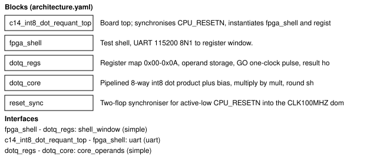
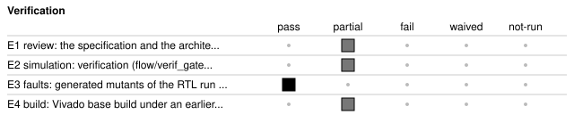

# c14_int8_dot_requant: Quantised-layer int8 dot-product and requantise unit behind the UART test shell

<!-- Generated from handover.yaml by flow/handover.py (brief 68). Edit handover.yaml, or the text between the prose markers, then run: python -m flow.handover write results/68_agent_docs/20261107-005621-8deb/c14_int8_dot_requant -->

The design computes an eight-way signed int8 dot product plus a 32-bit bias. It multiplies the sum by a 16-bit unsigned multiplier, rounds and shifts right by a programmable amount, and clamps the result to a signed byte (0..127 when relu is set). Operands, results and a READY flag are reached over the UART test shell on the Nexys A7-100T, and LED0 shows READY. The run reached RTL, benches and mutation testing: verification reached V2 of V3, the cover-property gate at V3 failed, and no stage from constraints onward ran. The only build was made under an earlier Vivado release and no figure from it is published. The specification and architecture were approved automatically, with no human review.

Not in scope:

- Not a general matrix or layer engine. It computes one eight-element dot product per GO, and the shell UART access dominates throughput.
- No overflow handling. acc is a plain 32-bit sum that wraps, and a shift outside 1..31 is out of contract.
- Not safe against operand writes while a computation is in flight. The core samples the operand registers every cycle and does not latch them at GO.
- Not hardware-verified. No bring-up or board result is recorded.
- Not timing-, resource- or power-measured on the pinned Vivado release.

Kind: agent-run; produced by the agent (agent run `20261107-005621-8deb`, [record](../summary.json)). State: rtl. For an agent: [AGENT.md](AGENT.md).

Run: model claude-sonnet-5-5 (claude_code harness), 6 loops, 101 turns, 2,482,927 tokens, 3379 s wall time, 2.9032 USD plan-cost estimate (not billed), stopped because: stage 2 visited more than 4 times (from the run record).

<!-- prose:what -->
<!-- /prose:what -->

## Technical parameters

| Item | Value |
|---|---|
| Part | `xc7a100tcsg324-1` |
| Board | nexys_a7_100t |
| Top | `c14_int8_dot_requant_top` |
| Tool | Vivado 2026.1 |

Clocks:

- `CLK100MHZ`: 100 MHz (from `results/68_agent_docs/20261107-005621-8deb/c14_int8_dot_requant/design.xdc`)

Resets:

- `CPU_RESETN`, active low: Board button (C12). The shell reset_sync (shell/rtl/reset_sync.sv) asserts it asynchronously and releases it synchronously to the internal active-high rst. dotq_regs, dotq_core and the shell flops use synchronous reset. The spec calls the reset "synchronised"; the RTL does this only on release.

Interfaces:

- `CLK100MHZ` (clock input, 100 MHz oscillator, pin E3): Single clock domain for shell and arithmetic; no MMCM or PLL (design.xdc creates sys_clk_pin with a period of 10.00 ns).
- `UART_TXD_IN` (UART serial input, 115200 baud 8N1, pin C4) ([datasheet](../../../../shell/PROTOCOL.md)): Host-to-FPGA data. It is asynchronous and is synchronised inside the shell, and design.xdc gives it a 2.0 ns maximum input delay.
- `UART_RXD_OUT` (UART serial output, 115200 baud 8N1, pin D4) ([datasheet](../../../../shell/PROTOCOL.md)): FPGA-to-host data. The register offsets in this handover are the shell window offsets; the host addresses them with address bit 7 set.
- `LED0` (status LED output, pin H17): Shows the READY flag. The RTL top port is the bus LED[0:0] (design.xdc names LED[0]), not a port called LED0; LED0 is an internal alias.

Registers (from spec.yaml; where the RTL differs, the gaps say so):

| Offset | Name | Access | Reset | Bits |
|---|---|---|---|---|
| 0x00 | `A_LO` | RW | 0x00000000 | [31:0] activations 0..3, a_i in bits [8i+7:8i] |
| 0x01 | `A_HI` | RW | 0x00000000 | [31:0] activations 4..7, a_(4+i) in bits [8i+7:8i] |
| 0x02 | `W_LO` | RW | 0x00000000 | [31:0] weights 0..3, same packing |
| 0x03 | `W_HI` | RW | 0x00000000 | [31:0] weights 4..7, same packing |
| 0x04 | `BIAS` | RW | 0x00000000 | [31:0] signed bias |
| 0x05 | `MULT` | RW | 0x00000000 | [15:0] unsigned multiplier; [31:16] read 0 |
| 0x06 | `CTRL` | RW | 0x00000001 | [4:0] shift (1..31), [8] relu; other bits read 0 |
| 0x07 | `GO` | WO | 0x00000000 | any write starts one computation; reads 0 |
| 0x08 | `Y` | RO | 0x00000000 | [7:0] limited answer (two's complement); [31:8] read 0 |
| 0x09 | `ACC` | RO | 0x00000000 | [31:0] the signed accumulator including the bias |
| 0x0A | `STATUS` | RO | 0x00000000 | [0] READY; other bits 0 |

| Parameter | Value | Legal range | Note |
|---|---|---|---|
| `CLKS_PER_BIT` | 868 | Positive integer. 868 gives 115200 baud at the 100 MHz clock; any other value changes the baud rate. | The spec gives 868 clocks per UART bit. The benches ran at 8, so the spec value was not simulated. |
| `TIMEOUT_CYCLES` | 100,000,000 | Positive integer, the shell frame-gap timeout in clocks. | Spec default, defaulted by the interview oracle. It is much longer than the shell's own default. The benches ran at 2000, so the spec value was not simulated. |
| `BUILD_STAMP` | 0 | Any 32-bit value. | The flow overrides the default of 0. The benches ran at 464367618, so the spec value was not simulated. |
| `DESIGN_ID` | DOTQ | Fixed at 32'h444F5451 (ASCII D,O,T,Q); not changeable from outside. | The spec lists it as a parameter, but in c14_int8_dot_requant_top.sv it is a localparam passed to the shell. |

| Quantity | Value | Source |
|---|---|---|
| Resources | not measured | [Known gaps](#known-gaps-and-limits) |
| Timing | not measured | [Known gaps](#known-gaps-and-limits) |
| Power | not measured | [Known gaps](#known-gaps-and-limits) |
| Latency | not measured | [Known gaps](#known-gaps-and-limits) |
| Throughput | not measured | [Known gaps](#known-gaps-and-limits) |

<!-- prose:parameters -->
<!-- /prose:parameters -->

## How to build, run and reproduce

| Step | Command | Heavy slot | Time |
|---|---|---|---|
| what changed since this handover (stale records, changed files, tool and knowledge-bank pins) | `python -m flow.handover fresh results/68_agent_docs/20261107-005621-8deb/c14_int8_dot_requant` | no | - |
| pick the work up again from the earliest stage the change or the staleness needs; needs a model (see docs/agent.md); Vivado for any stage from synthesis on | `python -m agent resume results/68_agent_docs/20261107-005621-8deb/c14_int8_dot_requant "<change request>"` | yes | - |
| run the Verifier's simulation tests; needs Icarus Verilog and cocotb, or the simulation container | `python -m pytest -q results/68_agent_docs/20261107-005621-8deb/c14_int8_dot_requant/tests/test_c14_int8_dot_requant_rtl.py` | no | - |
| re-run the Verilator coverage simulation and the verification gates (line, toggle, functional and cover results); needs Verilator 5.036 or later and cocotb (the simulation container has them) | `SIM=verilator FDA_COVERAGE=1 FDA_SIM_RESULTS_DIR=results/68_agent_docs/20261107-005621-8deb/c14_int8_dot_requant/build/verif/sim python -m pytest -q -x results/68_agent_docs/20261107-005621-8deb/c14_int8_dot_requant/tests/test_c14_int8_dot_requant_rtl.py && python3 flow/verif_gates.py results/68_agent_docs/20261107-005621-8deb/c14_int8_dot_requant --runs results/68_agent_docs/20261107-005621-8deb/c14_int8_dot_requant/build/verif/sim` | no | - |
| rebuild the bitstream with the flow; needs Vivado 2026.1 and a heavy slot | `flow/run_vivado.sh results/68_agent_docs/20261107-005621-8deb/c14_int8_dot_requant base` | yes | - |

Tool: Vivado 2026.1. Build ID of the inputs at handover: `cdded757` (`python flow/manifest.py show results/68_agent_docs/20261107-005621-8deb/c14_int8_dot_requant`: what a rebuild of today's sources and flow would carry; it changes when any build input or the flow changes, so it can differ from the build ID in an older evidence record). Knowledge-bank pin: `0959c27`.

| File | What |
|---|---|
| [`results/68_agent_docs/20261107-005621-8deb/c14_int8_dot_requant/spec.md`](spec.md) | the request the run started from |
| [`results/68_agent_docs/20261107-005621-8deb/c14_int8_dot_requant/spec.yaml`](spec.yaml) | the specification the Clarifier wrote, approved automatically with no human review |
| [`results/68_agent_docs/20261107-005621-8deb/c14_int8_dot_requant/ARCHITECTURE.md`](ARCHITECTURE.md) | the architecture note, accepted automatically before any RTL (no human review) |
| [`results/68_agent_docs/20261107-005621-8deb/c14_int8_dot_requant/architecture.yaml`](architecture.yaml) | the machine-checked architecture: blocks, clocks, predicted resources |
| [`results/68_agent_docs/20261107-005621-8deb/c14_int8_dot_requant/rtl/c14_int8_dot_requant_top.sv`](rtl/c14_int8_dot_requant_top.sv) | RTL written by the Designer |
| [`results/68_agent_docs/20261107-005621-8deb/c14_int8_dot_requant/rtl/dotq_core.sv`](rtl/dotq_core.sv) | RTL written by the Designer |
| [`results/68_agent_docs/20261107-005621-8deb/c14_int8_dot_requant/rtl/dotq_regs.sv`](rtl/dotq_regs.sv) | RTL written by the Designer |
| [`results/68_agent_docs/20261107-005621-8deb/c14_int8_dot_requant/rtl/reset_sync.sv`](rtl/reset_sync.sv) | RTL written by the Designer (empty: it holds no code; the build reads shell/rtl/reset_sync.sv for this module instead) |
| [`results/68_agent_docs/20261107-005621-8deb/c14_int8_dot_requant/design.xdc`](design.xdc) | pin, I/O standard and timing constraints |
| [`results/68_agent_docs/20261107-005621-8deb/c14_int8_dot_requant/build.yaml`](build.yaml) | the build description read by the flow; its sources also include shared shell files the agent did not write (read from the repository, not copied here): shell/rtl/fpga_shell.sv, shell/rtl/reset_sync.sv, shell/rtl/shell_core.sv, shell/rtl/sync2.sv, shell/rtl/uart_rx.sv, shell/rtl/uart_tx.sv |
| [`results/68_agent_docs/20261107-005621-8deb/c14_int8_dot_requant/model.py`](model.py) | the Modeller's reference model of the visible behaviour |
| [`results/68_agent_docs/20261107-005621-8deb/c14_int8_dot_requant/tests/c14_bench.py`](tests/c14_bench.py) | the Verifier's cocotb benches and pytest entries |
| [`results/68_agent_docs/20261107-005621-8deb/c14_int8_dot_requant/tests/test_c14_int8_dot_requant_rtl.py`](tests/test_c14_int8_dot_requant_rtl.py) | the Verifier's cocotb benches and pytest entries |
| [`results/68_agent_docs/20261107-005621-8deb/c14_int8_dot_requant/verif/testplan.yaml`](verif/testplan.yaml) | the test plan and mutant list read by the verification gates |
| [`results/68_agent_docs/20261107-005621-8deb/c14_int8_dot_requant/verif/checkers/c14_int8_dot_requant_checker.sv`](verif/checkers/c14_int8_dot_requant_checker.sv) | bound assertion and cover checkers |
| [`results/68_agent_docs/20261107-005621-8deb/c14_int8_dot_requant/verif/checkers/v_macros.svh`](verif/checkers/v_macros.svh) | bound assertion and cover checkers |
| [`results/68_agent_docs/20261107-005621-8deb/c14_int8_dot_requant/build/review/02_rtl-design-creation.html`](build/review/02_rtl-design-creation.html) | the review page of stage rtl-design-creation: its exit gates and their failures at the last visit |

<!-- prose:build -->
<!-- /prose:build -->

## Verified

| ID | Activity | Result | What | Evidence | Conditions |
|---|---|---|---|---|---|
| E1 | review | partial | the specification and the architecture were approved automatically, with no human review (review off; the interview oracle claude-haiku-5-5 only answered the interview questions); the interview asked 6 questions, 3 answered and 3 defaulted | [`results/68_agent_docs/20261107-005621-8deb/summary.json`](../summary.json) | - |
| E2 | simulation | partial | verification (flow/verif_gates.py) against the Modeller's reference model reached V2 of V3; the run asked for V3; V2 means simulation: seeded runs, a constrained-random test, bound assertions and formal tasks; V3 (coverage (line, toggle, functional bins, cover properties), three seeds and the mutation score) did not pass: cover properties pct 0.0 (needs 100); cover properties unhit C_led_fall, C_led_high, C_led_rise, C_rx_start, C_tx_start; no board result (V-HW) is recorded | [`results/68_agent_docs/20261107-005621-8deb/c14_int8_dot_requant/build/verif/verif_gates.json`](build/verif/verif_gates.json) | - |
| E3 | faults | pass | generated mutants of the RTL run against the Verifier's benches, each of which must make a test fail: 17 sampled of 32 candidates, 17 evaluated, 17 killed, 0 survived, 0 timed out | [`results/68_agent_docs/20261107-005621-8deb/c14_int8_dot_requant/build/verif/mutation.json`](build/verif/mutation.json) | - |
| E4 | build | partial | Vivado base build under an earlier Vivado release than the pinned one: it reached post_synth, the gates of the stages it ran all passed but its timing record says timing was not met after synthesis (the figures are withdrawn); every number from that build is withdrawn (it cannot be re-measured on Vivado 2026.1 without a rebuild), so none is published | [`results/68_agent_docs/20261107-005621-8deb/c14_int8_dot_requant/build/base/gates.json`](build/base/gates.json) | - |

Gates at handover: `clarify` pass, `board-and-device-planning` pass, `rtl-design-creation` fail, `constraints` not-run, `synthesis` not-run, `implementation` not-run, `timing-closure` not-run, `power-closure` not-run, `drc-closure` not-run, `configuration-and-debug` not-run.

<!-- prose:verified -->
<!-- /prose:verified -->

## Measured

Every value is read from the record by `python -m flow.handover fill`, not typed.

| ID | What | Value | Runs | Source | Conditions |
|---|---|---|---|---|---|
| M1 | simulation seeds run | 3 | 1 | [`results/68_agent_docs/20261107-005621-8deb/c14_int8_dot_requant/build/verif/verif_gates.json`](build/verif/verif_gates.json) `stages.V3.checks.seeds_run.value` | Verilator coverage simulation of the RTL against the Modeller's model, every seed the bench ran |
| M2 | line coverage | 100 % | 1 | [`results/68_agent_docs/20261107-005621-8deb/c14_int8_dot_requant/build/verif/verif_gates.json`](build/verif/verif_gates.json) `stages.V3.checks.line_pct.value` | Verilator coverage simulation of the RTL against the Modeller's model, every seed the bench ran |
| M3 | toggle coverage | 100 % | 1 | [`results/68_agent_docs/20261107-005621-8deb/c14_int8_dot_requant/build/verif/verif_gates.json`](build/verif/verif_gates.json) `stages.V3.checks.toggle_pct.value` | Verilator coverage simulation of the RTL against the Modeller's model, every seed the bench ran |
| M4 | functional coverage bins hit | 100.0 (50/50) | 1 | [`results/68_agent_docs/20261107-005621-8deb/c14_int8_dot_requant/build/verif/verif_gates.json`](build/verif/verif_gates.json) `stages.V3.checks.functional_bins_pct.value` | Verilator coverage simulation of the RTL against the Modeller's model, every seed the bench ran |
| M5 | cover properties hit | 0.0 % | 1 | [`results/68_agent_docs/20261107-005621-8deb/c14_int8_dot_requant/build/verif/verif_gates.json`](build/verif/verif_gates.json) `stages.V3.checks.cover_properties_pct.value` | Verilator coverage simulation of the RTL against the Modeller's model, every seed the bench ran |
| M6 | mutation score of the Verifier's benches | 100 % | 1 | [`results/68_agent_docs/20261107-005621-8deb/c14_int8_dot_requant/build/verif/mutation.json`](build/verif/mutation.json) `score_pct` | generated mutants sampled from the RTL, run in the simulation sandbox |

<!-- prose:measured -->
<!-- /prose:measured -->

## Known gaps and limits

- **REQ-04**: REQ-04 has no passing evidence for every proof method: hardware (uart_tests) is pending: no bring-up result
- **REQ-06**: REQ-06 has no passing evidence for every proof method: hardware (uart_tests) is pending: no bring-up result
- **REQ-07**: REQ-07 has no passing evidence for every proof method: hardware (uart_tests) is pending: no bring-up result
- **REQ-08**: REQ-08 has no passing evidence for every proof method: hardware (uart_tests) is pending: no bring-up result
- **REQ-09**: REQ-09 has no passing evidence for every proof method: hardware (uart_tests) is pending: no bring-up result
- **REQ-11**: REQ-11 has no passing evidence for every proof method: analysis (post_route:setup) is not run (the stage that makes this evidence did not run): gate post_route:setup = None
- **cover_properties**: cover properties C_led_fall, C_led_high, C_led_rise, C_rx_start, C_tx_start read 0.0 % while the functional bins were all hit (100.0 (50/50)) and 3 seeds ran. The benches did drive the design, so a missing stimulus is unlikely to be the whole cause; the cover results and the functional coverage disagree. Compare the two before proposing any new stimulus. The checker c14_int8_dot_requant_checker.sv binds clk to CLK100MHZ, rst to CPU_RESETN, led to LED0, rxd_out to UART_RXD_OUT, txd_in to UART_TXD_IN into c14_int8_dot_requant_top (outside Icarus only). Every bound name is declared in the top RTL, so a misspelt binding is not the cause. The cause is not settled by the records. To re-run the coverage simulation: SIM=verilator FDA_COVERAGE=1 FDA_SIM_RESULTS_DIR=results/68_agent_docs/20261107-005621-8deb/c14_int8_dot_requant/build/verif/sim python -m pytest -q -x results/68_agent_docs/20261107-005621-8deb/c14_int8_dot_requant/tests/test_c14_int8_dot_requant_rtl.py && python3 flow/verif_gates.py results/68_agent_docs/20261107-005621-8deb/c14_int8_dot_requant --runs results/68_agent_docs/20261107-005621-8deb/c14_int8_dot_requant/build/verif/sim
- **E4**: the base build was made under an earlier Vivado release than 2026.1: its result is not current and no number from it is published. Re-measure it, when the flow reaches the build again, with the resume command in How to build (python -m agent resume), and only then rely on its gates
- **E1**: review evidence is partial: the specification and the architecture were approved automatically, with no human review (review off; the interview oracle claude-haiku-5-5 only answered the interview questions); the interview asked 6 questions, 3 answered and 3 defaulted
- **E2**: simulation evidence is partial: verification reached V2 of V3 (the run asked for V3); the checks that did not pass or did not run are listed in the evidence row
- **rtl-design-creation**: stage rtl-design-creation did not pass its gates in this run; at its last visit: V3 cover_properties_pct: cover properties not hit: C_led_fall, C_led_high, C_led_rise, C_rx_start, C_tx_start: add or extend a test that drives the design into each, or correct the `V_COVER` expression if it can never be true [value 0.0, need 100] FAIL V3 cover_properties_unhit: cover properties not hit: C_led_fall, C_led_high, C_led_rise, C_rx_start, C_tx_start: add or extend a test that drives t ...
- **constraints**: stage constraints was not run: the run stopped before this stage (stage 2 visited more than 4 times)
- **synthesis**: stage synthesis was not run: the run stopped before this stage (stage 2 visited more than 4 times)
- **implementation**: stage implementation was not run: the run stopped before this stage (stage 2 visited more than 4 times)
- **timing-closure**: stage timing-closure was not run: the run stopped before this stage (stage 2 visited more than 4 times)
- **power-closure**: stage power-closure was not run: the run stopped before this stage (stage 2 visited more than 4 times)
- **drc-closure**: stage drc-closure was not run: the run stopped before this stage (stage 2 visited more than 4 times)
- **configuration-and-debug**: stage configuration-and-debug was not run: the run stopped before this stage (stage 2 visited more than 4 times)
- **oracle_record**: BUILD_NOTE.md names the interview oracle as openai/gpt-6-luna, while summary.json names claude-haiku-5-5; the two records disagree and neither is confirmed, so the specification's provenance is uncertain
- **formal**: formal checks were planned for REQ-01, REQ-02, REQ-03, REQ-05, REQ-06 and did not run; each was replaced by a simulation check (verif/testplan.yaml replan). Reason recorded: SymbiYosys is not installed here, so exactness of acc is checked by directed extremes and random cases against the model.
- **simulated_parameters**: the benches simulate at values other than the spec's (scaled for simulation speed or otherwise): CLKS_PER_BIT is simulated at 8 (results/68_agent_docs/20261107-005621-8deb/c14_int8_dot_requant/tests/test_c14_int8_dot_requant_rtl.py:17) while spec.yaml gives 868; TIMEOUT_CYCLES is simulated at 2000 (results/68_agent_docs/20261107-005621-8deb/c14_int8_dot_requant/tests/test_c14_int8_dot_requant_rtl.py:17) while spec.yaml gives 100000000; BUILD_STAMP is simulated at 464367618 (results/68_agent_docs/20261107-005621-8deb/c14_int8_dot_requant/tests/test_c14_int8_dot_requant_rtl.py:17) while spec.yaml gives 0. Behaviour that depends on the spec's value, such as a divider's timing against the clock, was not simulated at that value; it is stated here, not shown, unless another record covers it
- **assertions**: assertions that cannot fail: A_led_boolean (c14_int8_dot_requant_checker.sv:20) asserts that led is 0 or 1, which is always true; A_tx_boolean (c14_int8_dot_requant_checker.sv:21) asserts that rxd_out is 0 or 1, which is always true. They show only that the signal exists, not that the design behaves
- **resources**: resources not measured: no current Vivado build of this design has been recorded
- **timing**: timing not measured: no current Vivado build of this design has been recorded
- **power**: power not measured: no current Vivado build of this design has been recorded
- **latency**: latency not measured: the run measured no latency; the spec's latency promise is checked only by the benches
- **throughput**: throughput not measured: the run measured no throughput
- **latency_count**: Counted from dotq_regs.sv and dotq_core.sv: the GO write registers a one-cycle go pulse, which then passes through six register stages (v1 to v5, then done). Y and ACC are loaded when v5 is set, and READY is set one clock after done. The total is inside the spec promise of 8 clocks and READY never rises before Y and ACC are valid. This is a count from the RTL, not a measurement.
- **go_priority**: GO beats completion and an earlier GO. In dotq_regs.sv a GO write in the same cycle as done leaves READY at 0, because the later assignment wins. In dotq_core.sv a new go clears every in-flight pipeline valid bit and suppresses done and the Y/ACC update that cycle, so a GO during a computation restarts it. A GO is always accepted, including when READY is already set.
- **operands_not_latched**: The core reads the operand registers (act, wgt, bias, mult, shift, relu) every clock and does not capture them at GO. Writing any operand or CTRL while a computation is in flight changes the result. The spec assumes this is not required to be safe.
- **reserved_accesses**: Offsets 0x0B-0x7F read 0 and writes to them are ignored (default branches in dotq_regs.sv). GO reads 0, and writes to Y, ACC and STATUS are ignored. The shell still answers every window write with status OK, so the host gets no error for a write to a read-only or unmapped offset.
- **read_behaviour**: Reads have no side effects. Read data is registered in dotq_regs.sv, one cycle after win_rd. Y and ACC read 0 while READY is 0, including after reset and between a GO and completion. MULT bits [31:16] are dropped on write and CTRL bits other than [4:0] and [8] are dropped; both read back as 0. A CTRL write stores shift as written, so shift 0 is accepted, but it is outside the contract and was not tested.
- **reset_values**: Per dotq_regs.sv and dotq_core.sv, reset clears all operand registers, MULT, the go pulse, READY, the core pipeline valid bits, done, y and acc to 0, and sets CTRL to shift 1 and relu 0. The read-data register also resets to 0. The spec says outputs clear within 2 cycles of CPU_RESETN asserting; the RTL clears them on the first clock edge with rst high, and rst is raised asynchronously. This was not measured.
- **spec_vs_rtl_names**: spec.yaml names the LED port LED0 and lists DESIGN_ID as a parameter. The RTL (c14_int8_dot_requant_top.sv) and design.xdc use the port bus LED[0:0] and a localparam DESIGN_ID. The RTL and XDC are what was built; the spec disagrees.
- **arithmetic_width**: dotq_core.sv holds acc*mult as a 49-bit signed value and adds the rounding constant in 50 bits, as the spec requires. The 32-bit acc sum wraps on overflow and nothing saturates it. A weight of -128 is handled, though the spec limits weights to -127..127.

<!-- prose:gaps -->
<!-- /prose:gaps -->

## Next steps

1. Verification first: compare the cover results with the functional coverage. Cover properties C_led_fall, C_led_high, C_led_rise, C_rx_start and C_tx_start read 0 while every functional bin was hit. Re-run the coverage simulation command and check the checker bindings and the V_COVER expressions in c14_int8_dot_requant_checker.sv before adding any stimulus. Then re-run the verification gates until V3 passes.
2. Replace the two always-true assertions A_led_boolean and A_tx_boolean with checks that can fail, for example READY against LED0 and the UART idle level after reset.
3. Settle the oracle provenance gap by comparing BUILD_NOTE.md with summary.json, and consider a human review of spec.yaml and ARCHITECTURE.md, since both were approved automatically.
4. Once verification passes, resume the flow with python -m agent resume for constraints, synthesis, implementation and the closure stages. Because the existing base build predates Vivado 2026.1, this one run also re-measures it, and only then should resources, timing and power be recorded.
5. Run the hardware checks (REQ-04, REQ-06 to REQ-09) on the board after a bitstream exists, and consider rebuilding the benches at the spec's CLKS_PER_BIT of 868 for at least one UART round trip.

Open questions:

- What makes the five cover properties read 0 while the functional bins are all hit: the bindings, the cover expressions, or the coverage extraction? The records do not settle it.
- Which interview oracle answered the interview, claude-haiku-5-5 (summary.json) or openai/gpt-6-luna (BUILD_NOTE.md)?

<!-- prose:next -->
<!-- /prose:next -->

## History

| Date | Brief | PR | What |
|---|---|---|---|
| 2026-11-07 | agent run | - | produced by the agent graph; stages that passed: clarify, board-and-device-planning |

<!-- prose:history -->
<!-- /prose:history -->
