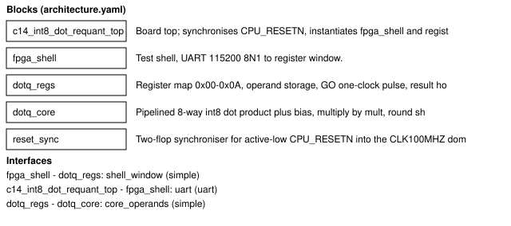
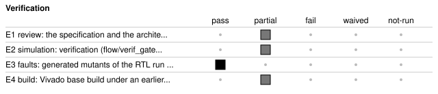

# c14_int8_dot_requant: Int8 dot-product and requantise unit behind the UART test shell

<!-- Generated from handover.yaml by flow/handover.py (brief 68). Edit handover.yaml, or the text between the prose markers, then run: python -m flow.handover write results/68_agent_docs/20261107-005621-8deb/c14_int8_dot_requant -->

The design computes an 8-way signed int8 dot product plus a 32-bit bias, multiplies by a 16-bit unsigned multiplier, rounds and shifts right with round-half-up, and clamps to int8 with an optional ReLU. A host loads operands and reads Y, ACC and STATUS through the UART test shell on the Nexys A7-100T. The run stopped in stage rtl-design-creation: simulation reached V2 of V3 and the V3 cover-property gate failed. All 17 sampled mutants were killed. No current Vivado build or board result exists, so nothing past RTL has a current measurement.

Not in scope:

- Not a streaming or pipelined engine. One result per GO, and the host UART dominates the time.
- Operands are not captured at GO. The core reads the live operand registers, so writing them while a result is computed is unsafe.
- No overflow or wrap handling for acc, and no range check on shift. Both are out of contract for inputs outside the spec.
- Not verified on hardware, and not measured for timing, power or resources under the pinned Vivado release.

Kind: agent-run; produced by the agent (agent run `20261107-005621-8deb`, [record](../summary.json)). State: rtl. For an agent: [AGENT.md](AGENT.md).

Run: model claude-sonnet-5-5 (claude_code harness), 6 loops, 101 turns, 2,482,927 tokens, 3379 s wall time, 2.9032 USD plan-cost estimate (not billed), stopped because: stage 2 visited more than 4 times (from the run record).

<!-- prose:what -->
<!-- /prose:what -->

## Technical parameters

| Item | Value |
|---|---|
| Part | `xc7a100tcsg324-1` |
| Board | nexys_a7_100t |
| Top | `c14_int8_dot_requant_top` |
| Tool | Vivado 2026.1 |

Clocks:

- `CLK100MHZ`: 100 MHz (from `results/68_agent_docs/20261107-005621-8deb/c14_int8_dot_requant/design.xdc`)

Resets:

- `CPU_RESETN`, active low: The reset_sync module (shell/rtl/reset_sync.sv) asserts the internal active-high rst asynchronously and releases it synchronously after two clock edges. All design registers use rst as a synchronous reset.

Interfaces:

- `CLK100MHZ` (clock input, pin E3, 100 MHz board oscillator): Single clock domain for the shell and the arithmetic. design.xdc creates the 10 ns clock sys_clk_pin.
- `CPU_RESETN` (reset input, pin C12, LVCMOS33): Asynchronous button. design.xdc gives it an input delay and it is synchronised by reset_sync.
- `UART_TXD_IN` (UART data into the FPGA, pin C4, LVCMOS33) ([datasheet](../../../../shell/PROTOCOL.md)): 8N1 at 115200 baud, synchronised inside the shell. Protocol in shell/PROTOCOL.md.
- `UART_RXD_OUT` (UART data out of the FPGA, pin D4, LVCMOS33) ([datasheet](../../../../shell/PROTOCOL.md)): Shell response line, driven by the shell's registered transmitter.
- `LED0` (output, pin H17, LVCMOS33): Shows the READY flag. In the RTL the top-level port is the one-bit bus LED[0:0], and LED0 is an internal net (c14_int8_dot_requant_top.sv, design.xdc).

| Parameter | Value | Legal range | Note |
|---|---|---|---|
| `CLKS_PER_BIT` | 868 | Positive integer, large enough that half a bit period is non-zero. 868 is the only value that gives 115200 baud at 100 MHz. | Clock cycles per UART bit. It is passed to the shell receiver and transmitter, and the spec gives uart_bit_cycles as 868. |
| `TIMEOUT_CYCLES` | 100,000,000 | Positive integer number of CLK100MHZ cycles. | Shell frame timeout in clock cycles. The top overrides the shell default with this value. A partly received frame older than this is dropped without a response. |
| `BUILD_STAMP` | 0 | Any 32-bit value. | Top-level parameter, default 0, read back at shell register 0x02. The flow overrides it per build. |
| `DESIGN_ID` | DOTQ | Fixed. It is a localparam, 32'h444F5451, not an overridable parameter. | Read back at shell register 0x00 as ASCII D,O,T,Q. |

| Quantity | Value | Source |
|---|---|---|
| Resources | not measured | [Known gaps](#known-gaps-and-limits) |
| Timing | not measured | [Known gaps](#known-gaps-and-limits) |
| Power | not measured | [Known gaps](#known-gaps-and-limits) |
| Latency | not measured | [Known gaps](#known-gaps-and-limits) |
| Throughput | not measured | [Known gaps](#known-gaps-and-limits) |

<!-- prose:parameters -->
<!-- /prose:parameters -->

## How to build, run and reproduce

| Step | Command | Heavy slot | Time |
|---|---|---|---|
| what changed since this handover (stale records, changed files, tool and knowledge-bank pins) | `python -m flow.handover fresh results/68_agent_docs/20261107-005621-8deb/c14_int8_dot_requant` | no | - |
| pick the work up again from the earliest stage the change or the staleness needs; needs a model (see docs/agent.md); Vivado for any stage from synthesis on | `python -m agent resume results/68_agent_docs/20261107-005621-8deb/c14_int8_dot_requant "<change request>"` | yes | - |
| run the Verifier's simulation tests; needs Icarus Verilog and cocotb, or the simulation container | `python -m pytest -q results/68_agent_docs/20261107-005621-8deb/c14_int8_dot_requant/tests/test_c14_int8_dot_requant_rtl.py` | no | - |
| rebuild the bitstream with the flow; needs Vivado 2026.1 and a heavy slot | `flow/run_vivado.sh results/68_agent_docs/20261107-005621-8deb/c14_int8_dot_requant base` | yes | - |

Tool: Vivado 2026.1. Build ID of the inputs at handover: `b27eac2c` (`python flow/manifest.py show results/68_agent_docs/20261107-005621-8deb/c14_int8_dot_requant`: what a rebuild of today's sources and flow would carry; it changes when any build input or the flow changes, so it can differ from the build ID in an older evidence record). Knowledge-bank pin: `aa71844`.

| File | What |
|---|---|
| [`results/68_agent_docs/20261107-005621-8deb/c14_int8_dot_requant/spec.md`](spec.md) | the request the run started from |
| [`results/68_agent_docs/20261107-005621-8deb/c14_int8_dot_requant/spec.yaml`](spec.yaml) | the signed-off specification written by the Clarifier |
| [`results/68_agent_docs/20261107-005621-8deb/c14_int8_dot_requant/ARCHITECTURE.md`](ARCHITECTURE.md) | the architecture note approved before any RTL |
| [`results/68_agent_docs/20261107-005621-8deb/c14_int8_dot_requant/architecture.yaml`](architecture.yaml) | the machine-checked architecture: blocks, clocks, predicted resources |
| [`results/68_agent_docs/20261107-005621-8deb/c14_int8_dot_requant/rtl/c14_int8_dot_requant_top.sv`](rtl/c14_int8_dot_requant_top.sv) | RTL written by the Designer |
| [`results/68_agent_docs/20261107-005621-8deb/c14_int8_dot_requant/rtl/dotq_core.sv`](rtl/dotq_core.sv) | RTL written by the Designer |
| [`results/68_agent_docs/20261107-005621-8deb/c14_int8_dot_requant/rtl/dotq_regs.sv`](rtl/dotq_regs.sv) | RTL written by the Designer |
| [`results/68_agent_docs/20261107-005621-8deb/c14_int8_dot_requant/rtl/reset_sync.sv`](rtl/reset_sync.sv) | RTL written by the Designer (empty: it holds no code; the build reads shell/rtl/reset_sync.sv for this module instead) |
| [`results/68_agent_docs/20261107-005621-8deb/c14_int8_dot_requant/design.xdc`](design.xdc) | pin, I/O standard and timing constraints |
| [`results/68_agent_docs/20261107-005621-8deb/c14_int8_dot_requant/build.yaml`](build.yaml) | the build description read by the flow; its sources also include shared shell files the agent did not write (read from the repository, not copied here): shell/rtl/fpga_shell.sv, shell/rtl/reset_sync.sv, shell/rtl/shell_core.sv, shell/rtl/sync2.sv, shell/rtl/uart_rx.sv, shell/rtl/uart_tx.sv |
| [`results/68_agent_docs/20261107-005621-8deb/c14_int8_dot_requant/model.py`](model.py) | the Modeller's reference model of the visible behaviour |
| [`results/68_agent_docs/20261107-005621-8deb/c14_int8_dot_requant/tests/c14_bench.py`](tests/c14_bench.py) | the Verifier's cocotb benches and pytest entries |
| [`results/68_agent_docs/20261107-005621-8deb/c14_int8_dot_requant/tests/test_c14_int8_dot_requant_rtl.py`](tests/test_c14_int8_dot_requant_rtl.py) | the Verifier's cocotb benches and pytest entries |
| [`results/68_agent_docs/20261107-005621-8deb/c14_int8_dot_requant/verif/testplan.yaml`](verif/testplan.yaml) | the test plan and mutant list read by the verification gates |
| [`results/68_agent_docs/20261107-005621-8deb/c14_int8_dot_requant/verif/checkers/c14_int8_dot_requant_checker.sv`](verif/checkers/c14_int8_dot_requant_checker.sv) | bound assertion and cover checkers |
| [`results/68_agent_docs/20261107-005621-8deb/c14_int8_dot_requant/verif/checkers/v_macros.svh`](verif/checkers/v_macros.svh) | bound assertion and cover checkers |
| [`results/68_agent_docs/20261107-005621-8deb/c14_int8_dot_requant/build/review/02_rtl-design-creation.html`](build/review/02_rtl-design-creation.html) | the review page of stage rtl-design-creation: its exit gates and their failures at the last visit |

<!-- prose:build -->
<!-- /prose:build -->

## Verified

| ID | Activity | Result | What | Evidence | Conditions |
|---|---|---|---|---|---|
| E1 | review | pass | spec.yaml was signed off after the interview; the questions asked, answered and defaulted are in the run summary | [`results/68_agent_docs/20261107-005621-8deb/summary.json`](../summary.json) | - |
| E2 | simulation | partial | verification (flow/verif_gates.py) against the Modeller's reference model reached V2 of V3; the run asked for V3; V2 means simulation: seeded runs, a constrained-random test, bound assertions and formal tasks; V3 (coverage (line, toggle, functional bins, cover properties), three seeds and the mutation score) did not pass: cover properties pct 0.0 (needs 100); cover properties unhit C_led_fall, C_led_high, C_led_rise, C_rx_start, C_tx_start; no board result (V-HW) is recorded | [`results/68_agent_docs/20261107-005621-8deb/c14_int8_dot_requant/build/verif/verif_gates.json`](build/verif/verif_gates.json) | - |
| E3 | faults | pass | generated mutants of the RTL run against the Verifier's benches, each of which must make a test fail: 17 sampled of 32 candidates, 17 evaluated, 17 killed, 0 survived, 0 timed out | [`results/68_agent_docs/20261107-005621-8deb/c14_int8_dot_requant/build/verif/mutation.json`](build/verif/mutation.json) | - |
| E4 | build | partial | Vivado base build under an earlier Vivado release than the pinned one: it reached post_synth, the gates of the stages it ran all passed; every number from that build is withdrawn (it cannot be re-measured on Vivado 2026.1 without a rebuild), so none is published | [`results/68_agent_docs/20261107-005621-8deb/c14_int8_dot_requant/build/base/gates.json`](build/base/gates.json) | - |

Gates at handover: `clarify` pass, `board-and-device-planning` pass, `rtl-design-creation` fail, `constraints` not-run, `synthesis` not-run, `implementation` not-run, `timing-closure` not-run, `power-closure` not-run, `drc-closure` not-run, `configuration-and-debug` not-run.

<!-- prose:verified -->
<!-- /prose:verified -->

## Measured

Every value is read from the record by `python -m flow.handover fill`, not typed.

| ID | What | Value | Runs | Source | Conditions |
|---|---|---|---|---|---|
| M1 | simulation seeds run | 3 | 1 | [`results/68_agent_docs/20261107-005621-8deb/c14_int8_dot_requant/build/verif/verif_gates.json`](build/verif/verif_gates.json) `stages.V3.checks.seeds_run.value` | Verilator coverage simulation of the RTL against the Modeller's model, every seed the bench ran |
| M2 | line coverage | 100 % | 1 | [`results/68_agent_docs/20261107-005621-8deb/c14_int8_dot_requant/build/verif/verif_gates.json`](build/verif/verif_gates.json) `stages.V3.checks.line_pct.value` | Verilator coverage simulation of the RTL against the Modeller's model, every seed the bench ran |
| M3 | toggle coverage | 100 % | 1 | [`results/68_agent_docs/20261107-005621-8deb/c14_int8_dot_requant/build/verif/verif_gates.json`](build/verif/verif_gates.json) `stages.V3.checks.toggle_pct.value` | Verilator coverage simulation of the RTL against the Modeller's model, every seed the bench ran |
| M4 | functional coverage bins hit | 100.0 (50/50) | 1 | [`results/68_agent_docs/20261107-005621-8deb/c14_int8_dot_requant/build/verif/verif_gates.json`](build/verif/verif_gates.json) `stages.V3.checks.functional_bins_pct.value` | Verilator coverage simulation of the RTL against the Modeller's model, every seed the bench ran |
| M5 | cover properties hit | 0.0 % | 1 | [`results/68_agent_docs/20261107-005621-8deb/c14_int8_dot_requant/build/verif/verif_gates.json`](build/verif/verif_gates.json) `stages.V3.checks.cover_properties_pct.value` | Verilator coverage simulation of the RTL against the Modeller's model, every seed the bench ran |
| M6 | mutation score of the Verifier's benches | 100 % | 1 | [`results/68_agent_docs/20261107-005621-8deb/c14_int8_dot_requant/build/verif/mutation.json`](build/verif/mutation.json) `score_pct` | generated mutants sampled from the RTL, run in the simulation sandbox |

<!-- prose:measured -->
<!-- /prose:measured -->

## Known gaps and limits

- **REQ-04**: REQ-04 has no passing evidence for every proof method: hardware (uart_tests) is pending: no bring-up result
- **REQ-06**: REQ-06 has no passing evidence for every proof method: hardware (uart_tests) is pending: no bring-up result
- **REQ-07**: REQ-07 has no passing evidence for every proof method: hardware (uart_tests) is pending: no bring-up result
- **REQ-08**: REQ-08 has no passing evidence for every proof method: hardware (uart_tests) is pending: no bring-up result
- **REQ-09**: REQ-09 has no passing evidence for every proof method: hardware (uart_tests) is pending: no bring-up result
- **REQ-11**: REQ-11 has no passing evidence for every proof method: analysis (post_route:setup) is not run (the stage that makes this evidence did not run): gate post_route:setup = None
- **cover_properties**: cover properties C_led_fall, C_led_high, C_led_rise, C_rx_start, C_tx_start read 0.0 % while the functional bins were all hit (100.0 (50/50)) and 3 seeds ran. The benches did drive the design, so a missing stimulus is unlikely to be the whole cause; the cover results and the functional coverage disagree. Compare the two before proposing any new stimulus. The checker c14_int8_dot_requant_checker.sv binds clk to CLK100MHZ, rst to CPU_RESETN, led to LED0, rxd_out to UART_RXD_OUT, txd_in to UART_TXD_IN into c14_int8_dot_requant_top (outside Icarus only). Every bound name is declared in the top RTL, so a misspelt binding is not the cause. The cause is not settled by the records.
- **E4**: the base build was made under an earlier Vivado release than 2026.1: its result is not current and no number from it is published. Re-measure first, with the resume command in How to build (python -m agent resume), and only then rely on its gates
- **E2**: simulation evidence is partial: verification reached V2 of V3 (the run asked for V3); the checks that did not pass or did not run are listed in the evidence row
- **rtl-design-creation**: stage rtl-design-creation did not pass its gates in this run; at its last visit: V3 cover_properties_pct: cover properties not hit: C_led_fall, C_led_high, C_led_rise, C_rx_start, C_tx_start: add or extend a test that drives the design into each, or correct the `V_COVER` expression if it can never be true [value 0.0, need 100] FAIL V3 cover_properties_unhit: cover properties not hit: C_led_fall, C_led_high, C_led_rise, C_rx_start, C_tx_start: add or extend a test that drives t ...
- **constraints**: stage constraints was not run: the run stopped before this stage (stage 2 visited more than 4 times)
- **synthesis**: stage synthesis was not run: the run stopped before this stage (stage 2 visited more than 4 times)
- **implementation**: stage implementation was not run: the run stopped before this stage (stage 2 visited more than 4 times)
- **timing-closure**: stage timing-closure was not run: the run stopped before this stage (stage 2 visited more than 4 times)
- **power-closure**: stage power-closure was not run: the run stopped before this stage (stage 2 visited more than 4 times)
- **drc-closure**: stage drc-closure was not run: the run stopped before this stage (stage 2 visited more than 4 times)
- **configuration-and-debug**: stage configuration-and-debug was not run: the run stopped before this stage (stage 2 visited more than 4 times)
- **resources**: resources not measured: no current Vivado build of this design has been recorded
- **timing**: timing not measured: no current Vivado build of this design has been recorded
- **power**: power not measured: no current Vivado build of this design has been recorded
- **latency**: latency not measured: the run measured no latency; the spec's latency promise is checked only by the benches
- **throughput**: throughput not measured: the run measured no throughput
- **latency_count**: Counted from dotq_regs.sv and dotq_core.sv, not measured. The GO write strobe registers into a one-cycle go pulse. go then passes through five valid stages (v1..v5) and the done register, and READY is set one cycle after done. READY is therefore high 8 clocks after the clock in which the shell's GO write strobe is high, exactly at the spec's limit of 8. READY rises only after y and acc are latched.
- **reset_latency**: The spec says outputs clear within 2 cycles of CPU_RESETN asserting. In the RTL (shell/rtl/reset_sync.sv) rst asserts asynchronously, so registers clear at the first clock edge after assertion. Release takes two clock edges after the button is let go.
- **spec_led_port**: spec.yaml names the output LED0. The RTL top port and the XDC use the bus LED[0] (pin H17), and LED0 is only an internal net. The RTL and XDC are what was built.
- **spec_design_id**: spec.yaml lists DESIGN_ID as a parameter. In c14_int8_dot_requant_top.sv it is a localparam and cannot be overridden from outside. The top-level parameters are CLKS_PER_BIT, TIMEOUT_CYCLES and BUILD_STAMP, as REQ-10 says.
- **reset_values**: On reset (dotq_regs.sv, dotq_core.sv): A_LO, A_HI, W_LO, W_HI, BIAS and MULT clear to 0, CTRL to shift 1 and relu 0, READY to 0, and y, acc and the read-data register to 0. In-flight pipeline valid bits are also cleared.
- **unmapped_access**: Reads of 0x0B-0x7F and of GO (0x07) return 0. Writes to unmapped offsets and to Y, ACC and STATUS are ignored with no error status. Offsets are the shell window offsets; the shell reaches them with address bit 7 set.
- **read_behaviour**: Reads have no side effects. Read data is registered and is due one cycle after win_rd. Y and ACC are gated at the read mux: they read 0 while READY is 0, although the core registers keep their last values internally.
- **partial_writes**: Writes are 32-bit only, with no byte enables. MULT stores bits [15:0] only, and CTRL stores only bits [4:0] (shift) and [8] (relu); the other bits are dropped and read back as 0.
- **shift_range**: CTRL shift is stored as written with no range check. The spec contract is 1..31 and the benches do not test outside it. A shift of 0 is handled in dotq_core.sv by skipping the rounding constant, which is behaviour the spec does not define.
- **go_priority**: A GO always restarts: while go is high, the core clears the in-flight valid bits and done, so earlier computations are abandoned. In dotq_regs.sv a GO write in the same cycle as done wins over the READY set and clears READY. A GO written in the cycle just before done rises can still leave READY set with the previous result. A UART frame is far too slow to hit this window, and no test is recorded for it.
- **operands_live**: The core samples act and wgt every clock and carries bias, mult, shift and relu stage by stage, so operand writes during a computation can corrupt it. The spec assumes this is not required to be safe.
- **assumption_acc_range**: Assumption from the spec: acc never overflows 32 bits for tested inputs and weights are never -128. The RTL does not check either.

<!-- prose:gaps -->
<!-- /prose:gaps -->

## Next steps

1. Re-measure with python -m agent resume, because the only build was made under an earlier Vivado release. Publish no number from it until the rebuild has passed under 2026.1.
2. Compare the cover results with the functional coverage before adding any stimulus. Find why C_led_fall, C_led_high, C_led_rise, C_rx_start and C_tx_start read 0.0 % while every functional bin was hit, starting with how the checker is bound and how the V_COVER expressions are sampled in the Verilator run.
3. Fix the cover gap, rerun V3 and then the stages from constraints on. Re-check the latency count (READY 8 clocks after the GO write strobe) in simulation, because it sits exactly on the spec limit.
4. Run the hardware bring-up (uart_tests) for REQ-04, REQ-06, REQ-07, REQ-08 and REQ-09, and the post_route:setup timing analysis for REQ-11.
5. Update spec.yaml for the LED0 versus LED[0] and DESIGN_ID differences, or change the RTL to match the spec, and record which was chosen.

Open questions:

- Why the five cover properties read 0.0 % while all functional bins were hit; the records do not settle it.

<!-- prose:next -->
<!-- /prose:next -->

## History

| Date | Brief | PR | What |
|---|---|---|---|
| 2026-11-07 | agent run | - | produced by the agent graph; stages that passed: clarify, board-and-device-planning |

<!-- prose:history -->
<!-- /prose:history -->
